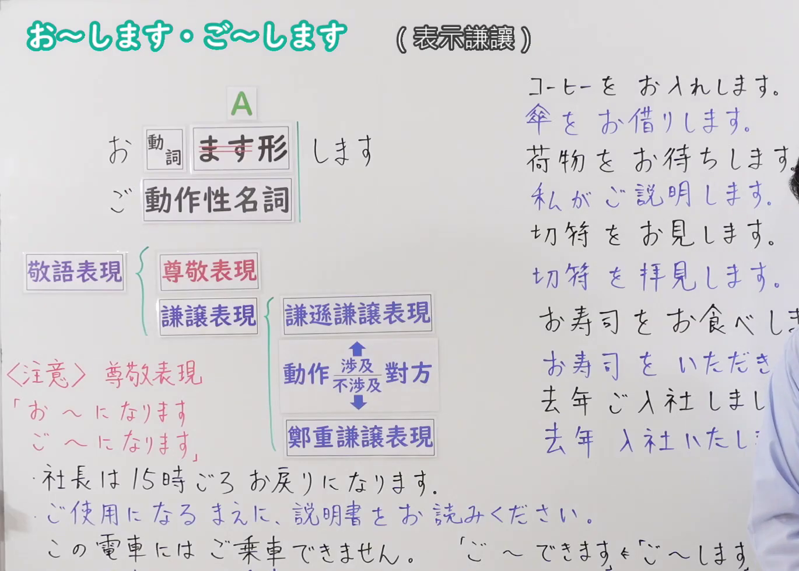
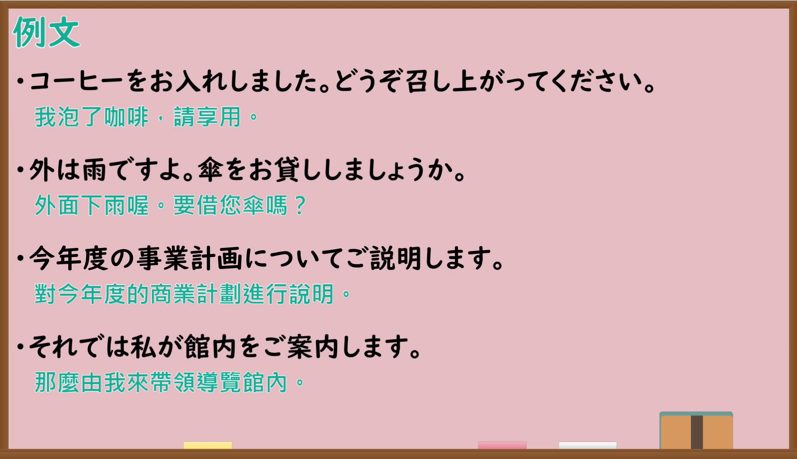

---
{
  "id": "N4-G-0081",
  "kind": "grammar",
  "level": "N4",
  "title": "お〜します・ご〜します（表示谦让）",
  "card_revision": 1,
  "schema_version": 1,
  "source": {
    "lesson": "N4 第81个语法",
    "material": "出口日語原视频板书、YouTube 原 WebVTT（中文为主、日语为辅）与毎日のんびり日本語教師「【Ｎ３文法】お／ご～する／します／致す／致します」正文",
    "video": "https://www.youtube.com/watch?v=mf9pc2Jd9i4",
    "screenshot": "assets/grammar/n4/N4-G-0081-connection.png",
    "screenshot_seconds": 1.0,
    "screenshot_crop": {
      "x": 0,
      "y": 0,
      "width": 1370,
      "height": 980
    }
  },
  "tags": ["敬语", "谦让语", "N4"],
  "confusions": ["お〜になります・ご〜になります"]
}
---

# 出口日語 N4 第81课：お〜します・ご〜します（表示謙譲）

## 视频学习资料整理

- [出口日語原视频（第 1.0 秒）](https://www.youtube.com/watch?v=mf9pc2Jd9i4)：原图分辨率 1920×1080，裁切区域为左上角 `(x=0, y=0, width=1370, height=980)`，展示本课语法接续与板书说明。
  
- [出口日語原视频（第 620.33 秒）](https://www.youtube.com/watch?v=mf9pc2Jd9i4)：原图分辨率 1920×1080，裁切区域为 `(x=30, y=0, width=1860, height=1070)`，展示课程教学例句板书。
  

# 核心

## 功能一：谦逊谦让表现（动作涉及对方）

**くわしい意味記述：**

- **お〜します・ご〜します：** 自分の行為について、その行為が向かう先の人物を立てて述べたり、相手に対して丁重に述べる謙譲表現です。原則として和語には「お」、漢語には「ご」が付きます。この文型を使うには、行為が＜向かう先＞の人物がはっきり存在していなければいけません。（关于自己的行为，抬高该行为所指向的对象，或者向对方郑重陈述的谦让表现。原则上和语词接「お」，汉语词接「ご」。使用该句型时，行为的“指向对象”必须明确存在。）

### 例句

1. いらっしゃいませ。お席にご案内します。

   （欢迎光临。我带您去座位。）

2. 荷物をお預かりします。

   （我给您保管行李。）

3. １６時頃に折り返しお電話します。

   （16点左右给您回电话。）

4. こちらで確認してから、後ほどご連絡致します。

   （在这边确认后，稍后再联系您。）

# 来源

- [出口日語原视频](https://www.youtube.com/watch?v=mf9pc2Jd9i4)
- [毎日のんびり日本語教師「【Ｎ３文法】お／ご～する／します／致す／致します」](https://mainichi-nonbiri.com/grammar/n3-osuru/)（查询日期：2026-09-25）
