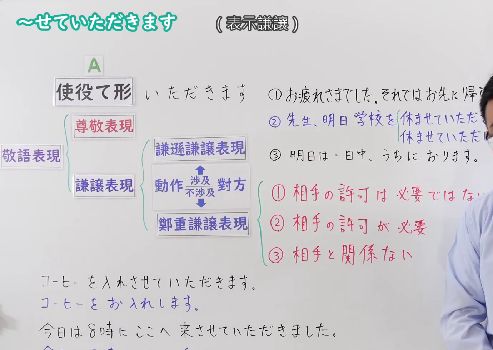
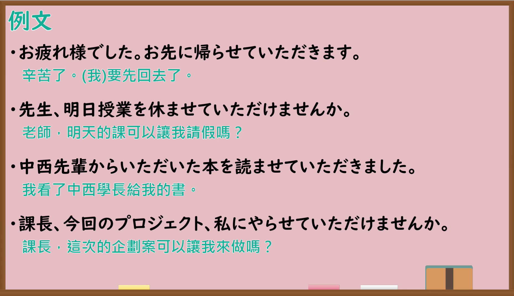

---
{
  "id": "N4-G-0082",
  "kind": "grammar",
  "level": "N4",
  "title": "〜せていただきます（表示谦让）",
  "card_revision": 1,
  "schema_version": 1,
  "source": {
    "lesson": "N4 第82个语法",
    "material": "出口日語原视频板书、YouTube 原 WebVTT（中文为主、日语为辅）与毎日のんびり日本語教師「【Ｎ３文法】～させていただく／させていただきます」正文",
    "video": "https://www.youtube.com/watch?v=AALApq_JqNI",
    "screenshot": "assets/grammar/n4/N4-G-0082-connection.png",
    "screenshot_seconds": 1.0,
    "screenshot_crop": {
      "x": 0,
      "y": 0,
      "width": 1380,
      "height": 980
    }
  },
  "tags": ["敬语", "谦让语", "使役", "N4"],
  "confusions": ["〜せてくださる・〜せてください"]
}
---

# 出口日語 N4 第82课：〜せていただきます（表示謙譲）

## 视频学习资料整理

- [出口日語原视频（第 1.0 秒）](https://www.youtube.com/watch?v=AALApq_JqNI)：原图分辨率 1920×1080，裁切区域为左上角 `(x=0, y=0, width=1380, height=980)`，展示本课语法接续与板书说明。
  
- [出口日語原视频（第 434.92 秒）](https://www.youtube.com/watch?v=AALApq_JqNI)：原图分辨率 1920×1080，裁切区域为 `(x=30, y=0, width=1860, height=1070)`，展示课程教学例句板书。
  

# 核心

## 功能一：需要对方许可（请求许可并表示谦逊谦让）

**くわしい意味記述：**

- **〜せていただきます：** 自分の行為について、その行為が向かう先の人物を立てて述べたり、相手に対して丁重に述べる謙譲表現です。自分の行為について許可を請う時に用います。恩恵を受けるのは自分です。（关于自己的行为，抬高该行为所指向的对象，或者向对方郑重陈述的谦让表现。在就自己的行为请求对方许可时使用。接受恩惠的是说话人自己。）

### 例句

1. 私も参加させていただきます。

   （请让我也参加。）

2. 大変申し訳ございませんが、詳細については明日お返事させていただきます。

   （非常抱歉，详细情况将于明日回复。）

3. 館内については私が案内させていただきます。

   （馆内由我来带路引导。）

4. 工場内を見学させていただけませんか？

   （能让我参观一下工厂吗？）

# 来源

- [出口日語原视频](https://www.youtube.com/watch?v=AALApq_JqNI)
- [毎日のんびり日本語教師「【Ｎ３文法】～させていただく／させていただきます」](https://mainichi-nonbiri.com/grammar/n3-saseteitadaku/)（查询日期：2026-09-25）
