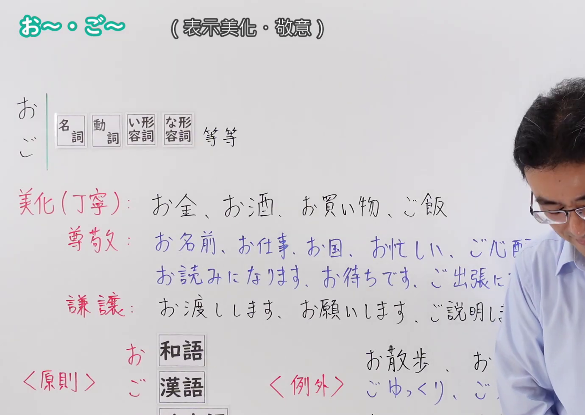
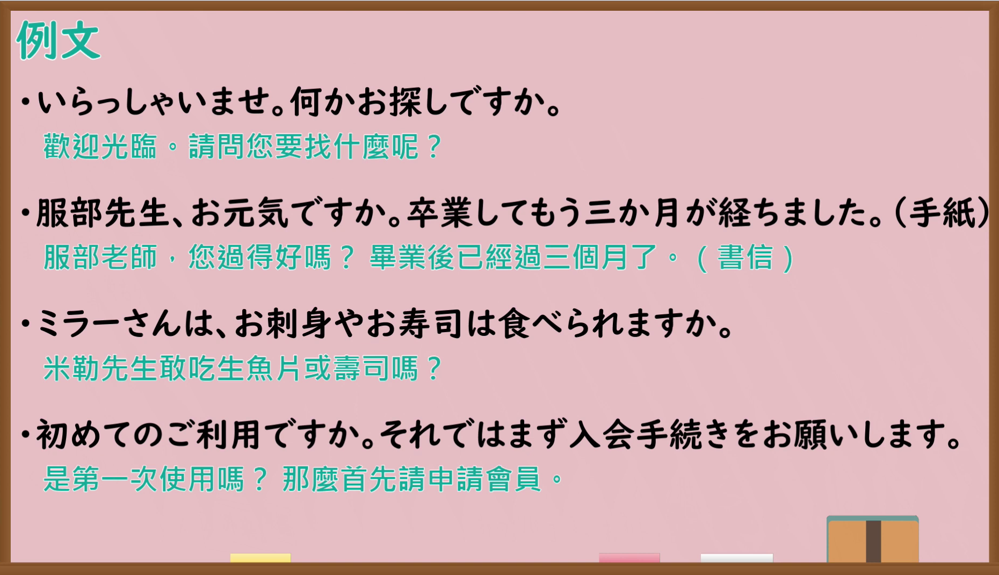

---
{
  "id": "N4-G-0083",
  "kind": "grammar",
  "level": "N4",
  "title": "お〜・ご〜（表示美化与敬意）",
  "card_revision": 1,
  "schema_version": 1,
  "source": {
    "lesson": "N4 第83个语法",
    "material": "出口日語原视频板书、Bilibili P83 音频的本地中文／日语混合转写 WebVTT 与日本語教師の広場「御 :「お」と「ご」（その１）」正文",
    "video": "https://www.youtube.com/watch?v=QCJVGCKTTLo",
    "screenshot": "assets/grammar/n4/N4-G-0083-connection.png",
    "screenshot_seconds": 1.0,
    "screenshot_crop": {
      "x": 0,
      "y": 0,
      "width": 1380,
      "height": 980
    }
  },
  "tags": ["敬语", "美化语", "接头辞", "N4"],
  "confusions": ["お〜します・ご〜します", "お〜になります・ご〜になります"]
}
---

# 出口日語 N4 第83课：お〜・ご〜（表示美化・敬意）

## 视频学习资料整理

- [出口日語原视频（第 1.0 秒）](https://www.youtube.com/watch?v=QCJVGCKTTLo)：原图分辨率 1920×1080，裁切区域为左上角 `(x=0, y=0, width=1380, height=980)`，展示本课语法接续与板书说明。
  
- [出口日語原视频（第 422.47 秒）](https://www.youtube.com/watch?v=QCJVGCKTTLo)：原图分辨率 1920×1080，裁切区域为 `(x=30, y=0, width=1860, height=1070)`，展示课程教学例句板书。
  

# 核心

## 功能一：表示美化与敬意（美化语、尊敬语与谦让语）

**くわしい意味記述：**

- **お〜・ご〜：** 接頭語として名詞・動詞・形容詞などの前に付き、物事を美化して丁寧に述べたり、相手に対する敬意（尊敬・謙譲）を表す表現です。一般的に和語には「お」がつき、漢語（音読みの言葉）には「ご」がつきます。（作为前缀附加在名词、动词、形容词等之前，用于美化事物、礼貌地陈述，或向对方表达敬意（尊敬或谦让）。一般而言和语词接「お」，汉语词（音读词）接「ご」。）

### 例句

1. 先生、少しご相談があります。

   （老师，我有些事想跟您商量。）

2. 会場までは私がご案内します。

   （去会场的路，由我来为您引路带路。）

3. さとし君、とってもいいお返事ですね。

   （小聪，你的回答真棒呢。）

4. 先生にきちんとご返事なさい。

   （好好向老师回答。）

# 来源

- [出口日語原视频](https://www.youtube.com/watch?v=QCJVGCKTTLo)
- [日本語教師の広場「御 :「お」と「ご」（その１）」](https://www.tomojuku.com/blog/otogo/)（查询日期：2026-09-25）
