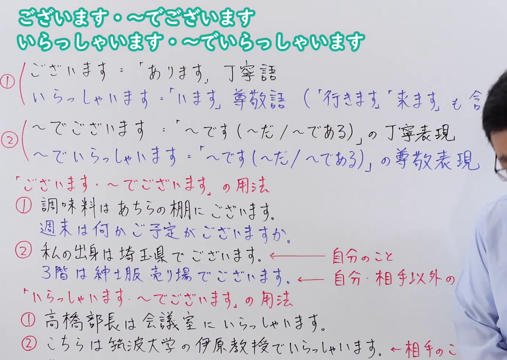
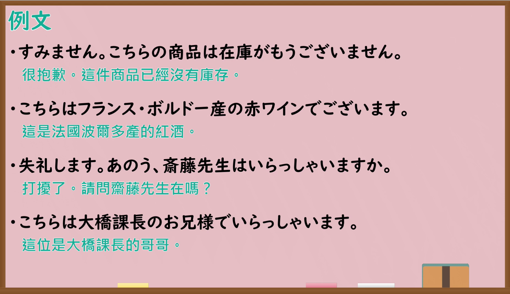

---
{
  "id": "N4-G-0084",
  "kind": "grammar",
  "level": "N4",
  "title": "ございます・〜でございます・いらっしゃいます・〜でいらっしゃいます（郑重语与尊敬语）",
  "card_revision": 1,
  "schema_version": 1,
  "source": {
    "lesson": "N4 第84个语法",
    "material": "出口日語原视频板书、Bilibili P84 音频的本地中文／日语混合转写 WebVTT 与毎日のんびり日本語教師「【Ｎ３文法】～ございます」「【Ｎ３文法】～ていらっしゃる／ていらっしゃいます」正文",
    "video": "https://www.youtube.com/watch?v=yALJAEhtwIA",
    "screenshot": "assets/grammar/n4/N4-G-0084-connection.png",
    "screenshot_seconds": 1.0,
    "screenshot_crop": {
      "x": 0,
      "y": 0,
      "width": 1380,
      "height": 980
    }
  },
  "tags": ["敬语", "郑重语", "尊敬语", "N4"],
  "confusions": ["あります・います", "です・だ"]
}
---

# 出口日語 N4 第84课：ございます・〜でございます・いらっしゃいます・〜でいらっしゃいます

## 视频学习资料整理

- [出口日語原视频（第 1.0 秒）](https://www.youtube.com/watch?v=yALJAEhtwIA)：原图分辨率 1920×1080，裁切区域为左上角 `(x=0, y=0, width=1380, height=980)`，展示本课语法接续与板书说明。
  
- [出口日語原视频（第 860.2 秒）](https://www.youtube.com/watch?v=yALJAEhtwIA)：原图分辨率 1920×1080，裁切区域为 `(x=30, y=0, width=1860, height=1070)`，展示课程教学例句板书。
  

# 核心

## 功能一：「ございます・〜でございます」的用法（郑重语与郑重断定）

**くわしい意味記述：**

- **ございます・〜でございます：** 「～です」「～あります」の丁寧形です。（是「～です（是）」「～あります（有）」的郑重语表达形式。）

### 例句

1. スケジュールに変更がございます。

   （日程有变更。）

2. お聞きしたいことがございます。

   （我有想问的事情。）

3. 会議は午後１時からの予定でございます。

   （会议预定从下午1点开始。）

4. こちらはＡ株式会社でございます。

   （这里是A株式会社。）

## 功能二：「いらっしゃいます・〜でいらっしゃいます」的用法（尊敬语与尊敬断定）

**くわしい意味記述：**

- **いらっしゃいます・〜でいらっしゃいます：** 相手あるいは第三者の行為・物事・状態等を立てて述べる尊敬表現です。「～です」「～ている」「～ていく」「～てある」の尊敬語にあたります。（用于抬高对方或第三者的行为、事物或状态的尊敬表达。相当于「～です（是）」「～ている（在……）」「～ていく」「～てある」的尊敬语。）

### 例句

1. 中田さんでいらっしゃいますか？

   （您是中田先生吗？）

2. 元気でいらっしゃいますか？

   （您身体还好吗？）

3. 睡眠は十分にとれていらっしゃいますか。

   （睡眠充足吗？）

4. 奥様はいつもお美しくていらっしゃいますね。

   （您夫人总是那么漂亮。）

# 来源

- [出口日語原视频](https://www.youtube.com/watch?v=yALJAEhtwIA)
- [毎日のんびり日本語教師「【Ｎ３文法】～ございます」](https://mainichi-nonbiri.com/grammar/n3-gozaimasu/)（查询日期：2026-09-25）
- [毎日のんびり日本語教師「【Ｎ３文法】～ていらっしゃる／ていらっしゃいます」](https://mainichi-nonbiri.com/grammar/n3-teirassharu/)（查询日期：2026-09-25）
