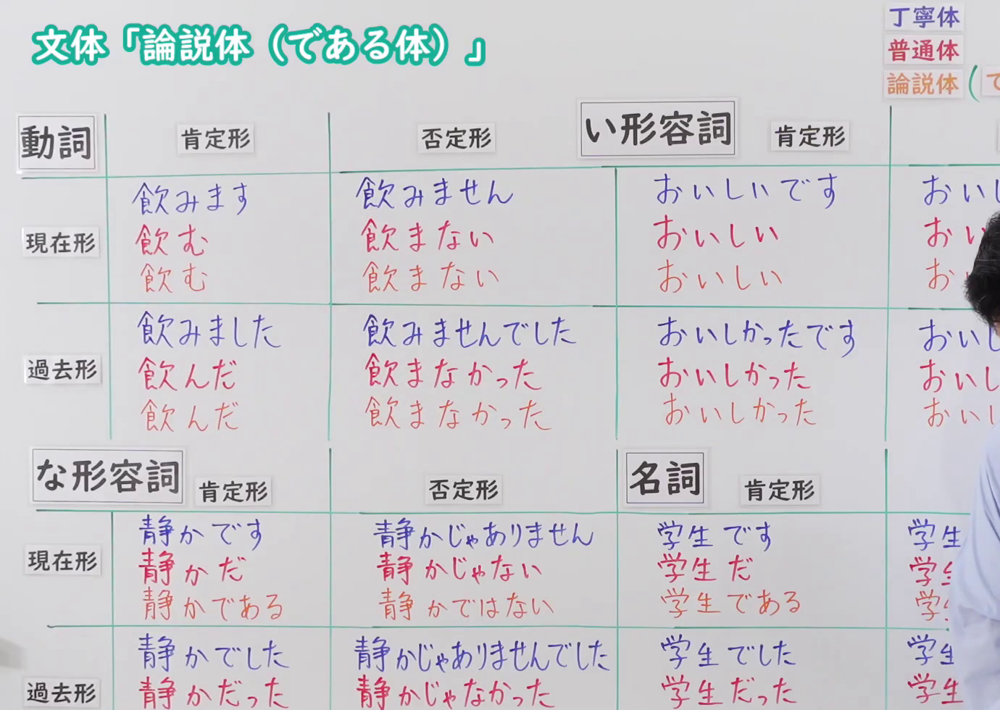
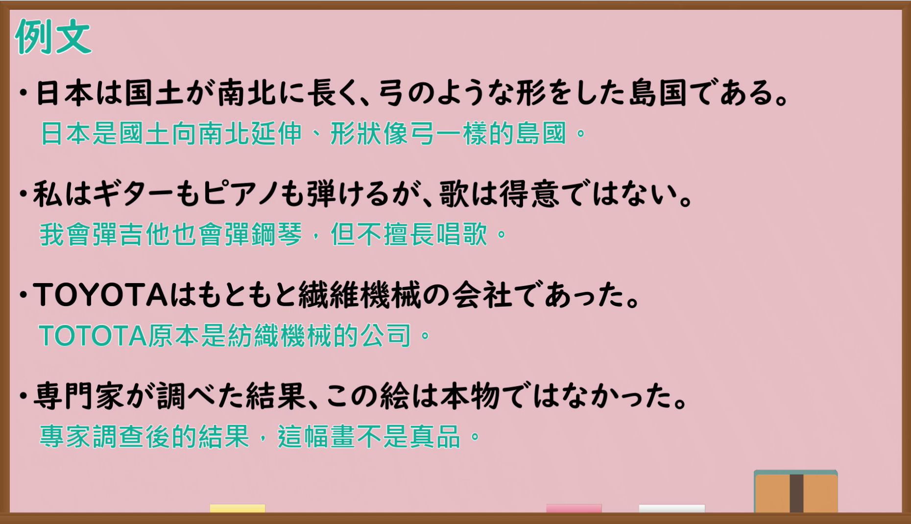

---
{
  "id": "N4-G-0085",
  "kind": "grammar",
  "level": "N4",
  "title": "文体「論説体（である体）」（论说体书面文体）",
  "card_revision": 1,
  "schema_version": 1,
  "source": {
    "lesson": "N4 第85个语法",
    "material": "出口日語原视频板书、YouTube 原 WebVTT（中文为主、日语为辅）与上級へのとびら「「である体」の説明」正文",
    "video": "https://www.youtube.com/watch?v=uPcLNMJB5Jc",
    "screenshot": "assets/grammar/n4/N4-G-0085-connection.png",
    "screenshot_seconds": 1.0,
    "screenshot_crop": {
      "x": 0,
      "y": 0,
      "width": 1380,
      "height": 980
    }
  },
  "tags": ["文体", "论说体", "普通体", "N4"],
  "confusions": ["普通体（だ体）", "丁寧体（です・ます体）"]
}
---

# 出口日語 N4 第85课：文体「論説体（である体）」

## 视频学习资料整理

- [出口日語原视频（第 1.0 秒）](https://www.youtube.com/watch?v=uPcLNMJB5Jc)：原图分辨率 1920×1080，裁切区域为左上角 `(x=0, y=0, width=1380, height=980)`，展示本课语法接续与板书说明。
  
- [出口日語原视频（第 479.88 秒）](https://www.youtube.com/watch?v=uPcLNMJB5Jc)：原图分辨率 1920×1080，裁切区域为 `(x=30, y=0, width=1860, height=1070)`，展示课程教学例句板书。
  

# 核心

## 功能一：论说体（である体）（学术论文与公文等正式书面文体）

**くわしい意味記述：**

- **文体「論説体（である体）」：** 「である」は「だ」の改まった普通形であり、名詞やナ形容詞などに接続します。レポートや論文などの学術的な文章や公的文書といった改まった書き言葉（論説体）で用いられます。（「である」是「だ」的庄重普通体形式，接在名词和ナ形容词等之后。常用于报告、论文等学术文章及公文等庄重的书面语（论说体）中。）

### 例句

1. 哲学者のパスカルは、人間は考える葦であると言った。

   （哲学家帕斯卡尔曾说：人是一根会思想的芦苇。）

2. こんなにたくさんの人に読まれているのだから、面白い本であるに違いない。

   （既然有这么多人读它，那必定是一本有趣的书。）

3. あの話は本当ではないと言われていたが、最近、本当であることが分かった。

   （虽然曾有人说那件事不是真的，但最近证实了它是事实。）

4. 子供の頃嫌いであった食べ物が、大人になって好きになるということはよくある。

   （孩童时期讨厌的食物，长大成人后变得喜欢上，这种事是常有的。）

# 来源

- [出口日語原视频](https://www.youtube.com/watch?v=uPcLNMJB5Jc)
- [上級へのとびら「「である体」の説明」](https://tobiraweb.9640.jp/grammar-note_de-aru-style/)（查询日期：2026-09-25）
