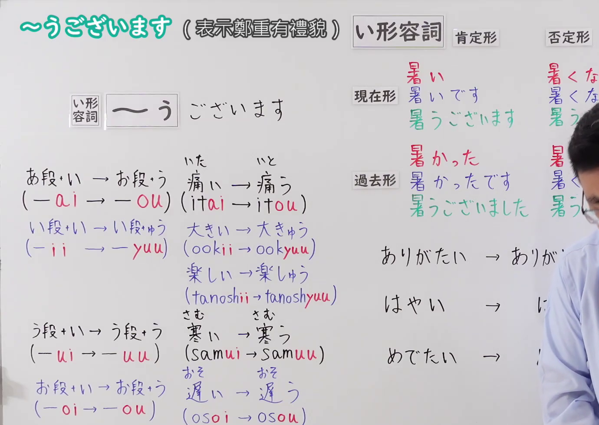
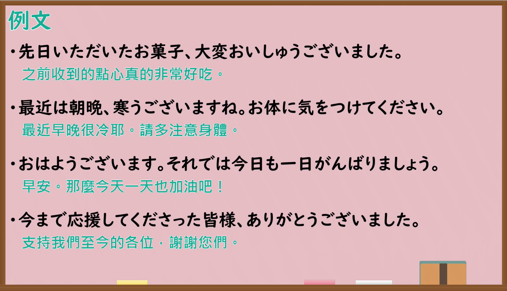

---
{
  "id": "N4-G-0086",
  "kind": "grammar",
  "level": "N4",
  "title": "〜うございます（表示郑重有礼貌）",
  "card_revision": 1,
  "schema_version": 1,
  "source": {
    "lesson": "N4 第86个语法",
    "material": "出口日語原视频板书、Bilibili P86 音频的本地中文／日语混合转写 WebVTT 与毎日のんびり日本語教師「音便とは？」正文",
    "video": "https://www.youtube.com/watch?v=HsLltYilXEs",
    "screenshot": "assets/grammar/n4/N4-G-0086-connection.png",
    "screenshot_seconds": 1.0,
    "screenshot_crop": {
      "x": 0,
      "y": 0,
      "width": 1380,
      "height": 980
    }
  },
  "tags": ["敬语", "郑重语", "音便", "N4"],
  "confusions": ["〜ございます", "〜いです"]
}
---

# 出口日語 N4 第86课：〜うございます（表示鄭重有禮貌）

## 视频学习资料整理

- [出口日語原视频（第 1.0 秒）](https://www.youtube.com/watch?v=HsLltYilXEs)：原图分辨率 1920×1080，裁切区域为左上角 `(x=0, y=0, width=1380, height=980)`，展示本课语法接续与板书说明。
  
- [出口日語原视频（第 554.7 秒）](https://www.youtube.com/watch?v=HsLltYilXEs)：原图分辨率 1920×1080，裁切区域为 `(x=30, y=0, width=1860, height=1070)`，展示课程教学例句板书。
  

# 核心

## 功能一：表示郑重有礼貌（形容词ウ音便的郑重语）

**くわしい意味記述：**

- **〜うございます：** 単語中の一音が発音の便宜のために、母音の「う」に変化する現象をウ音便と言います。現代日本語では「おはようございます」「ありがとうございます」「よろしゅうございます」など、イ形容詞に「ございます」が続く丁寧で改まった言い方にウ音便が取り入れられています。（单词中的某个音为了发音方便而变为元音「う」的现象称为ウ音便。在现代日语中，这种ウ音便主要保留在「おはようございます」「ありがとうございます」「よろしゅうございます」等一类形容词接「ございます」的郑重、礼貌的表达方式中。）

### 例句

1. 今日は一段と寒うございますね。

   （今天格外寒冷呢。）

2. いつもお引き立ていただき、ありがたうございます（ありがとうございます）。

   （承蒙您一直以来的关照，非常感谢。）

3. それでよろしゅうございますか。

   （那样可以吗？/那样您觉得妥当吗？）

4. 朝早くからお疲れ様です。はやうございます（おはようございます）。

   （一大早就辛苦了。早上好。）

# 来源

- [出口日語原视频](https://www.youtube.com/watch?v=HsLltYilXEs)
- [毎日のんびり日本語教師「音便とは？」](https://mainichi-nonbiri.com/jltct/onbin/)（查询日期：2026-09-25）
