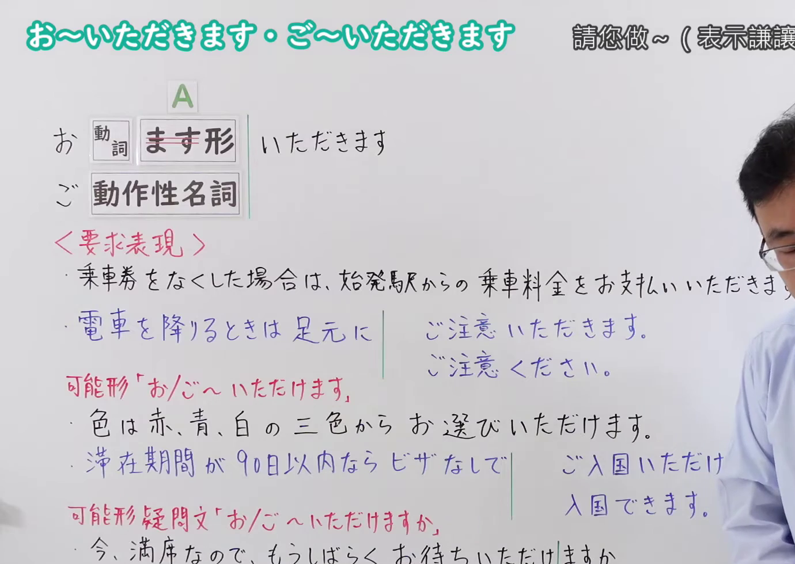
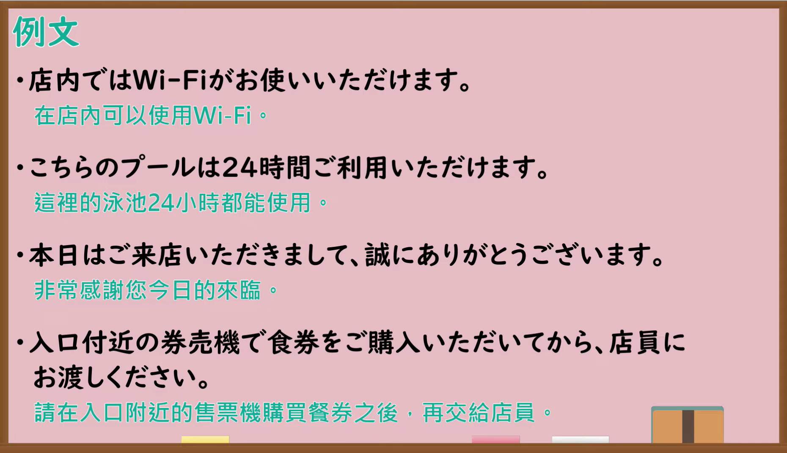

---
{
  "id": "N4-G-0087",
  "kind": "grammar",
  "level": "N4",
  "title": "お〜いただきます・ご〜いただきます（请您做……、表示谦让）",
  "card_revision": 1,
  "schema_version": 1,
  "source": {
    "lesson": "N4 第87个语法",
    "material": "出口日語原视频板书、YouTube 原 WebVTT（中文为主、日语为辅）与Japanese Exercises「【JLPT N3】お／ご～いただく／くださる　文法解説・問題」正文",
    "video": "https://www.youtube.com/watch?v=rTJzE1KwVbA",
    "screenshot": "assets/grammar/n4/N4-G-0087-connection.png",
    "screenshot_seconds": 1.0,
    "screenshot_crop": {
      "x": 0,
      "y": 0,
      "width": 1380,
      "height": 980
    }
  },
  "tags": ["敬语", "谦让语", "授受表现", "N4"],
  "confusions": ["お〜くださる・ご〜くださる", "〜ていただく"]
}
---

# 出口日語 N4 第87课：お〜いただきます・ご〜いただきます 請您做〜（表示謙讓）

## 视频学习资料整理

- [出口日語原视频（第 1.0 秒）](https://www.youtube.com/watch?v=rTJzE1KwVbA)：原图分辨率 1920×1080，裁切区域为左上角 `(x=0, y=0, width=1380, height=980)`，展示本课语法接续与板书说明。
  
- [出口日語原视频（第 409.81 秒）](https://www.youtube.com/watch?v=rTJzE1KwVbA)：原图分辨率 1920×1080，裁切区域为 `(x=30, y=0, width=1860, height=1070)`，展示课程教学例句板书。
  

# 核心

## 功能一：要求表现与请求对方做某事（请您做……、表示谦让）

**くわしい意味記述：**

- **お〜いただきます・ご〜いただきます：** 「～てもらう」「～てくれる」の丁寧の形（「～てもらう（请对方为自己做某事）」「～てくれる（对方为自己做某事）」的郑重表达形式。）

### 例句

1. このプロジェクトについて詳しくご説明いただけますか？

   （关于这个项目，能否请您详细说明一下？）

2. ご協力いただき、本当にありがとうございました。

   （非常感谢您的配合协助。）

3. このアンケートにご記入いただけると幸いです。

   （如果您能填写这份问卷，我们将不胜感激。）

4. お手伝いいただいたおかげで、作業が無事に終わりました。

   （多亏了您的帮忙协助，工作顺利完成了。）

# 来源

- [出口日語原视频](https://www.youtube.com/watch?v=rTJzE1KwVbA)
- [Japanese Exercises「【JLPT N3】お／ご～いただく／くださる　文法解説・問題」](https://japaneseexercises.com/2024/11/30/%E3%80%90jlpt-n3-%E3%81%8A%EF%BC%8F%E3%81%94%EF%BD%9E%E3%81%84%E3%81%9F%E3%81%A0%E3%81%8F%EF%BC%8F%E3%81%8F%E3%81%A0%E3%81%95%E3%82%8B%E3%80%80%E6%96%87%E6%B3%95%E8%A7%A3%E8%AA%AC%E3%83%BB%E5%95%8F/)（查询日期：2026-09-25）
