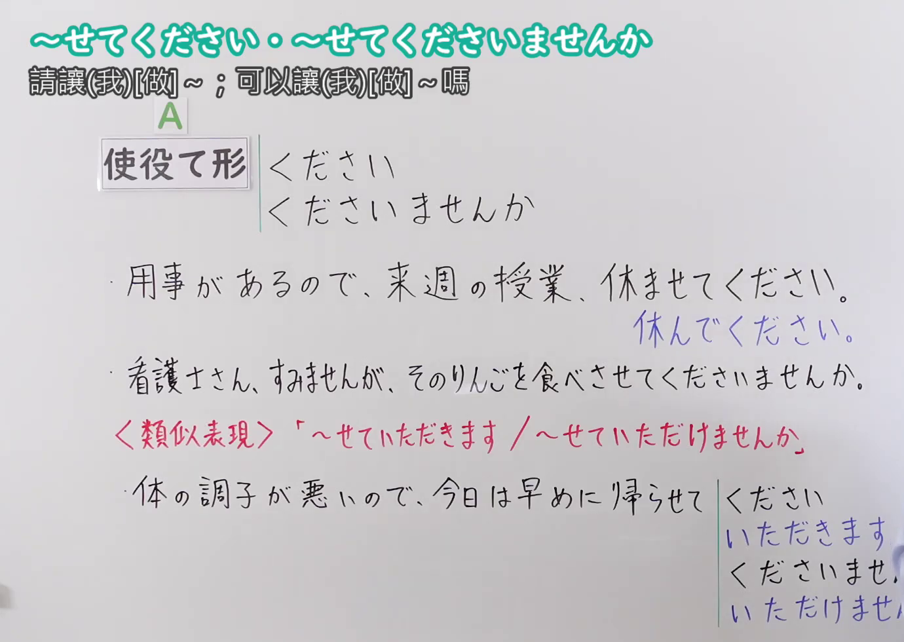
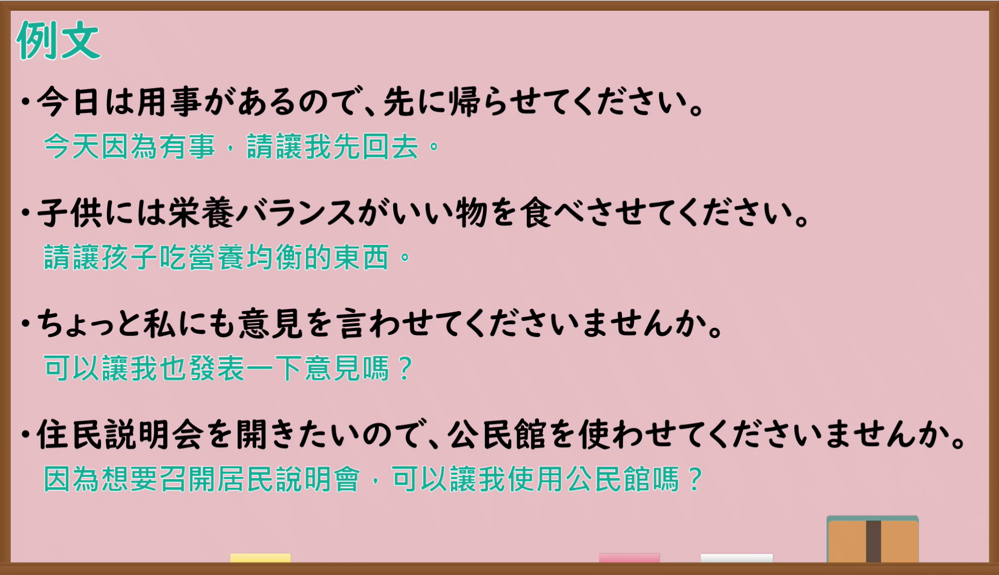

---
{
  "id": "N4-G-0088",
  "kind": "grammar",
  "level": "N4",
  "title": "〜せてください・〜せてくださいませんか（请让我[做]……；可以让我[做]……吗）",
  "card_revision": 1,
  "schema_version": 1,
  "source": {
    "lesson": "N4 第88个语法",
    "material": "出口日語原视频板书、YouTube 原 WebVTT（中文为主、日语为辅）与毎日のんびり日本語教師「【Ｎ３文法】～させてくださる／させてください」正文",
    "video": "https://www.youtube.com/watch?v=jMbzzJeW-bo",
    "screenshot": "assets/grammar/n4/N4-G-0088-connection.png",
    "screenshot_seconds": 1.0,
    "screenshot_crop": {
      "x": 0,
      "y": 0,
      "width": 1380,
      "height": 980
    }
  },
  "tags": ["敬语", "尊敬语", "使役", "请求", "N4"],
  "confusions": ["〜てください", "〜せていただきます"]
}
---

# 出口日語 N4 第88课：〜せてください・〜せてくださいませんか 請讓(我)[做]〜；可以讓(我)[做]〜嗎

## 视频学习资料整理

- [出口日語原视频（第 1.0 秒）](https://www.youtube.com/watch?v=jMbzzJeW-bo)：原图分辨率 1920×1080，裁切区域为左上角 `(x=0, y=0, width=1380, height=980)`，展示本课语法接续与板书说明。
  
- [出口日語原视频（第 416.75 秒）](https://www.youtube.com/watch?v=jMbzzJeW-bo)：原图分辨率 1920×1080，裁切区域为 `(x=30, y=0, width=1860, height=1070)`，展示课程教学例句板书。
  

# 核心

## 功能一：请求对方允许（请让我[做]……；可以让我[做]……吗）

**くわしい意味記述：**

- **〜せてください・〜せてくださいませんか：** 相手あるいは第三者の行為・物事・状態等を立てて述べる尊敬表現です。自分の行為について許可を請う時に用います。相手の「許す／許可する」という行為に対する尊敬を表します。恩恵を受けるのは自分です。（抬高对方或第三者的行为、事物或状态的尊敬表达。在就自己的行为请求对方许可时使用，对对方“允许/准许”的行为表示尊敬。得到恩惠的是说话人自己。）

### 例句

1. これからもあなたのそばに居させてください。

   （今后也请让我待在你身边。）

2. 自慢させてください。私の娘は本当に可愛いんです。

   （请让我自夸一下。我女儿真的很可爱。）

3. ちょっと困ったことがあるので、相談させてください。

   （我有点为难，请让我商量一下。）

4. もしよかったら私も参加させてくださいませんか？

   （如果可以的话，我也可以参加吗？）

# 来源

- [出口日語原视频](https://www.youtube.com/watch?v=jMbzzJeW-bo)
- [毎日のんびり日本語教師「【Ｎ３文法】～させてくださる／させてください」](https://mainichi-nonbiri.com/grammar/n3-sasetekudasaru/)（查询日期：2026-09-25）
