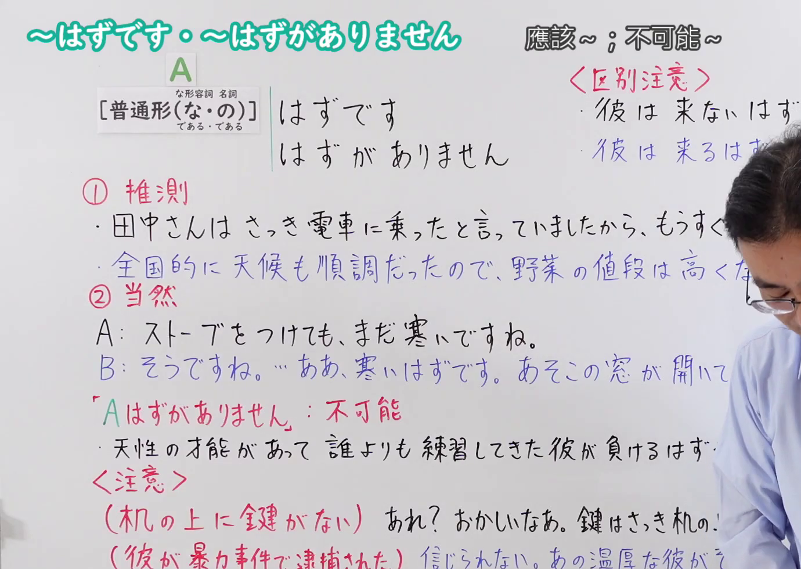
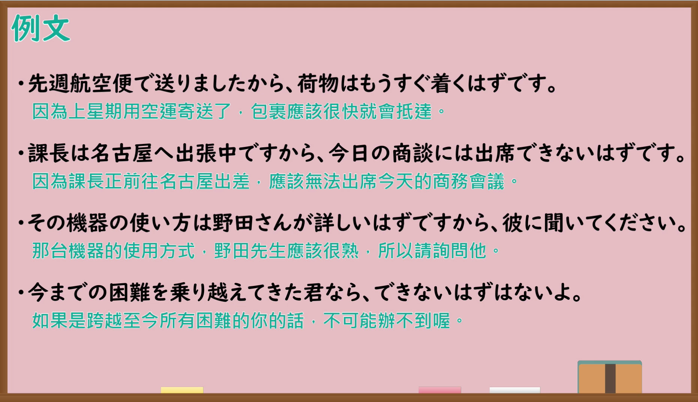

---
{
  "id": "N4-G-0089",
  "kind": "grammar",
  "level": "N4",
  "title": "〜はずです・〜はずがありません（应该……；不可能……）",
  "card_revision": 1,
  "schema_version": 1,
  "source": {
    "lesson": "N4 第89个语法",
    "material": "出口日語原视频板书、YouTube 原 WebVTT（中文为主、日语为辅）与毎日のんびり日本語教師「【Ｎ４文法】～はずだ／ないはずだ」「【Ｎ３文法】～はずがない／はずはない」正文",
    "video": "https://www.youtube.com/watch?v=DGnLDaSc2Y0",
    "screenshot": "assets/grammar/n4/N4-G-0089-connection.png",
    "screenshot_seconds": 1.0,
    "screenshot_crop": {
      "x": 0,
      "y": 0,
      "width": 1380,
      "height": 980
    }
  },
  "tags": ["推测", "断定", "N4"],
  "confusions": ["〜かもしれません", "〜にちがいありません"]
}
---

# 出口日語 N4 第89课：〜はずです・〜はずがありません　應該〜；不可能〜

## 视频学习资料整理

- [出口日語原视频（第 1.0 秒）](https://www.youtube.com/watch?v=DGnLDaSc2Y0)：原图分辨率 1920×1080，裁切区域为左上角 `(x=0, y=0, width=1380, height=980)`，展示本课语法接续与板书说明。
  
- [出口日語原视频（第 432.43 秒）](https://www.youtube.com/watch?v=DGnLDaSc2Y0)：原图分辨率 1920×1080，裁切区域为 `(x=30, y=0, width=1860, height=1070)`，展示课程教学例句板书。
  

# 核心

## 功能一：推测（说话人认为可能性极高的主观判断）

**くわしい意味記述：**

- **〜はずです：** 状況や常識、経験等から推測した主観的な判断を述べる文法です。話者はその可能性が高いと思っていますが、話者自身も状況を完全に把握しているわけではないので推測が確かかどうかは分かりません。（叙述根据状况、常识、经验等推测出的主观判断的语法。说话人认为其可能性极高，但由于说话人自身也并未完全掌握全部状况，因此推测是否确凿尚属未知。）

### 例句

1. 何度も説明してあげたし、ちゃんと理解できているはずだ。

   （我给你解释了好几次，你应该能理解的。）

2. 完璧な人なんていないはずだ。

   （应该没有完美的人。）

3. 火のない所に煙は立たぬと言うし、きっと理由があるはずだ。

   （俗话说无风不起浪，这其中一定有原因。）

4. このチームは実力者揃いだし、どんな相手でも負けることはないはずだ。

   （这个团队实力雄厚，遇到任何对手都应该不会输。）

## 功能二：A不可能（断定绝无可能）

**くわしい意味記述：**

- **〜はずがありません：** 状況や常識、経験等から推測した主観的な判断を述べる文法で、その可能性がないことを表します。（叙述根据状况、常识、经验等推测出的主观判断的语法，表示绝无那种可能性。）

### 例句

1. 彼女は一言で言うとお姫様。こんな美貌で人気がないはずがない。

   （她用一句话说就是公主。这样的美貌不可能不受欢迎。）

2. 他人のために一生懸命になれるはずがない。

   （不可能为了他人而拼命。）

3. 運転歴３０年無事故、無違反だし、そんな私が事故るはずがない。

   （驾龄30年无事故、无违反记录，那样的我绝不可能发生事故。）

4. 放課後ろくに勉強もせずに遊び放題。そんな状態で良い成績が出るはずがない。

   （放学后不好好学习一味玩耍。在那种状态下不可能取得好成绩。）

# 来源

- [出口日語原视频](https://www.youtube.com/watch?v=DGnLDaSc2Y0)
- [毎日のんびり日本語教師「【Ｎ４文法】～はずだ／ないはずだ」](https://mainichi-nonbiri.com/grammar/n4-hazuda/)（查询日期：2026-09-25）
- [毎日のんびり日本語教師「【Ｎ３文法】～はずがない／はずはない」](https://mainichi-nonbiri.com/grammar/n3-hazuganai/)（查询日期：2026-09-25）
