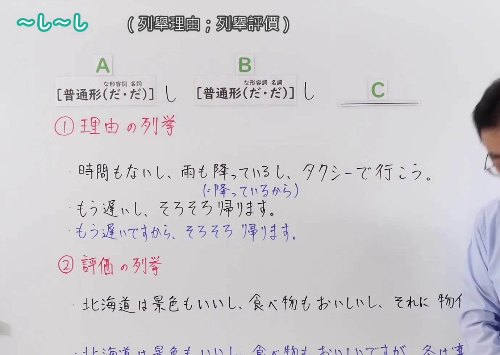
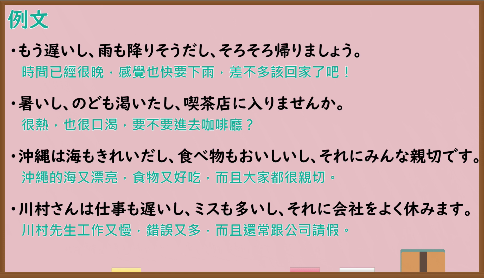

---
{
  "id": "N4-G-0090",
  "kind": "grammar",
  "level": "N4",
  "title": "〜し〜し（列举理由；列举评价）",
  "card_revision": 1,
  "schema_version": 1,
  "source": {
    "lesson": "N4 第90个语法",
    "material": "出口日語原视频板书、YouTube 原 WebVTT（中文为主、日语为辅）与日本語NET「【JLPT N4】文法・例文：〜し、〜し」正文",
    "video": "https://www.youtube.com/watch?v=7i3A0DSOg-Y",
    "screenshot": "assets/grammar/n4/N4-G-0090-connection.png",
    "screenshot_seconds": 1.0,
    "screenshot_crop": {
      "x": 0,
      "y": 0,
      "width": 1380,
      "height": 980
    }
  },
  "tags": ["并列", "理由", "评价", "N4"],
  "confusions": ["〜から", "〜ので", "〜たり〜たり"]
}
---

# 出口日語 N4 第90课：〜し〜し（列舉理由；列舉評價）

## 视频学习资料整理

- [出口日語原视频（第 1.0 秒）](https://www.youtube.com/watch?v=7i3A0DSOg-Y)：原图分辨率 1920×1080，裁切区域为左上角 `(x=0, y=0, width=1380, height=980)`，展示本课语法接续与板书说明。
  
- [出口日語原视频（第 354.4 秒）](https://www.youtube.com/watch?v=7i3A0DSOg-Y)：原图分辨率 1920×1080，裁切区域为 `(x=30, y=0, width=1860, height=1070)`，展示课程教学例句板书。
  

# 核心

## 功能一：列举理由

**くわしい意味記述：**

- **〜し〜し：** 理由を複数あげ、最後に結論を述べる表現。理由を１つだけ言う時もこの文型が使えるが、「言っていないだけで、他にも理由がある」というニュアンスがある。（列举多个理由并在最后陈述结论的表达。即使只说一个理由时也可以使用该句型，但带有“只是没说出来，其实还有其他理由”的语感。）

### 例句

1. 漢字は多いし、文法は難しいし、私は日本語の勉強があまり好きではありません。

   （汉字又多，语法又难，我不太喜欢学日语。）

2. 日本は綺麗だし、食べ物が美味しいし、好きです。

   （日本又干净漂亮，食物又美味，我很喜欢。）

3. このレストランは安いし量も多いし、よく来ます。

   （这家餐馆又便宜分量又足，我经常来。）

4. 頭も痛いし、熱もあるし、今夜のパーティーには行けません。

   （头又疼，又在发烧，今晚的聚会我没法去了。）

## 功能二：列举评价（并列描写）

**くわしい意味記述：**

- **〜し〜し：** 複数の事柄を並べて述べる表現。話し手の「さらに」、「その上」という気持ちが含まれる。人や物を評価するときによく使われる。（将多件事物并列陈述的表达。包含说话人“更加”、“不仅如此”的心情。常用于评价人物或事物。）

### 例句

1. トムさんは、面白いし、親切だし、サッカーも上手です。

   （汤姆既风趣又亲切，而且足球踢得也很好。）

2. 田中先生は優しいし、かっこいいし、それに教え方も上手です。

   （田中老师温柔体贴，人又帅气，而且讲课也教得好。）

3. ジョンさんはスポーツもできるし、頭もいいし、それに女の子からの人気が高いです。

   （约翰擅长体育，人又聪明，而且在女生中人气很高。）

4. 大阪は美味しい食べ物がたくさんあるし、観光地がたくさんあるし、それに人が面白いです。

   （大阪有很多好吃的食物，观光胜地也多，而且当地人很有趣。）

# 来源

- [出口日語原视频](https://www.youtube.com/watch?v=7i3A0DSOg-Y)
- [日本語NET「【JLPT N4】文法・例文：〜し、〜し」](https://nihongokyoshi-net.com/2019/08/09/jlptn4-grammar-shi-shi/)（查询日期：2026-09-25）
