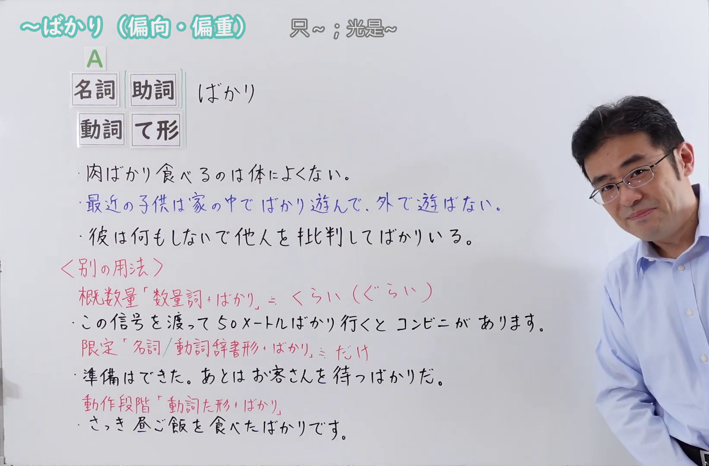
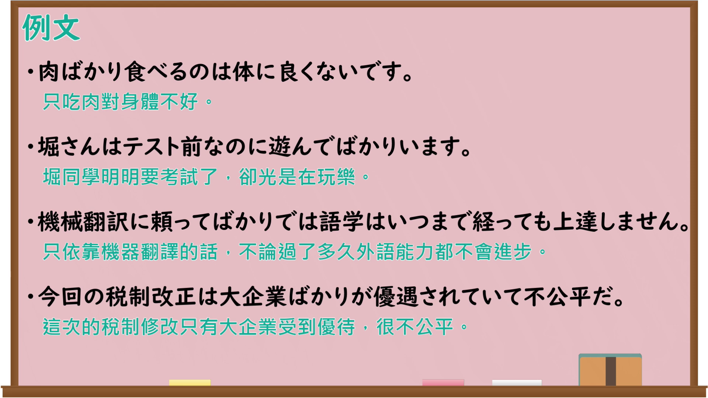

---
{
  "id": "N4-G-0091",
  "kind": "grammar",
  "level": "N4",
  "title": "～ばかり（偏向・偏重）",
  "card_revision": 1,
  "schema_version": 1,
  "source": {
    "lesson": "N4 第91个语法",
    "material": "出口日語原视频板书、Bilibili P91音频的本地中文／日语混合转写 WebVTT 与Hagoromo正文",
    "video": "https://www.youtube.com/watch?v=BC1bvU9xWEI",
    "screenshot": "assets/grammar/n4/N4-G-0091-connection.png",
    "screenshot_seconds": 306.58,
    "screenshot_crop": {
      "x": 0,
      "y": 0,
      "width": 1642,
      "height": 1080
    }
  },
  "tags": [
    "取り立て助詞",
    "ばかり",
    "N4"
  ],
  "confusions": [
    "Vたばかりだ（動作段階）",
    "Vるばかりだ（限定・あとは〜するだけだ）",
    "〔数量詞〕＋ばかり（概数）"
  ]
}
---

# ～ばかり（偏向・偏重）

## 视频学习资料整理

原视频：[【Ｎ４文法】～ばかり（偏向・偏重）](https://www.youtube.com/watch?v=BC1bvU9xWEI)

**接续图**：真实时间 306.58 秒（5:06），原图尺寸 1920×1080，裁切区域 x=0、y=0、宽1642、高1080（固定左上角，收拢右下角，裁去右侧人像与空白）。

**例句图**：真实时间 337.68 秒（5:37），原图尺寸 1920×1080，未裁切（整幅画面）。

# 核心

## 功能一：偏向・偏重（只～；光是～，带有批评的语气）

**最上位意味カテゴリー：**

- **ばかり：** ものごとの関係（事物的关系）
- **Vてばかりいる：** 考え・感情（想法与感情）

**中位意味カテゴリー：**

- **ばかり：** 限定（限定）
- **Vてばかりいる：** 軽重の強調（轻重的强调）

**意味：**

- **ばかり：** 限定（限定）
- **Vてばかりいる：** 程度の強調（程度的强调）

**くわしい意味記述：**

- **ばかり：** 「〜だけ」「〜以外はしない／ない」という意味。あることを批判して言うときに使う。（表示「只～」「除此以外不／不做」，用于批评某件事的时候。）
- **Vてばかりいる：** Vを繰り返したり，いつもVの状態にあることを批判的に言う時に使う。（用于批评反复做V、或总是处于V的状态。）

**派生語：** 未列出

### 例句

1. この子は毎日テレビばかり見ています。

   （这个孩子每天光看电视。）

2. 知らない人ばかりになる。

   （变成尽是些不认识的人。）

3. ちょっと成功したと思ったらそればかりやって、情勢が変わってもそのやり方を変えない。

   （一觉得有点成功就光做那件事，即使形势变了也不改变做法。）

4. あの子は、先生の話を聞かないで、しゃべってばかりいる。

   （那个孩子不听课，光顾着说话。）

## 功能二：概数量「数量詞＋ばかり」≒ くらい（ぐらい）（数量词＋ばかり ≒ 大约）

**最上位意味カテゴリー：**

- **〔数量詞〕＋ばかり：** ものごとの様子（事物的状态）

**中位意味カテゴリー：**

- **〔数量詞〕＋ばかり：** 程度（程度）

**意味：**

- **〔数量詞〕＋ばかり：** 概数（概数）

**くわしい意味記述：**

- **〔数量詞〕＋ばかり：** 「大体」「約」という意味を表す。数量を表す表現とともに使って，大体の数を示す。「くらい」「ぐらい」「ほど」という言い方もある。（表示「大体」「大约」的意思。与表示数量的表达一起使用，指出大概的数字。也有「くらい」「ぐらい」「ほど」的说法。）

**派生語：** 未列出

### 例句

1. 引っ越しを手伝いに友だちが三人ばかり来てくれます。

   （大概有三个朋友来帮我搬家。）

2. 兼好法師も、「徒然草」の第二百三十八段に機転をきかした自慢話を七つばかり書きつらねている。

   （兼好法师也在《徒然草》第二百三十八段中，一连写下了大约七个机敏的自夸故事。）

3. 集排法の適用も結局は１８社ばかりの限られた企業にとどまり、日本製鉄、三菱重工、王子製紙、三井鉱山など、当時の日本産業を代表する大企業の一部だけが適用を受け、銀行はその対象とはならなかった。

   （集中排除法的适用最终也只限于大约十八家有限的企业，只有日本制铁、三菱重工、王子制纸、三井矿山等当时代表日本产业的一部分大企业成为适用对象，银行并没有被列入其中。）

## 功能三：限定「名詞／動詞辞書形＋ばかり」≒ だけ（限定：只，之后只剩做～）

**最上位意味カテゴリー：**

- **Vるばかりだ：** 場所・時間（地点与时间）

**中位意味カテゴリー：**

- **Vるばかりだ：** 時間的前後（时间先后）

**意味：**

- **Vるばかりだ：** 終点（终点）

**くわしい意味記述：**

- **Vるばかりだ：** 「準備が完了して，あとは〜するだけだ」という意味。（表示「准备已经完成，之后就只剩下做～了」的意思。）

**派生語：** 未列出

### 例句

1. やるだけのことをやって、後は結果を待つばかりだ。

   （该做的都做了，之后就只等结果了。）

2. 出かけるばかりの時に、父が事故にあったという電話がかかってきた。

   （正要出门的时候，接到了父亲出了事故的电话。）

3. 新外国為替法の四月一日施行まで、あと一か月を残すばかりとなった。

   （距离新外汇法四月一日施行，只剩下一个月了。）

## 功能四：動作段階「動詞た形＋ばかり」（动作阶段：某个动作刚刚结束之后）

**最上位意味カテゴリー：**

- **Vたばかりだ：** 場所・時間（地点与时间）

**中位意味カテゴリー：**

- **Vたばかりだ：** 時間的前後（时间先后）

**意味：**

- **Vたばかりだ：** 継起（後）（继起（后））

**くわしい意味記述：**

- **Vたばかりだ：** ある動作や行為が起こった直後であることを表す。（表示某个动作或行为发生之后不久。）

**派生語：** 未列出

### 例句

1. 今起きたばかりです。

   （我刚刚起床。）

2. 今朝とれたばかりの魚はおいしい。

   （今早刚捕到的鱼很好吃。）

3. 受験生への成績情報の開示は、ほとんどの大学が今年から始めたばかりだ。

   （向考生公开成绩信息，几乎所有大学都是从今年才开始做的。）

# 来源

- [出口日語原视频](https://www.youtube.com/watch?v=BC1bvU9xWEI)
- [Hagoromo「ばかり（取り立て助詞）」](https://hagoromo-text.work/lookup?vid=1447)（查询日期：2026-09-25）
- [Hagoromo「Vてばかりいる」](https://hagoromo-text.work/lookup?vid=847)（查询日期：2026-09-25）
- [Hagoromo「〔数量詞〕＋ばかり」](https://hagoromo-text.work/lookup?vid=1874)（查询日期：2026-09-25）
- [Hagoromo「Vるばかりだ」](https://hagoromo-text.work/lookup?vid=201)（查询日期：2026-09-25）
- [Hagoromo「Vたばかりだ」](https://hagoromo-text.work/lookup?vid=721)（查询日期：2026-09-25）
