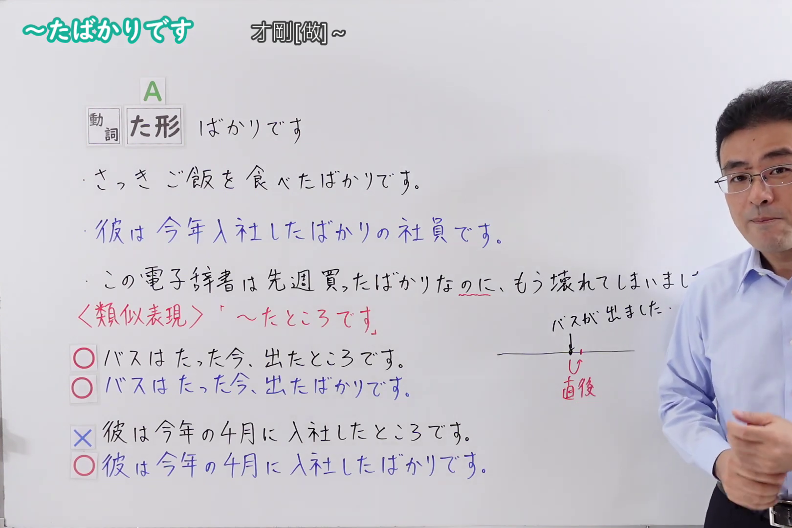
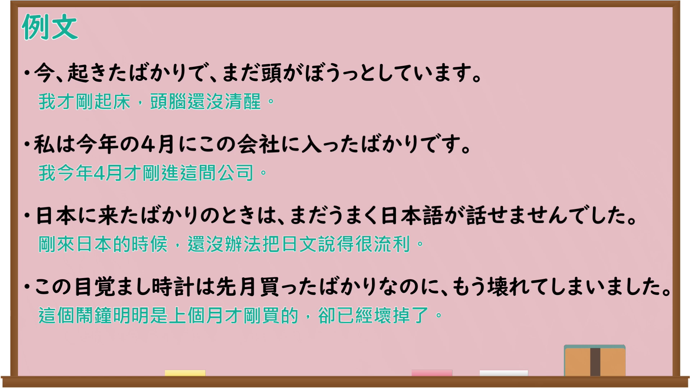

---
{
  "id": "N4-G-0092",
  "kind": "grammar",
  "level": "N4",
  "title": "～たばかりです（才刚做～）",
  "card_revision": 1,
  "schema_version": 1,
  "source": {
    "lesson": "N4 第92个语法",
    "material": "出口日語原视频板书、YouTube 原 WebVTT（中文为主、日语为辅）与Hagoromo正文",
    "video": "https://www.youtube.com/watch?v=V9dkK97WnGQ",
    "screenshot": "assets/grammar/n4/N4-G-0092-connection.png",
    "screenshot_seconds": 311.75,
    "screenshot_crop": {
      "x": 0,
      "y": 0,
      "width": 1620,
      "height": 1080
    }
  },
  "tags": [
    "助動詞",
    "たばかり",
    "N4"
  ],
  "confusions": [
    "～たところです（時間の直前・直後）",
    "～てばかりいる（偏向・偏重）",
    "～たばかりのN"
  ]
}
---

# ～たばかりです（才刚做～）

## 视频学习资料整理

原视频：[[N4 Grammar] ~I just finished](https://www.youtube.com/watch?v=V9dkK97WnGQ)

**接续图**：真实时间 311.75 秒（5:11），原图尺寸 1920×1080，裁切区域 x=0、y=0、宽1620、高1080（固定左上角，收拢右下角，裁去右侧人像与空白；板书中「もう壊れてしまいまし…」的句尾本来就被老师身体挡住，未作补写）。

**例句图**：真实时间 321.57 秒（5:21），原图尺寸 1920×1080，未裁切（整幅画面）。

# 核心

## 功能一：A（動詞た形）＋ばかりです（表示某个动作或行为刚刚结束之后）

**最上位意味カテゴリー：**

- **Vたばかりだ：** 場所・時間（地点与时间）

**中位意味カテゴリー：**

- **Vたばかりだ：** 時間的前後（时间先后）

**意味：**

- **Vたばかりだ：** 継起（後）（继起（后））

**くわしい意味記述：**

- **Vたばかりだ：** ある動作や行為が起こった直後であることを表す。（表示某个动作或行为发生之后不久。）

**派生語：** 未列出

### 例句

1. 今起きたばかりです。

   （我刚刚起床。）

2. 今朝とれたばかりの魚はおいしい。

   （今早刚捕到的鱼很好吃。）

3. 私は日本へ来たばかりの頃、ほとんど簡単なあいさつしかできませんでした。

   （我刚来日本的时候，几乎只会说简单的寒暄语。）

4. インターネットによって、今の世界が大層変えられたと思っている。それはインターネットで、世界に方々で発生したばかりの事がすぐ手に入られるから。

   （我认为互联网使当今世界发生了巨大变化。那是因为通过互联网，世界各地刚刚发生的事马上就能获取。）

# 来源

- [出口日語原视频](https://www.youtube.com/watch?v=V9dkK97WnGQ)
- [Hagoromo「Vたばかりだ」](https://hagoromo-text.work/lookup?vid=721)（查询日期：2026-09-25）
