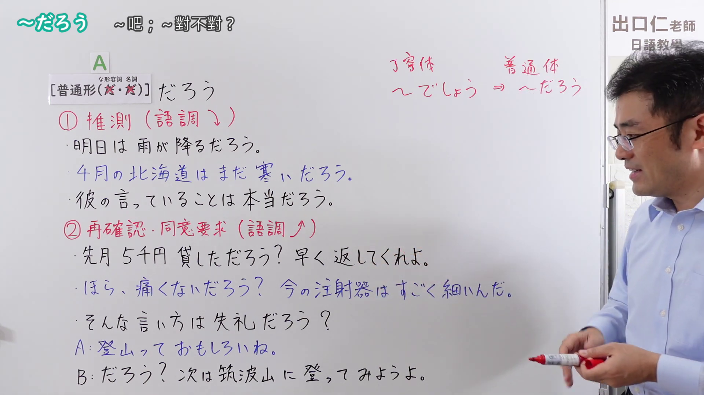
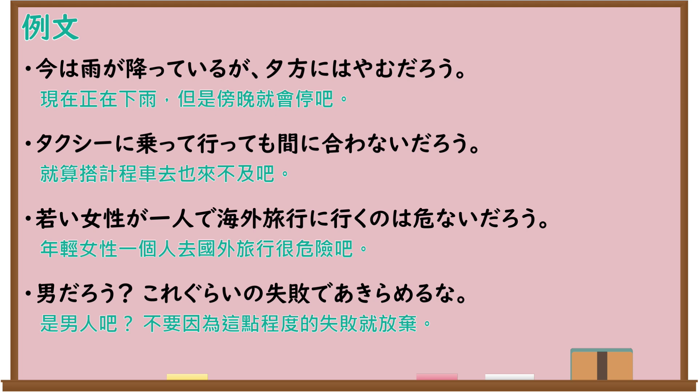

---
{
  "id": "N4-G-0093",
  "kind": "grammar",
  "level": "N4",
  "title": "～だろう（～吧；～对不对？）",
  "card_revision": 1,
  "schema_version": 1,
  "source": {
    "lesson": "N4 第93个语法",
    "material": "出口日語原视频板书、Bilibili P93音频的本地中文／日语混合转写 WebVTT 与Hagoromo正文",
    "video": "https://www.youtube.com/watch?v=9fvbxvcdaEU",
    "screenshot": "assets/grammar/n4/N4-G-0093-connection.png",
    "screenshot_seconds": 398.95,
    "screenshot_crop": {
      "x": 0,
      "y": 0,
      "width": 1920,
      "height": 1080
    }
  },
  "tags": [
    "助動詞",
    "だろう",
    "推量",
    "N4"
  ],
  "confusions": [
    "～でしょう（丁寧体）",
    "～かもしれない",
    "～のだろう"
  ]
}
---

# ～だろう（～吧；～对不对？）

## 视频学习资料整理

原视频：[【Ｎ４文法】～だろう](https://www.youtube.com/watch?v=9fvbxvcdaEU)

**接续图**：真实时间 398.95 秒（6:38），原图尺寸 1920×1080，未裁切（整幅画面；老师位于画面最右侧，板书完整，未再收拢右下角）。

**例句图**：真实时间 452.14 秒（7:32），原图尺寸 1920×1080，未裁切（整幅画面）。

# 核心

## 功能一：①推測（語調↓）（推测，语调下降）

**最上位意味カテゴリー：**

- **だろう：** 考え・感情（想法与感情）

**中位意味カテゴリー：**

- **だろう：** 推量（推测）

**意味：**

- **だろう：** 推量・概言（推测・概括陈述）

**くわしい意味記述：**

- **だろう：** 話し手があることを根拠として予想して述べるときに使う。（说话人以某事为依据作出预想来叙述时使用。）

**派生語：** かろう

### 例句

1. 明日は晴れるだろう。

   （明天会晴吧。）

2. 核戦争が起きれば、地球は破滅するだろう。

   （如果发生核战争，地球将会毁灭吧。）

3. 今回の自殺の動機、背景解明には、もう少し時間が必要だろう。

   （要查明此次自杀的动机与背景，大概还需要一些时间吧。）

4. 当然のことだろう。

   （这是理所当然的吧。）

## 功能二：②再確認・同意要求（語調↑）（再次确认・要求同意，语调上升）

**最上位意味カテゴリー：**

- **だろう：** 考え・感情（想法与感情）

**中位意味カテゴリー：**

- **だろう：** 主張・断定的評価（主张・断定性评价）

**意味：**

- **だろう：** 主張（主张）

**くわしい意味記述：**

- **だろう：** 「〜ですよね」「〜しますよね」といった意味を持つ。相手の応答を期待しており，確認の意味を持つため，上昇調のイントネーションで用いられる。「でしょう」「でしょ」という言い方もある。（具有「〜ですよね」「〜しますよね」的意思。因为期待对方的回应、含有确认的意味，所以用上升语调来使用。也有「でしょう」「でしょ」的说法。）

**派生語：** 未列出

### 例句

1. これでわかっただろう？あいつは俺たちのことなど全然考えていないんだ。

   （这样你明白了吧？那家伙根本没把我们放在心上。）

2. な、さくら、惜しまれて、引き止められるうちが花ってことよ、分かるだろう？

   （喂，樱，被人惋惜、被人挽留的时候才是最好的时候，你懂吧？）

3. いいかげんにしろ、さっき持ってたのは金だろう。

   （适可而止吧，刚才你拿的是钱吧。）

# 来源

- [出口日語原视频](https://www.youtube.com/watch?v=9fvbxvcdaEU)
- [Hagoromo「だろう（推量・概言）」](https://hagoromo-text.work/lookup?vid=751)（查询日期：2026-09-25）
- [Hagoromo「だろう（主張）」](https://hagoromo-text.work/lookup?vid=752)（查询日期：2026-09-25）
