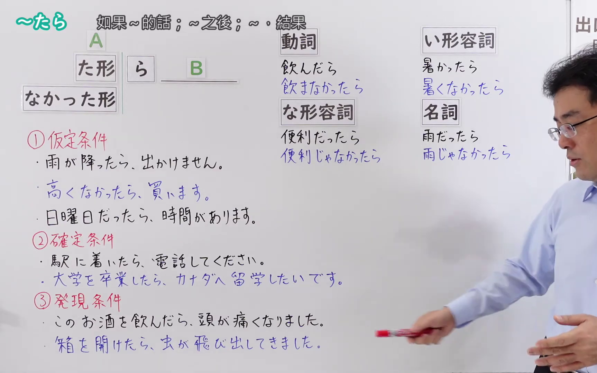
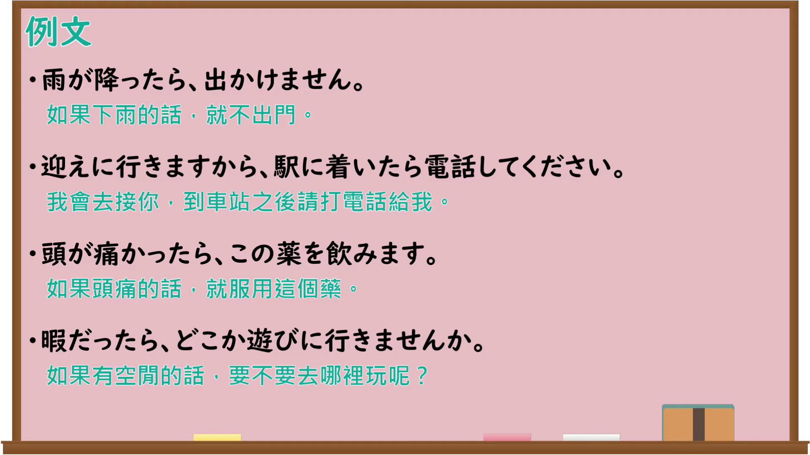

---
{
  "id": "N4-G-0094",
  "kind": "grammar",
  "level": "N4",
  "title": "～たら（仮定条件・確定条件・発見条件）",
  "card_revision": 1,
  "schema_version": 1,
  "source": {
    "lesson": "N4 第94个语法",
    "material": "出口日語原视频板书、Bilibili P94音频的本地中文／日语混合转写 WebVTT 与Hagoromo正文",
    "video": "https://www.youtube.com/watch?v=LVHXyP_9RRY",
    "screenshot": "assets/grammar/n4/N4-G-0094-connection.png",
    "screenshot_seconds": 321.65,
    "screenshot_crop": {
      "x": 0,
      "y": 0,
      "width": 1726,
      "height": 1080
    }
  },
  "tags": [
    "接続助詞",
    "たら",
    "条件",
    "N4"
  ],
  "confusions": [
    "～なら（仮定条件）",
    "～と（条件）",
    "～ば（仮定条件）"
  ]
}
---

# ～たら（仮定条件・確定条件・発見条件）

## 视频学习资料整理

原视频：[【Ｎ４文法】～たら](https://www.youtube.com/watch?v=LVHXyP_9RRY)

**接续图**：真实时间 321.65 秒（5:21），原图尺寸 1920×1080，裁切区域 x=0、y=0、宽1726、高1080（固定左上角，收拢右下角，裁去右侧人像与空白；选用老师退到画面右侧的时点，動詞・な形容詞・い形容詞・名詞四列变化全部完整）。

**例句图**：真实时间 364.54 秒（6:04），原图尺寸 1920×1080，未裁切（整幅画面）。

# 核心

## 功能一：①仮定条件（假定条件：如果～的话）

**最上位意味カテゴリー：**

- **たら：** ものごとの関係（事物的关系）

**中位意味カテゴリー：**

- **たら：** 条件（条件）

**意味：**

- **たら：** 条件：仮定条件（条件：假定条件）

**くわしい意味記述：**

- **たら：** 未来の不確定な出来事について，その出来事が成立する時に，後ろの出来事も成立し，成立したい時には後ろの出来事も成立しないという関係を表す。仮定条件。（就未来的不确定事件而言，表示该事件成立时后面的事件也成立、不成立时后面的事件也不成立的关系。假定条件。）

**派生語：** 未列出

### 例句

1. 雨が降ったら、行きません。

   （如果下雨，就不去。）

2. もし忙しかったら、手伝いますよ。

   （如果你忙的话，我来帮忙。）

3. もし、子どもをそのまま放っておいたら、子どもは敏捷に飛び出せたかもしれない。

   （如果就那样把孩子放着不管，孩子或许就能敏捷地跑出去了。）

## 功能二：②確定条件（确定条件：到了～的时候，就～）

**最上位意味カテゴリー：**

- **たら：** ものごとの関係（事物的关系）

**中位意味カテゴリー：**

- **たら：** 条件（条件）

**意味：**

- **たら：** 条件：確定条件（条件：确定条件）

**くわしい意味記述：**

- **たら：** 未来の確定的な出来事について，そのタイミングになった後で，後の出来事が起こるということを表す。確定条件。（就未来的确定事件而言，表示到了那个时间点之后，后面的事件才发生。确定条件。）

**派生語：** 未列出

### 例句

1. 10時になったら、会議が始まります。

   （到了十点，会议就开始。）

2. 駅についたら、電話してください。

   （到了车站请给我打电话。）

3. 2年終わったら、やっぱり先生になるんですよね。

   （两年结束之后，果然还是要当老师吧。）

## 功能三：③発見条件（发现条件：做了～之后，发现～）

**最上位意味カテゴリー：**

- **たら〜た：** ものごとの関係（事物的关系）

**中位意味カテゴリー：**

- **たら〜た：** 条件（条件）

**意味：**

- **たら〜た：** 条件：確定条件（条件：确定条件）

**くわしい意味記述：**

- **たら〜た：** 過去の出来事について，ある出来事をきっかけに後の出来事が起こったことを表す。異なる主体が行った行為の連続や，発見の意味を表す。（就过去的事件而言，表示以某件事为契机，后面的事件发生了。表示不同主体所做行为的连续，或「发现」的意思。）

**派生語：** 未列出

### 例句

1. お金を入れてキーを押したら、機械が「ありがとうございました」と答えてくれた。おかしな感じだった。

   （投进钱按下按键后，机器回了句「谢谢惠顾」。感觉很奇怪。）

2. お母さんに言ったら怒られた。

   （跟妈妈说了之后，被骂了。）

3. 音楽がやれるようにと、成城学園中学校を受けたら合格した。

   （为了能学音乐，去考了成城学园中学，结果考上了。）

# 来源

- [出口日語原视频](https://www.youtube.com/watch?v=LVHXyP_9RRY)
- [Hagoromo「たら（仮定条件）」](https://hagoromo-text.work/lookup?vid=729)（查询日期：2026-09-25）
- [Hagoromo「たら（確定条件）」](https://hagoromo-text.work/lookup?vid=1940)（查询日期：2026-09-25）
- [Hagoromo「たら〜た（確定条件・発見）」](https://hagoromo-text.work/lookup?vid=732)（查询日期：2026-09-25）
