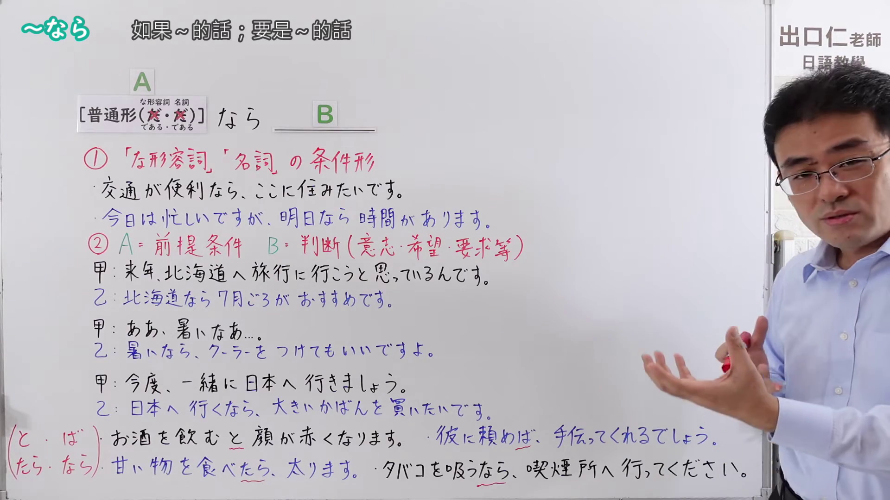
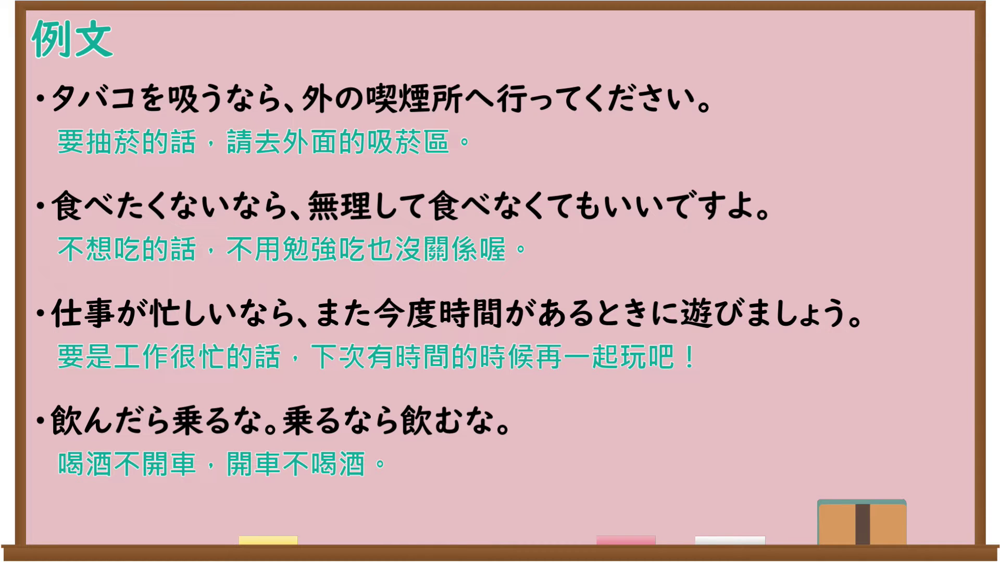

---
{
  "id": "N4-G-0095",
  "kind": "grammar",
  "level": "N4",
  "title": "～なら（仮定条件・前提条件と判断）",
  "card_revision": 1,
  "schema_version": 1,
  "source": {
    "lesson": "N4 第95个语法",
    "material": "出口日語原视频板书、YouTube 原 WebVTT（中文为主、日语为辅）与Hagoromo正文",
    "video": "https://www.youtube.com/watch?v=ig9Ys6KrGk8",
    "screenshot": "assets/grammar/n4/N4-G-0095-connection.png",
    "screenshot_seconds": 418.85,
    "screenshot_crop": {
      "x": 0,
      "y": 0,
      "width": 1920,
      "height": 1080
    }
  },
  "tags": [
    "接続助詞",
    "なら",
    "条件",
    "N4"
  ],
  "confusions": [
    "～たら（仮定条件）",
    "～と（条件）",
    "～なら（主题の提示）"
  ]
}
---

# ～なら（仮定条件・前提条件と判断）

## 视频学习资料整理

原视频：[[N4 Grammar] ~nara](https://www.youtube.com/watch?v=ig9Ys6KrGk8)

**接续图**：真实时间 418.85 秒（6:58），原图尺寸 1920×1080，未裁切（整幅画面；老师位于画面最右侧，板书完整，未再收拢右下角）。

**例句图**：真实时间 472.47 秒（7:52），原图尺寸 1920×1080，未裁切（整幅画面）。

# 核心

## 功能一：①「な形容詞」「名詞」の条件形（な形容词、名词的条件形：如果～的话）

**最上位意味カテゴリー：**

- **なら（仮定条件）：** ものごとの関係（事物的关系）
- **なら（仮定条件（時間関係なし））：** ものごとの関係（事物的关系）

**中位意味カテゴリー：**

- **なら（仮定条件）：** 条件（条件）
- **なら（仮定条件（時間関係なし））：** 条件（条件）

**意味：**

- **なら（仮定条件）：** 条件：仮定条件（条件：假定条件）
- **なら（仮定条件（時間関係なし））：** 条件：仮定条件（時間関係なし）（条件：假定条件（无时间关系））

**くわしい意味記述：**

- **なら（仮定条件）：** まだ実現していない仮定の出来事をとりあげ，その出来事が実現したら，後の行為を行う，という意味を表す。仮定条件。（提出尚未实现的假定事件，表示该事件一旦实现，就进行后面的行为。假定条件。）
- **なら（仮定条件（時間関係なし））：** 「前件が成立したあとで後件が起こる」という時間の関係がない。後件は，前件の方法や状態，条件について述べることが多い。（没有「前件成立之后后件才发生」这种时间关系。后件多就前件的方法、状态或条件进行叙述。）

**派生語：** 未列出

### 例句

1. 明日いい天気なら、山へ行きます。

   （明天天气好的话，就去爬山。）

2. 相手が熊なら防御できるが、悪賢い人間だったらこういう馬を倒すのはわけないことだ。

   （如果对手是熊还能防御，但如果是狡猾的人，要打倒这样的马就不在话下了。）

3. もし中国が冒険主義的な道を選ぶなら、アジアの勢力均衡を維持するため、我々は現存の防衛誓約の履行その他の措置をとらなければならない。

   （如果中国选择冒险主义的道路，为了维持亚洲的势力均衡，我们必须履行现有的防卫承诺并采取其他措施。）

4. 空港に行くなら、電車がべんりよ。

   （去机场的话，坐电车很方便哦。）

## 功能二：②A＝前提条件　B＝判断（意志・希望・要求等）（提出前提条件，后项为判断、意志、希望、要求等）

**最上位意味カテゴリー：**

- **なら：** ものごとの関係（事物的关系）

**中位意味カテゴリー：**

- **なら：** 関連・対応（关联与对应）

**意味：**

- **なら：** 対応（对应）

**くわしい意味記述：**

- **なら：** 話の中ですでに出た話題をとりあげ，それについて何か情報提供をするときに使う。（用于提出会话中已经出现的话题，并就此提供某些信息。）

**派生語：** 未列出

### 例句

1. 時計なら、スイス製がいいです。

   （要说手表的话，瑞士制的好。）

2. 学生なら、入場料は半額です。

   （学生的话，入场费是半价。）

3. 『出雲・石見』はあえて呼ぶなら、エッセーです。

   （《出云・石见》若硬要归类的话，是随笔。）

# 来源

- [出口日語原视频](https://www.youtube.com/watch?v=ig9Ys6KrGk8)
- [Hagoromo「なら（仮定条件）」](https://hagoromo-text.work/lookup?vid=1160)（查询日期：2026-09-25）
- [Hagoromo「なら（仮定条件（時間関係なし））」](https://hagoromo-text.work/lookup?vid=2052)（查询日期：2026-09-25）
- [Hagoromo「なら（対応）」](https://hagoromo-text.work/lookup?vid=1161)（查询日期：2026-09-25）
