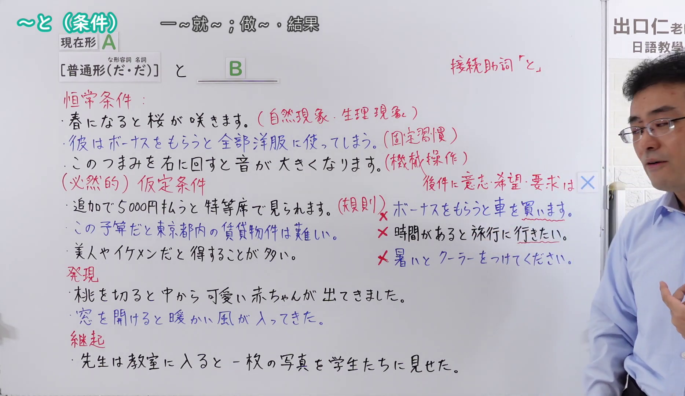
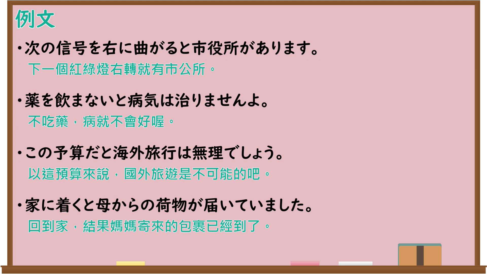

---
{
  "id": "N4-G-0096",
  "kind": "grammar",
  "level": "N4",
  "title": "～と（条件：恒常条件・仮定条件・発見・継起）",
  "card_revision": 1,
  "schema_version": 1,
  "source": {
    "lesson": "N4 第96个语法",
    "material": "出口日語原视频板书、Bilibili P96音频的本地中文／日语混合转写 WebVTT 与Hagoromo正文",
    "video": "https://www.youtube.com/watch?v=9f2BnjvKOW8",
    "screenshot": "assets/grammar/n4/N4-G-0096-connection.png",
    "screenshot_seconds": 706.18,
    "screenshot_crop": {
      "x": 0,
      "y": 0,
      "width": 1868,
      "height": 1080
    }
  },
  "tags": [
    "接続助詞",
    "と",
    "条件",
    "N4"
  ],
  "confusions": [
    "～たら（仮定条件）",
    "～なら（仮定条件）",
    "～ば（仮定条件）"
  ]
}
---

# ～と（条件：恒常条件・仮定条件・発見・継起）

## 视频学习资料整理

原视频：[【Ｎ４文法】～と（条件）](https://www.youtube.com/watch?v=9f2BnjvKOW8)

**接续图**：真实时间 706.18 秒（11:46），原图尺寸 1920×1080，裁切区域 x=0、y=0、宽1868、高1080（固定左上角，收拢右下角，裁去右侧人像与空白；恒常条件・（必然的）仮定条件・発見・継起及「後件に意志・希望・要求は×」的板书全部完整）。

**例句图**：真实时间 760.00 秒（12:40），原图尺寸 1920×1080，未裁切（整幅画面）。

# 核心

## 功能一：恒常条件・（必然的）仮定条件（恒常条件与必然的假定条件：一～就～；做～就会～）

**最上位意味カテゴリー：**

- **と：** ものごとの関係（事物的关系）

**中位意味カテゴリー：**

- **と：** 条件（条件）

**意味：**

- **と：** 必然的な結果（必然的结果）

**くわしい意味記述：**

- **と：** 前の出来事が起こることをきっかけとして，後の出来事が起こる，あるいは気づく。（以前面的事件发生为契机，后面的事件随之发生，或者由此察觉。）

**派生語：** 未列出

### 例句

1. 春になると桜が咲く。

   （一到春天樱花就开。）

2. その角を右に曲がると、公園があります。

   （在那个拐角向右转，就有个公园。）

3. でもね、長い間この商売をしてメシを食っていると、百に一つは当たることがあるんだよ。

   （不过啊，长期做这行生意混饭吃的话，一百次里总会有一次能中的。）

## 功能二：発見（发现：做～之后，发现～）

**最上位意味カテゴリー：**

- **と：** ものごとの関係（事物的关系）

**中位意味カテゴリー：**

- **と：** 条件（条件）

**意味：**

- **と：** 条件：発見（条件：发现）

**くわしい意味記述：**

- **と：** 前の行為を行った結果，後ろの内容に気づいたということを表す。発見の意味。（表示做了前面的行为之后，察觉到了后面的内容。即「发现」的意思。）

**派生語：** 未列出

### 例句

1. 窓を開けると、雪が降っていた。

   （打开窗户一看，外面在下雪。）

2. 郵便局を訪れると、郵便サービスの種類が豊富になったのに驚く。

   （去邮局一看，会惊讶于邮政服务的种类变丰富了。）

3. 「実際に会ってみると、大変温かい人柄で、いい関係ができた」と語った。

   （他说道：「实际见了面一看，人非常温和，建立了很好的关系。」）

## 功能三：継起（继起：一～就马上～）

**最上位意味カテゴリー：**

- **と〜た：** 場所・時間（地点与时间）

**中位意味カテゴリー：**

- **と〜た：** 時間的前後（时间先后）

**意味：**

- **と〜た：** 継起（後）（继起（后））

**くわしい意味記述：**

- **と〜た：** 前の行為を行った後，続けて別の行為をすることを表す。「〜してすぐに」という意味を持つ。（表示做了前面的行为之后，紧接着做另一个行为。具有「～之后马上」的意思。）

**派生語：** 未列出

### 例句

1. 彼は部屋に入ると、コートを脱いだ。

   （他一进房间就脱下了外套。）

2. 私が電話をすると、彼女はすぐに来てくれた。

   （我一打电话，她马上就来了。）

3. モッコをかつぐと、タラップをおりていった。

   （他一扛起箢子，就沿舷梯走了下去。）

# 来源

- [出口日語原视频](https://www.youtube.com/watch?v=9f2BnjvKOW8)
- [Hagoromo「と（必然的な結果）」](https://hagoromo-text.work/lookup?vid=897)（查询日期：2026-09-25）
- [Hagoromo「と（条件：発見）」](https://hagoromo-text.work/lookup?vid=899)（查询日期：2026-09-25）
- [Hagoromo「と〜た（継起（後））」](https://hagoromo-text.work/lookup?vid=1952)（查询日期：2026-09-25）
