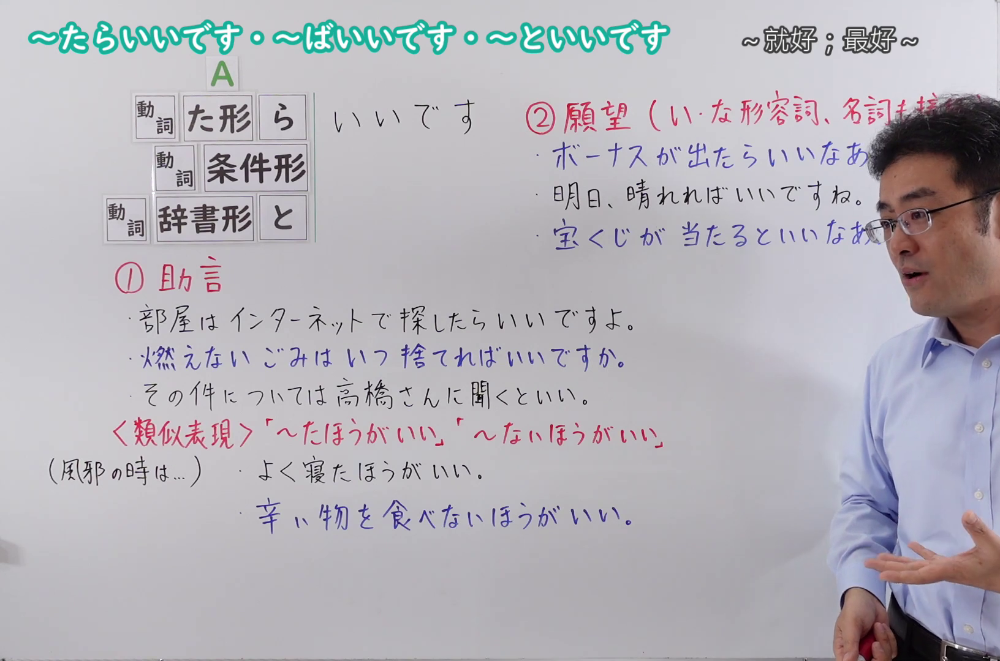
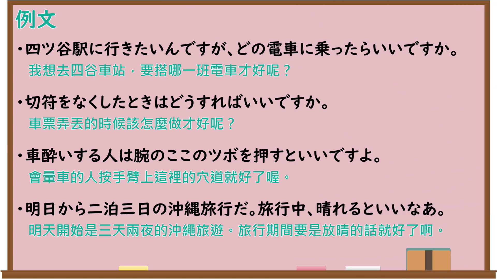

---
{
  "id": "N4-G-0097",
  "kind": "grammar",
  "level": "N4",
  "title": "～たらいいです・～ばいいです・～といいです（助言・願望）",
  "card_revision": 1,
  "schema_version": 1,
  "source": {
    "lesson": "N4 第97个语法",
    "material": "出口日語原视频板书、YouTube 原 WebVTT（中文为主、日语为辅）与Hagoromo正文",
    "video": "https://www.youtube.com/watch?v=au5UM_9Qtlw",
    "screenshot": "assets/grammar/n4/N4-G-0097-connection.png",
    "screenshot_seconds": 339.90,
    "screenshot_crop": {
      "x": 0,
      "y": 0,
      "width": 1632,
      "height": 1080
    }
  },
  "tags": [
    "助動詞",
    "たらいい",
    "ばいい",
    "といい",
    "N4"
  ],
  "confusions": [
    "～たほうがいい（類似表現）",
    "～ないほうがいい（類似表現）",
    "～たらどう（か）"
  ]
}
---

# ～たらいいです・～ばいいです・～といいです（助言・願望）

## 视频学习资料整理

原视频：[[N4 Grammar] ~tara ii desu, ~ba ii desu, ~to ii desu](https://www.youtube.com/watch?v=au5UM_9Qtlw)

**接续图**：真实时间 339.90 秒（5:39），原图尺寸 1920×1080，裁切区域 x=0、y=0、宽1632、高1080（固定左上角，收拢右下角，裁去右侧人像与空白）。该时点老师的头部遮住「②願望（い・な形容詞、名詞＋接続）」一行括号末端的少量文字，其余接续（動詞た形＋ら／動詞条件形／動詞辞書形＋と）与两组例句、類似表現均完整；未换用遮挡更多的其它时点。

**例句图**：真实时间 364.03 秒（6:04），原图尺寸 1920×1080，未裁切（整幅画面）。

# 核心

## 功能一：①助言（建议：做～就好）

**最上位意味カテゴリー：**

- **たらいい：** 人との関係（人际关系）
- **ばいい：** 考え・感情（想法与感情）
- **といい：** 人との関係（人际关系）

**中位意味カテゴリー：**

- **たらいい：** 勧誘・申し出・助言（劝诱・提议・建议）
- **ばいい：** 主張・断定的評価（主张・断定性评价）
- **といい：** 勧誘・申し出・助言（劝诱・提议・建议）

**意味：**

- **たらいい：** 助言（建议）
- **ばいい：** 主張（主张）
- **といい：** 当為（应当）

**くわしい意味記述：**

- **たらいい：** ある行為をするように，人に勧めるときに使う。（用于劝别人做某个行为时。）
- **ばいい：** 話し手が他の人に，ある行為をすることを勧めるときに使う。話し手にとってその行動はどうでもいいというような気持ちを表すことが多い。（说话人劝别人做某个行为时使用。多表示说话人觉得那个行动怎么样都无所谓的心情。）
- **といい：** 動詞の辞書形と一緒に使って，ある行為をするように，人に勧めるときに使う表現。（与动词的辞书形一起使用，用于劝别人做某个行为的表现。）

**派生語：** 未列出

### 例句

1. 歩いていくと時間かかるから、バスで行ったらいいよ。

   （走路去要花时间，所以坐公交车去就好。）

2. どうしたらいい?

   （怎么做才好？）

3. 行くのが嫌なら、行かなければいい。誰も文句は言わないよ。

   （不想去的话，不去就行了。谁都不会抱怨的。）

4. 分からないことは彼に聞くといいよ。

   （不懂的事问他就好。）

## 功能二：②願望（い・な形容詞、名詞＋接続）（愿望：要是～就好了）

**最上位意味カテゴリー：**

- **たらいい：** 考え・感情（想法与感情）
- **といい：** 考え・感情（想法与感情）

**中位意味カテゴリー：**

- **たらいい：** 願望（愿望）
- **といい：** 願望（愿望）

**意味：**

- **たらいい：** 願望（愿望）
- **といい：** 願望（愿望）

**くわしい意味記述：**

- **たらいい：** そうなってほしいという話し手の気持ちを表す。（表示说话人希望某事变成那样的心情。）
- **といい：** あることがそうなってほしい/そうならないでほしいという願望を表す。（表示希望某事变成那样／不要变成那样的愿望。）

**派生語：** ないといい

### 例句

1. 明日晴れたらいいな。

   （明天要是晴天就好了。）

2. 明日から旅行なので、雨が降らないといいけど。

   （明天开始要去旅行，要是不下雨就好了。）

3. 夢がかなうといいな。

   （愿望能实现就好了。）

4. 外部で培った多様な人間関係が、子供の理解につながるといい。

   （希望在外面培养的多种人际关系能有助于理解孩子。）

# 来源

- [出口日語原视频](https://www.youtube.com/watch?v=au5UM_9Qtlw)
- [Hagoromo「たらいい（助言）」](https://hagoromo-text.work/lookup?vid=1944)（查询日期：2026-09-25）
- [Hagoromo「ばいい（主張）」](https://hagoromo-text.work/lookup?vid=1444)（查询日期：2026-09-25）
- [Hagoromo「といい（当為）」](https://hagoromo-text.work/lookup?vid=908)（查询日期：2026-09-25）
- [Hagoromo「たらいい（願望）」](https://hagoromo-text.work/lookup?vid=737)（查询日期：2026-09-25）
- [Hagoromo「といい（願望）」](https://hagoromo-text.work/lookup?vid=1994)（查询日期：2026-09-25）
