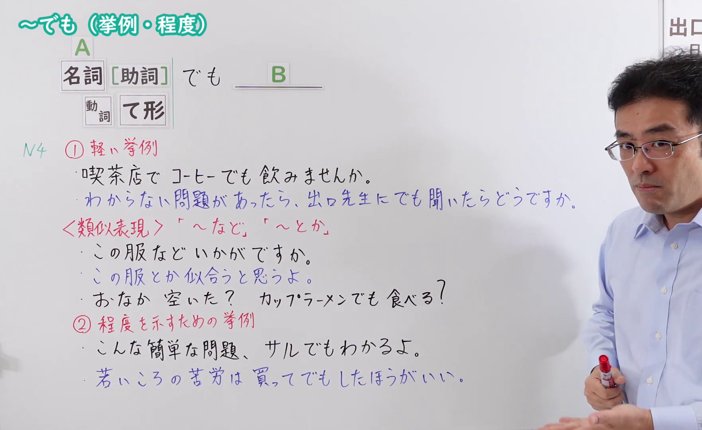
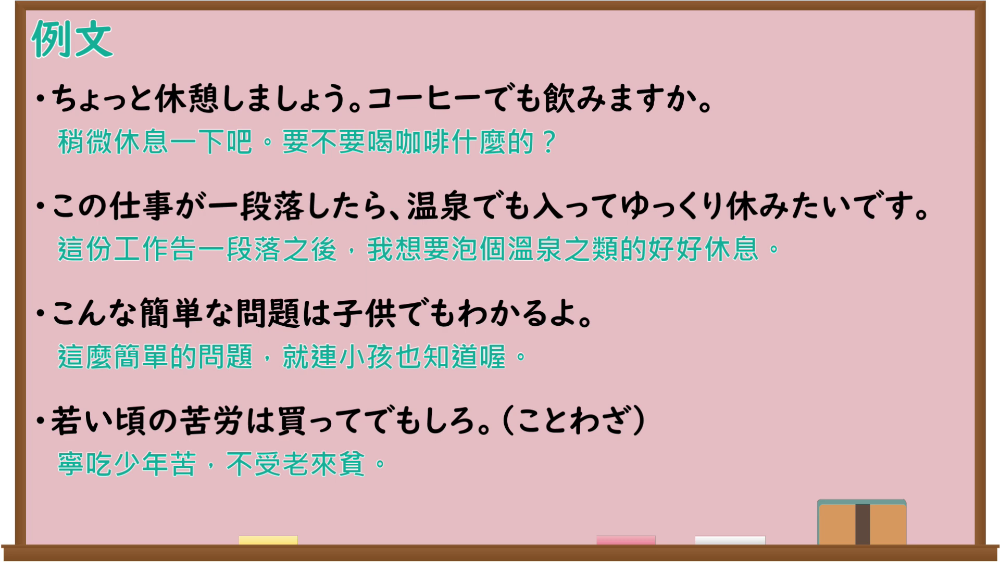

---
{
  "id": "N4-G-0098",
  "kind": "grammar",
  "level": "N4",
  "title": "～でも（挙例・程度）",
  "card_revision": 1,
  "schema_version": 1,
  "source": {
    "lesson": "N4 第98个语法",
    "material": "出口日語原视频板书、YouTube 原 WebVTT（中文为主、日语为辅）与Hagoromo及日文教学网页正文",
    "video": "https://www.youtube.com/watch?v=c7KMbhVK_x8",
    "screenshot": "assets/grammar/n4/N4-G-0098-connection.png",
    "screenshot_seconds": 350.00,
    "screenshot_crop": {
      "x": 0,
      "y": 0,
      "width": 1762,
      "height": 1080
    }
  },
  "tags": [
    "取り立て助詞",
    "でも",
    "挙例",
    "N4"
  ],
  "confusions": [
    "～など（類似表現）",
    "～とか（類似表現）",
    "～てでも（極端な手段）"
  ]
}
---

# ～でも（挙例・程度）

## 视频学习资料整理

原视频：[[N4 Grammar] Even though (examples/degree)](https://www.youtube.com/watch?v=c7KMbhVK_x8)

**接续图**：真实时间 350.00 秒（5:50），原图尺寸 1920×1080，裁切区域 x=0、y=0、宽1762、高1080（固定左上角，收拢右下角，裁去右侧人像与空白；①②两组说明、類似表現与全部例句完整）。

**例句图**：真实时间 488.76 秒（8:08），原图尺寸 1920×1080，未裁切（整幅画面）。

# 核心

## 功能一：①軽い挙例（轻轻举出一例：～之类的）

**最上位意味カテゴリー：**

- **でも：** ものごとの関係（事物的关系）

**中位意味カテゴリー：**

- **でも：** 例示（例示）

**意味：**

- **でも：** 例示（例示）

**くわしい意味記述：**

- **でも：** 何かの提案で１例を挙げる時に使われる。（在某个提议中举出一个例子时使用。）

**派生語：** 未列出

### 例句

1. お茶でも飲もう。

   （喝点茶之类的吧。）

2. あのカフェにでも入りませんか。

   （要不要进那家咖啡馆坐坐？）

3. 私もね正直言って疲れましたしね、のんびり孫の世話でもして暮しましょう。

   （我也说实话累了，就悠闲地照看照看孙子过日子吧。）

## 功能二：②程度を示すための挙例（为表示程度而举出极端的例子：连～都）

**くわしい意味記述：**

- **名詞＋でも（類推）：** XでもYの形をとって、Xという極端な例を出して、ほかは当然であることを表す。（采取「XでもY」的形式，举出X这个极端的例子，表示其他的情况当然也是如此。）
- **動詞て形＋でも：** 「AてでもB」は「Aのためなら、どんな手段でもとる」「Bを実現するためなら、Aという大変な手段を使う」という意味の文型です。「A」には、普通ではしないような極端なことが入ります。（「AてでもB」是表示「为了A的话，什么手段都采取」「为了实现B的话，使用A这个很费劲的手段」的句型。「A」中放入平时不会做的极端的事情。）

### 例句

1. こんなこと猿でもわかるよ。

   （这种事连猴子都懂。）

2. こんな問題子供でも解けるよ。

   （这样的问题连小孩都能解开。）

3. 私にでもできるんだから、パソコンが得意な田中さんなら絶対にできますよ。

   （连我都会做，所以擅长电脑的田中先生绝对也能做。）

4. 仕事を休んででも、新しいゲームを買いに行きたい。

   （为了去买新游戏，就算请假也要去。）

5. あそこのラーメンは、また並んででも食べたいわ。

   （那家的拉面，就算要再排队也想吃。）

# 来源

- [出口日語原视频](https://www.youtube.com/watch?v=c7KMbhVK_x8)
- [Hagoromo「でも（取り立て助詞・例示）」](https://hagoromo-text.work/lookup?vid=871)（查询日期：2026-09-25）
- [助詞シリーズ「でも」【例示】・【類推】](https://jp19vlog.com/postpositional-particle-demo/)（查询日期：2026-09-25，用于「名詞＋でも」的極端な例示）
- [〜てでも｜絵でわかる日本語](https://www.edewakaru.com/archives/20976678.html)（查询日期：2026-09-25，用于「動詞て形＋でも」）
