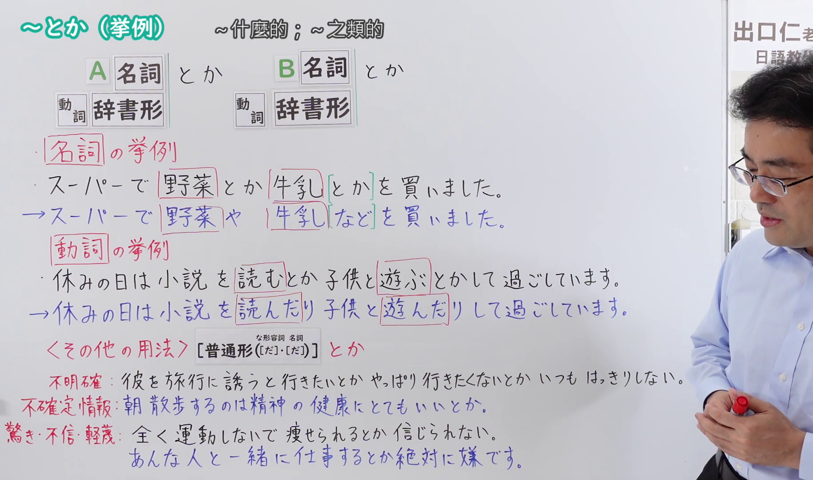
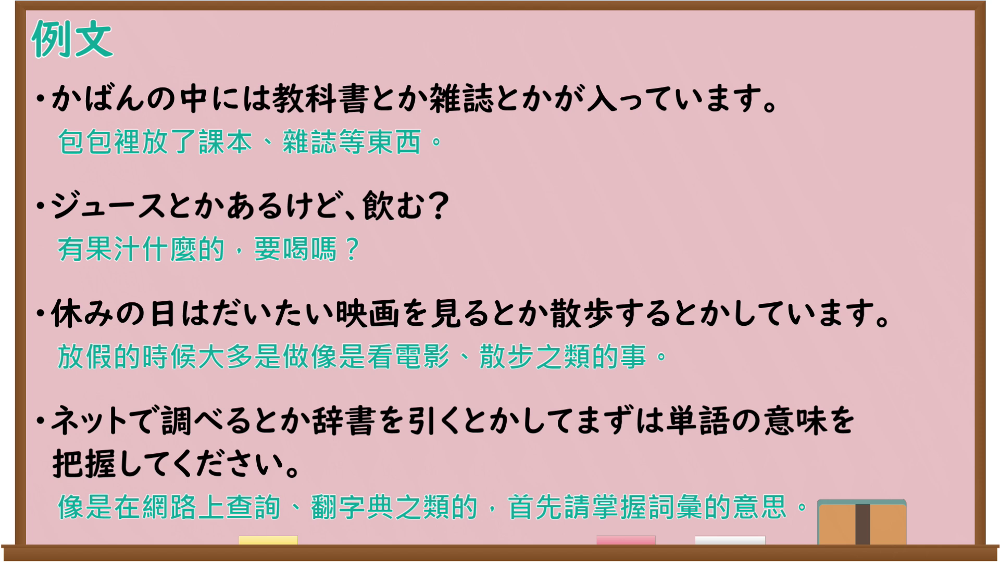

---
{
  "id": "N4-G-0099",
  "kind": "grammar",
  "level": "N4",
  "title": "～とか（挙例）",
  "card_revision": 1,
  "schema_version": 1,
  "source": {
    "lesson": "N4 第99个语法",
    "material": "出口日語原视频板书、YouTube 原 WebVTT（中文为主、日语为辅）与Hagoromo正文",
    "video": "https://www.youtube.com/watch?v=sIcBHSyQY9s",
    "screenshot": "assets/grammar/n4/N4-G-0099-connection.png",
    "screenshot_seconds": 354.80,
    "screenshot_crop": {
      "x": 0,
      "y": 0,
      "width": 1830,
      "height": 1080
    }
  },
  "tags": [
    "並立助詞",
    "とか",
    "挙例",
    "N4"
  ],
  "confusions": [
    "～たり～たり（並列・反復）",
    "～とかいう（伝聞）",
    "～など（例示）"
  ]
}
---

# ～とか（挙例）

## 视频学习资料整理

原视频：[[N4 Grammar] ~toka (Examples)](https://www.youtube.com/watch?v=sIcBHSyQY9s)

**接续图**：真实时间 354.80 秒（5:54），原图尺寸 1920×1080，裁切区域 x=0、y=0、宽1830、高1080（固定左上角，收拢右下角，裁去右侧人像与空白；名詞・動詞两组挙例及〈その他の用法〉全部板书完整）。

**例句图**：真实时间 385.58 秒（6:25），原图尺寸 1920×1080，未裁切（整幅画面）。

# 核心

## 功能一：〔名詞〕の挙例・〔動詞〕の挙例（列举名词、动词的例子：～之类的）

**最上位意味カテゴリー：**

- **とか（〜とか）：** ものごとの関係（事物的关系）

**中位意味カテゴリー：**

- **とか（〜とか）：** 例示（例示）

**意味：**

- **とか（〜とか）：** 例示（例示）

**くわしい意味記述：**

- **とか（〜とか）：** 例を示す時に使う。「〜とか…とか」の「〜」と「…」は，同類のものである場合が多いが，対立する言葉である場合もある。同類の例をあげる場合は，二つ目の例を言わないこともある。（用于举例。「〜とか…とか」的「〜」和「…」多为同类事物，但也有是对立词语的情况。举同类例子时，有时也省略第二个例子不说。）

**派生語：** とか〜とか

### 例句

1. 彼はジョギングとかスキーとか、外でするスポーツが得意だ。

   （他擅长慢跑、滑雪之类在户外做的运动。）

2. 私、アイスクリームとか、好きなのよね。

   （我啊，喜欢冰淇淋之类的。）

3. やせたいなら、甘いものをひかえるとか、運動するとかするといい。

   （想瘦的话，控制甜食、做做运动之类的就好。）

4. 黙ってないで、面白いとかつまらないとか、なんか感想を言ってくれるといいのにね。

   （别沉默，有趣啊无聊啊之类的，随便说点感想就好了。）

## 功能二：〈その他の用法〉不確定情報（其他用法：不确定的信息——传闻）

**最上位意味カテゴリー：**

- **とか：** ものごとの関係（事物的关系）
- **とかいうことだ：** ものごとの関係（事物的关系）

**中位意味カテゴリー：**

- **とか：** 伝聞・引用（传闻与引用）
- **とかいうことだ：** 伝聞・引用（传闻与引用）

**意味：**

- **とか：** 伝聞（传闻）
- **とかいうことだ：** 伝聞（传闻）

**くわしい意味記述：**

- **とか：** 伝聞を表す。私的な文脈で用いられることが多い。（表示传闻。多用于私人性的语境。）
- **とかいうことだ：** 他の人から聞いたことを表すが，それが不確かである時に用いる。（表示从别人那里听来的事情，用于该内容不确定的时候。）

**派生語：** 未列出

### 例句

1. 北海道は昨日大雪だったとか。

   （听说北海道昨天下了大雪。）

2. 田中さんのおじいさんは、海外に長く住んでいたとかいうことだ。

   （听说田中先生的爷爷曾在国外长住。）

3. 雪で期末試験が延期になったとかいうことで、春休みが短くなった。

   （据说因为大雪期末考延期，春假变短了。）

# 来源

- [出口日語原视频](https://www.youtube.com/watch?v=sIcBHSyQY9s)
- [Hagoromo「とか（〜とか）」](https://hagoromo-text.work/lookup?vid=978)（查询日期：2026-09-25）
- [Hagoromo「とか（伝聞）」](https://hagoromo-text.work/lookup?vid=977)（查询日期：2026-09-25）
- [Hagoromo「とかいうことだ」](https://hagoromo-text.work/lookup?vid=981)（查询日期：2026-09-25）
