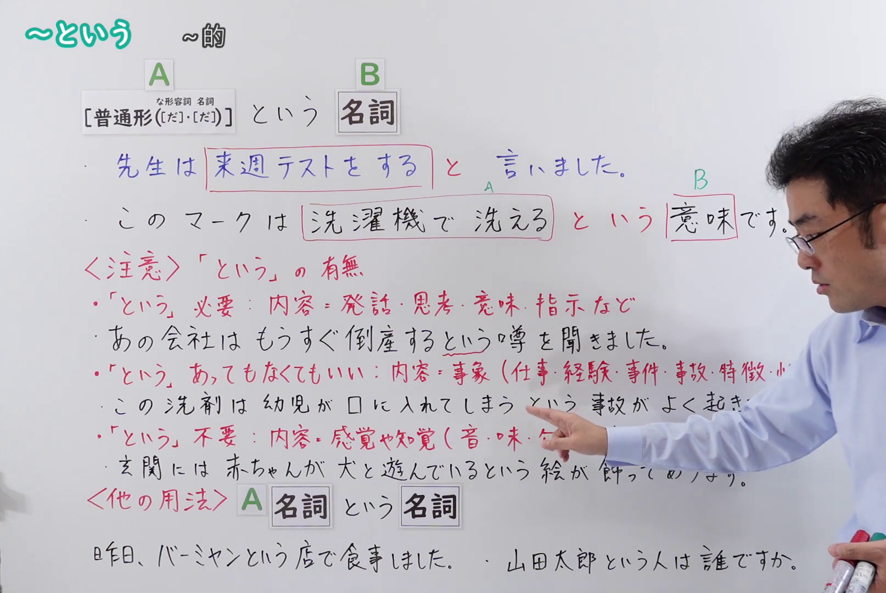
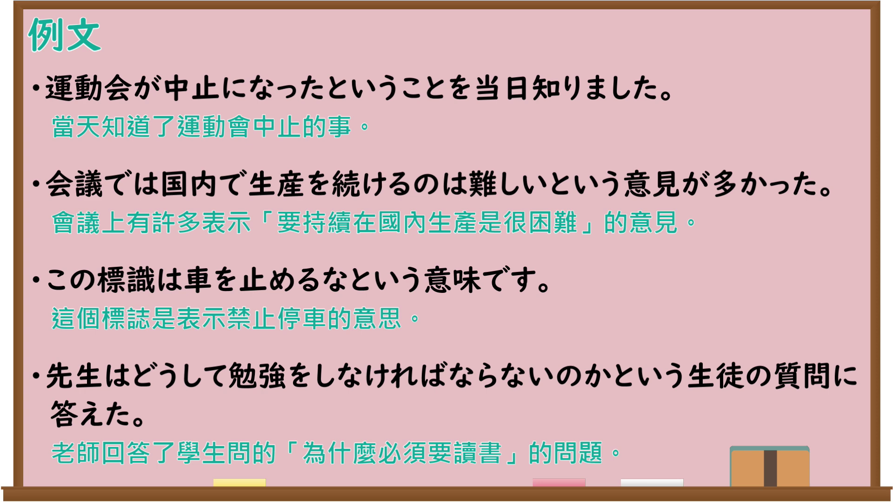

---
{
  "id": "N4-G-0101",
  "kind": "grammar",
  "level": "N4",
  "title": "～という",
  "card_revision": 1,
  "schema_version": 1,
  "source": {
    "lesson": "N4 第101个语法",
    "material": "出口日語原视频板书、Bilibili P101音频的本地中文／日语混合转写 WebVTT 与Hagoromo正文",
    "video": "https://www.youtube.com/watch?v=5oMr9M1uDmk",
    "screenshot": "assets/grammar/n4/N4-G-0101-connection.png",
    "screenshot_seconds": 233.25,
    "screenshot_crop": {
      "x": 0,
      "y": 0,
      "width": 1614,
      "height": 1080
    }
  },
  "tags": [
    "引用",
    "同格",
    "N4"
  ],
  "confusions": [
    "～というN（名称の導入）",
    "～というのは",
    "～ということ"
  ]
}
---

# ～という

## 视频学习资料整理

原视频：[【Ｎ４文法】～という](https://www.youtube.com/watch?v=5oMr9M1uDmk)

**接续图**：真实时间 233.25 秒（3:53），原图尺寸 1920×1080，裁切区域 x=0、y=0、宽1614、高1080（固定左上角，收拢右下角，裁去右侧人像与空白）。

**例句图**：真实时间 452.37 秒（7:32），原图尺寸 1920×1080，未裁切（整幅画面）。

# 核心

## 功能一：A（普通形）＋という＋B（名詞）（表示B所指的内容就是A）

**最上位意味カテゴリー：**

- **～という：** ものごとの関係（事物的关系）

**中位意味カテゴリー：**

- **～という：** 伝聞・引用（传闻与引用）

**意味：**

- **～という：** 同格＝との（同格＝「との」）

**くわしい意味記述：**

- **～という：** 後の名詞の内容を述べる時に用いる。（用于陈述后面名词的内容。）

**派生語：** 未列出

### 例句

1. 田中さんが帰ってきたというしらせを受けた。

   （接到了田中先生回来了的消息。）

2. 他に複数の利用者が同様な掲示を見たという情報もある。

   （也有信息说，还有其他多名使用者看到了同样的告示。）

3. 実際、日本の高等教育の学力は低下し、国際的な競争力を失ったという声が高まって久しい。

   （实际上，「日本高等教育的学力下降、失去了国际竞争力」这样的声音高涨已久。）

## 功能二：A（名詞）＋という＋B（名詞）（向对方说明其不知道的名称）

**最上位意味カテゴリー：**

- **～という：** ものごとの関係（事物的关系）

**中位意味カテゴリー：**

- **～という：** 説明（说明）

**意味：**

- **～という：** 名称の導入（名称的引入）

**くわしい意味記述：**

- **NというN：** 相手が知らない物や人の名前について述べるときの言い方。N1が具体物である物や人の名前，N2はN1が含まれる一般的な名詞である。（陈述对方不知道的物品或人名的说法。N1是具体的物品或人的名称，N2是包含N1的一般性名词。）

**派生語：** 未列出

### 例句

1. ルネという店で会いましょう。

   （在一家叫「ルネ」的店见面吧。）

2. ワシントンホテルプラザチェーンも昨年４月から「Ｒ＆Ｂ」という名前のホテルを東京と金沢、福岡でオープン。

   （华盛顿酒店广场连锁也从去年四月开始在东京、金泽、福冈开设了名为「Ｒ＆Ｂ」的酒店。）

3. 夫を指す日本独自の「背の君」という言葉はこのような観念の支配をみごとに示す一例だといえよう。

   （指称丈夫的日本特有的「背の君」一词，可以说是出色体现这种观念支配的一个例子。）

# 来源

- [出口日語原视频](https://www.youtube.com/watch?v=5oMr9M1uDmk)
- [Hagoromo「という（同格＝との）」](https://hagoromo-text.work/lookup?vid=910)（查询日期：2026-09-25）
- [Hagoromo「NというN（名称の導入）」](https://hagoromo-text.work/lookup?vid=913)（查询日期：2026-09-25）
