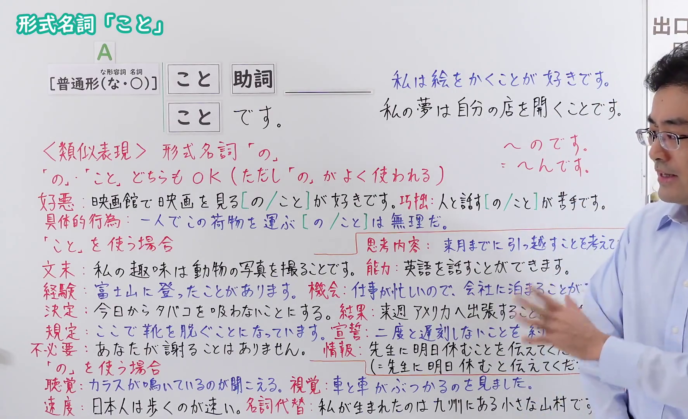
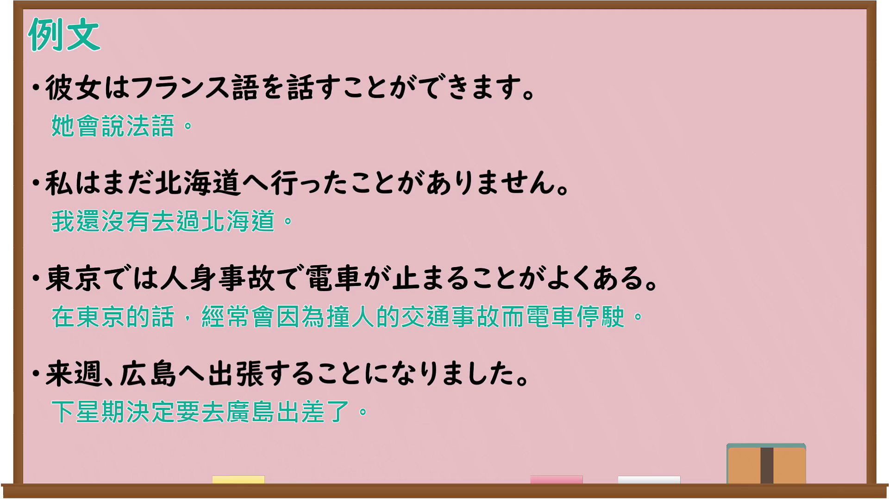

---
{
  "id": "N4-G-0102",
  "kind": "grammar",
  "level": "N4",
  "title": "形式名詞「こと」・「の」（文の名詞化）",
  "card_revision": 1,
  "schema_version": 1,
  "source": {
    "lesson": "N4 第102个语法",
    "material": "出口日語原视频板书、Bilibili P102音频的本地中文／日语混合转写 WebVTT 与Hagoromo正文",
    "video": "https://www.bilibili.com/video/BV1t4411y7L3?p=102",
    "screenshot": "assets/grammar/n4/N4-G-0102-connection.png",
    "screenshot_seconds": 664.45,
    "screenshot_crop": {
      "x": 0,
      "y": 0,
      "width": 1774,
      "height": 1080
    }
  },
  "tags": [
    "形式名詞",
    "名詞化",
    "N4"
  ],
  "confusions": [
    "ことにする・ことになる",
    "たことがある",
    "ことができる"
  ]
}
---

# 形式名詞「こと」・「の」（文の名詞化）

## 视频学习资料整理

原视频：[【Ｎ４文法】形式名詞「こと」](https://www.bilibili.com/video/BV1t4411y7L3?p=102)

**接续图**：真实时间 664.45 秒（11:04），原图尺寸 1920×1080，裁切区域 x=0、y=0、宽1774、高1080（固定左上角，收拢右下角，裁去右侧人像与空白）。

**例句图**：真实时间 700.00 秒（11:40），原图尺寸 1920×1080，未裁切（整幅画面）。

# 核心

## 功能一：A（普通形）＋こと（把句子名词化，使其能接续到只能接名词的表达）

**最上位意味カテゴリー：**

- **こと：** もの・こと（物与事）

**中位意味カテゴリー：**

- **こと：** 文法のことば（语法性词语）

**意味：**

- **こと：** 文の名詞化（句子的名词化）

**くわしい意味記述：**

- **こと：** 文を名詞化し，名詞にしか接続しない表現に接続できるようにする。（把句子名词化，使其能够接续到只能接名词的表达上。）

**派生語：** 未列出

### 例句

1. 私がここにいることをだれから聞きましたか。

   （你从谁那里听说我在这里的？）

2. 日本語の本を読むことも重要です。

   （读日语书也很重要。）

3. 本論において言及された日本社会の諸現象の多くは、断片的には、多くの人々がすでに指摘したり、また十分経験したりしていることである。

   （本论中提到的日本社会的诸多现象，就片段而言，许多是许多人已经指出过、也充分经历过的。）

## 功能二：A（普通形）＋の（把句子名词化，含主观色彩的句子多用「の」）

**最上位意味カテゴリー：**

- **の：** もの・こと（物与事）

**中位意味カテゴリー：**

- **の：** 文法のことば（语法性词语）

**意味：**

- **の：** 文の名詞化（句子的名词化）

**くわしい意味記述：**

- **の：** 文を名詞化する。「〜こと」と同じだが，主観を含んだ文では「の」が用いられやすい。（把句子名词化。与「〜こと」相同，但包含主观色彩的句子中更易使用「の」。）

**派生語：** 未列出

### 例句

1. あんな所へ行くのはいやです。

   （我不想去那种地方。）

2. 社会のあるところ必ず構造がある、というのが私たち社会人類学者の確信である。

   （有社会的地方必定有结构，这是我们社会人类学者的确信。）

3. その構造（言語における文法にあたるもの）を見つけ出し、理論化して、諸社会のそれと比較しながら、人類のもつ社会というものを考えていくのが、社会人類学の仕事である。

   （找出这种结构（相当于语言中的语法），将其理论化，与各社会的相应结构进行比较，进而思考人类所具有的社会，这就是社会人类学的工作。）

# 来源

- [出口日語原视频](https://www.bilibili.com/video/BV1t4411y7L3?p=102)
- [Hagoromo「こと（形式名詞）」](https://hagoromo-text.work/lookup?vid=505)（查询日期：2026-09-25）
- [Hagoromo「の（形式名詞）」](https://hagoromo-text.work/lookup?vid=1383)（查询日期：2026-09-25）
