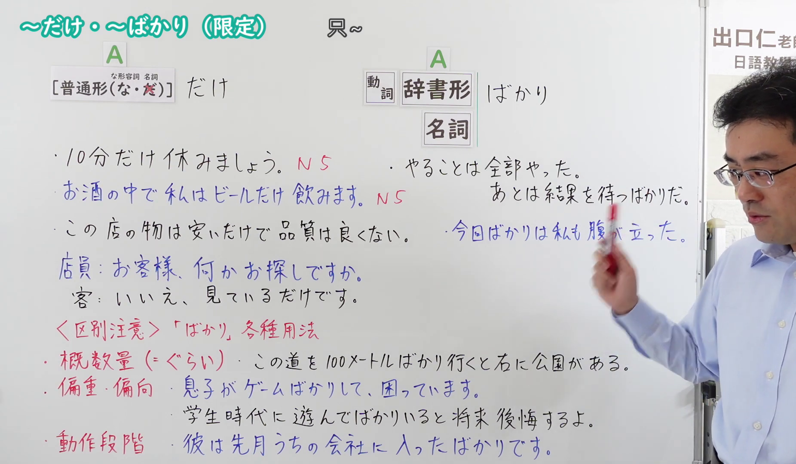
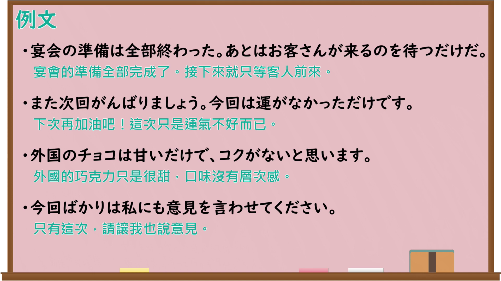

---
{
  "id": "N4-G-0103",
  "kind": "grammar",
  "level": "N4",
  "title": "～だけ・～ばかり（限定）",
  "card_revision": 1,
  "schema_version": 1,
  "source": {
    "lesson": "N4 第103个语法",
    "material": "出口日語原视频板书、Bilibili P103音频的本地中文／日语混合转写 WebVTT 与Hagoromo正文",
    "video": "https://www.youtube.com/watch?v=1PspwNinYes",
    "screenshot": "assets/grammar/n4/N4-G-0103-connection.png",
    "screenshot_seconds": 374.15,
    "screenshot_crop": {
      "x": 0,
      "y": 0,
      "width": 1852,
      "height": 1080
    }
  },
  "tags": [
    "限定",
    "取り立て助詞",
    "N4"
  ],
  "confusions": [
    "ばかり（概数量＝くらい）",
    "ばかり（偏重・偏向）",
    "ばかり（動作段階）",
    "だけしか〜ない"
  ]
}
---

# ～だけ・～ばかり（限定）

## 视频学习资料整理

原视频：[【Ｎ４文法】～だけ・～ばかり（限定）](https://www.youtube.com/watch?v=1PspwNinYes)

**接续图**：真实时间 374.15 秒（6:14），原图尺寸 1920×1080，裁切区域 x=0、y=0、宽1852、高1080（固定左上角，收拢右下角，裁去右侧人像与空白）。

**例句图**：真实时间 424.04 秒（7:04），原图尺寸 1920×1080，未裁切（整幅画面）。

# 核心

## 功能一：A（動詞・イA・ナA・名詞）＋だけ（限定：除此之外没有）

**最上位意味カテゴリー：**

- **だけ：** ものごとの関係（事物的关系）

**中位意味カテゴリー：**

- **だけ：** 限定（限定）

**意味：**

- **だけ：** 限定（限定）

**くわしい意味記述：**

- **だけ：** 「それ以外はない」という意味。範囲を限定するときに使う。（表示「除此之外没有」的意思。用于限定范围。）

**派生語：** 未列出

### 例句

1. 男の子が一人だけいます。

   （只有一个男孩。）

2. くだものだけ食べました。

   （只吃了水果。）

3. もう準備はできた。あとは結果を待つだけだ。

   （已经准备好了。剩下的就是等结果了。）

## 功能二：A（動詞る・動詞て・名詞）＋ばかり（限定：老是…，尽是…，含批评语气）

**最上位意味カテゴリー：**

- **ばかり：** ものごとの関係（事物的关系）

**中位意味カテゴリー：**

- **ばかり：** 限定（限定）

**意味：**

- **ばかり：** 限定（限定）

**くわしい意味記述：**

- **ばかり：** 「〜だけ」「〜以外はしない／ない」という意味。あることを批判して言うときに使う。（表示「只是…」「除了…以外不做／没有」。用于对某事进行批评时。）

**派生語：** 未列出

### 例句

1. この子は毎日テレビばかり見ています。

   （这孩子每天光看电视。）

2. 状況証拠ばかりで、実際にどうかっていうのはわかんないわけですね。

   （尽是些状况证据，实际情况如何并不清楚。）

3. 知らない人ばかりになる。

   （尽是些不认识的人。）

4. 運動ばかりやっていたから就職もできない。

   （因为光顾着运动，所以也找不到工作。）

# 来源

- [出口日語原视频](https://www.youtube.com/watch?v=1PspwNinYes)
- [Hagoromo「だけ（限定）」](https://hagoromo-text.work/lookup?vid=683)（查询日期：2026-09-25）
- [Hagoromo「ばかり（限定）」](https://hagoromo-text.work/lookup?vid=1447)（查询日期：2026-09-25）
