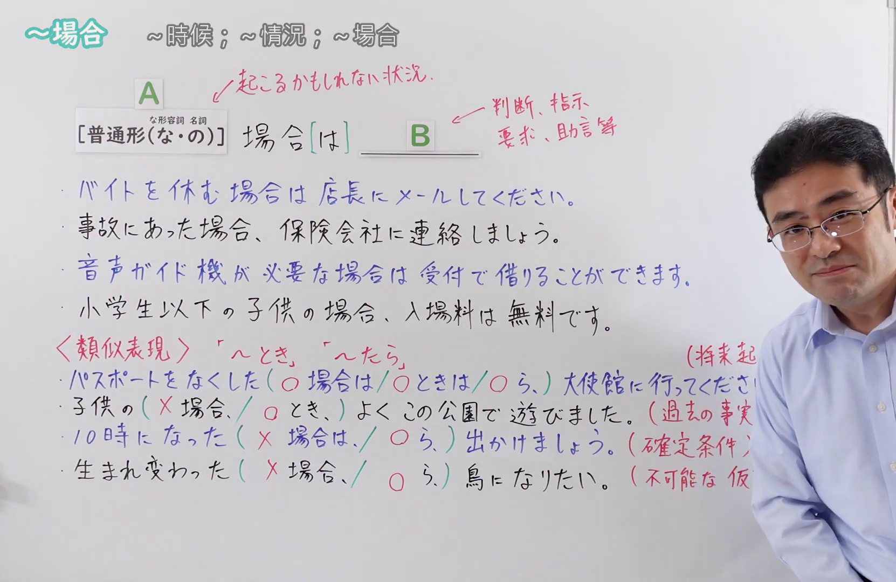
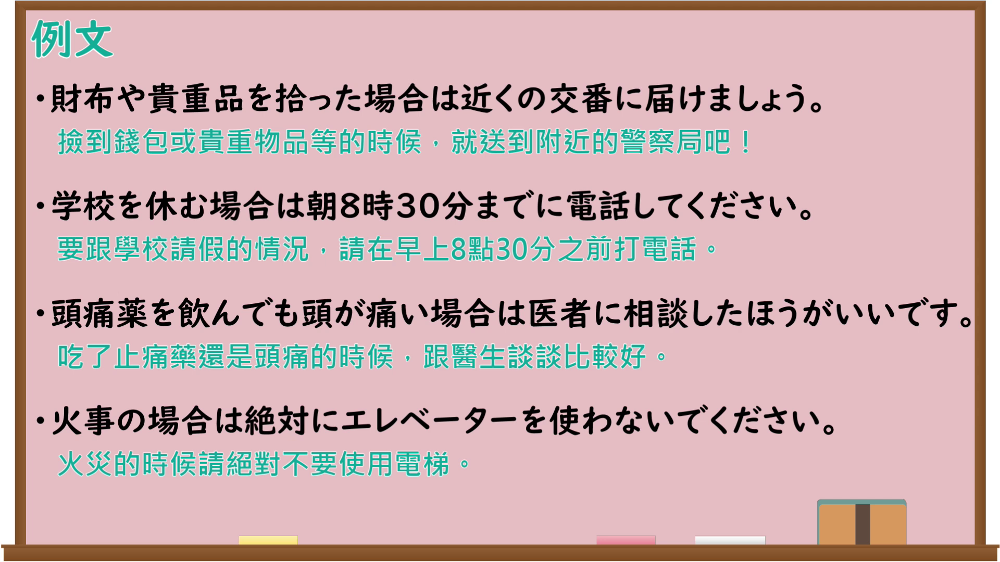

---
{
  "id": "N4-G-0104",
  "kind": "grammar",
  "level": "N4",
  "title": "～場合",
  "card_revision": 1,
  "schema_version": 1,
  "source": {
    "lesson": "N4 第104个语法",
    "material": "出口日語原视频板书、Bilibili P104音频的本地中文／日语混合转写 WebVTT 与Hagoromo正文",
    "video": "https://www.youtube.com/watch?v=xvXxsRFvAto",
    "screenshot": "assets/grammar/n4/N4-G-0104-connection.png",
    "screenshot_seconds": 428.5,
    "screenshot_crop": {
      "x": 0,
      "y": 0,
      "width": 1662,
      "height": 1080
    }
  },
  "tags": [
    "仮定",
    "場面",
    "N4"
  ],
  "confusions": [
    "～とき",
    "～たら",
    "～ばあいは（条件形との違い）"
  ]
}
---

# ～場合

## 视频学习资料整理

原视频：[【Ｎ４文法】～場合](https://www.youtube.com/watch?v=xvXxsRFvAto)

**接续图**：真实时间 428.50 秒（7:08），原图尺寸 1920×1080，裁切区域 x=0、y=0、宽1662、高1080（固定左上角，收拢右下角，裁去右侧人像与空白）。

**例句图**：真实时间 459.62 秒（7:39），原图尺寸 1920×1080，未裁切（整幅画面）。

# 核心

## 功能一：A（普通形・名詞＋の）＋場合［は］＋B（表示「遇到A这种情况时，就做B」，比「とき」更具假定性）

**最上位意味カテゴリー：**

- **ばあい：** 場所・時間（地点与时间）

**中位意味カテゴリー：**

- **ばあい：** 時点・場面（时间点与场面）

**意味：**

- **ばあい：** 場面・場合（场面与情况）

**くわしい意味記述：**

- **ばあい：** 「〜ときは」という意味を表す。「とき」よりも仮定的な意味を表す。（表示「〜的时候」的意思。比「とき」更具假定性。）

**派生語：** 未列出

### 例句

1. 朝7時までに電車が動かない場合は、午前中の授業は休講になります。

   （如果早上7点前电车还不开动，上午的课就停课。）

2. 車の場合そんなに苦じゃない。

   （如果是开车的话，就没那么辛苦。）

3. わたしの場合ほら、すぐ教えにいったから、一番最初から社会活動じゃない。

   （就我而言，你看，因为马上去教了，从一开始就是社会活动嘛。）

4. サリドマイドの場合は本当にひどかったわけでしょう、さ、副作用が。

   （萨利窦迈的情况就真的很严重吧，那副作用。）

# 来源

- [出口日語原视频](https://www.youtube.com/watch?v=xvXxsRFvAto)
- [Hagoromo「ばあい（場面・場合）」](https://hagoromo-text.work/lookup?vid=1439)（查询日期：2026-09-25）
