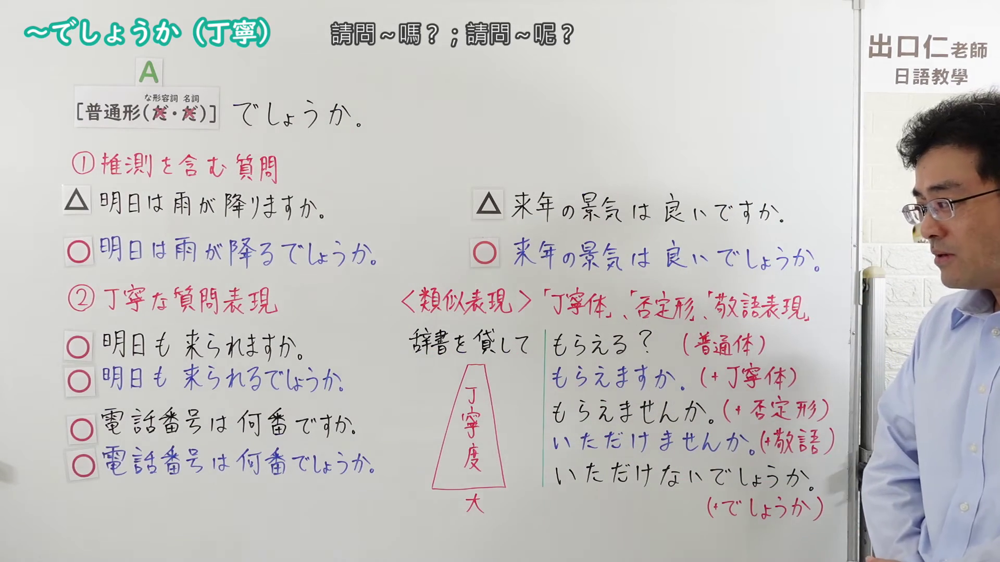
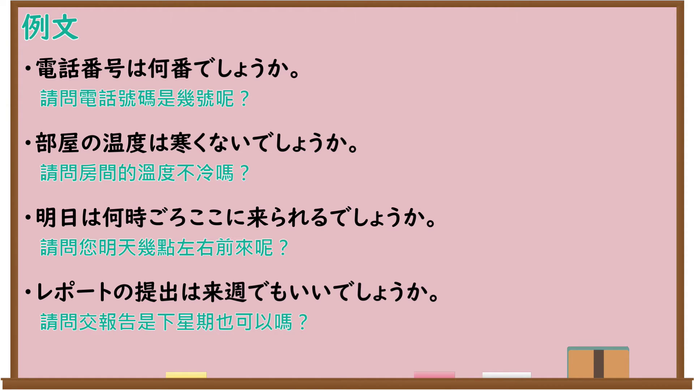

---
{
  "id": "N4-G-0105",
  "kind": "grammar",
  "level": "N4",
  "title": "～でしょうか（丁寧）",
  "card_revision": 1,
  "schema_version": 1,
  "source": {
    "lesson": "N4 第105个语法",
    "material": "出口日語原视频板书、Bilibili P105音频的本地中文／日语混合转写 WebVTT 与Hagoromo正文",
    "video": "https://www.youtube.com/watch?v=2hK7NSXWctU",
    "screenshot": "assets/grammar/n4/N4-G-0105-connection.png",
    "screenshot_seconds": 437.23,
    "screenshot_crop": {
      "x": 0,
      "y": 0,
      "width": 1920,
      "height": 1080
    }
  },
  "tags": [
    "丁寧",
    "問いかけ",
    "N4"
  ],
  "confusions": [
    "～でしょう（推量）",
    "～ですか",
    "～ませんか"
  ]
}
---

# ～でしょうか（丁寧）

## 视频学习资料整理

原视频：[【Ｎ４文法】～でしょうか（丁寧）](https://www.youtube.com/watch?v=2hK7NSXWctU)

**接续图**：真实时间 437.23 秒（7:17），原图尺寸 1920×1080，未裁切（整幅画面）。

**例句图**：真实时间 495.52 秒（8:15），原图尺寸 1920×1080，未裁切（整幅画面）。

# 核心

## 功能一：A（普通形）＋でしょうか（「ですか」的礼貌体：礼貌地询问或确认）

**最上位意味カテゴリー：**

- **でしょうか：** 人との関係（人际关系）

**中位意味カテゴリー：**

- **でしょうか：** 問いかけ（提问）

**意味：**

- **でしょうか：** 確認（确认）

**くわしい意味記述：**

- **でしょうか：** 「ですか」の丁寧体。（「ですか」的礼貌体。）

**派生語：** 未列出

### 例句

1. A:お客様、ご注文は以上でしょうか。B:はい。

   （A：客人，您点的就是这些吗？B：是的。）

2. 四百枚の作品を書いて、せいぜい四枚か五枚というところでしょうか。

   （写了四百页的作品，大概也就不过四五页吧。）

3. 芸術など最たる例でしょうか。

   （艺术大概是最典型的例子吧。）

4. 今年もやっぱり帰って来ないんでしょうかね。

   （今年果然也不会回来了吧。）

# 来源

- [出口日語原视频](https://www.youtube.com/watch?v=2hK7NSXWctU)
- [Hagoromo「でしょうか（確認）」](https://hagoromo-text.work/lookup?vid=2050)（查询日期：2026-09-25）
