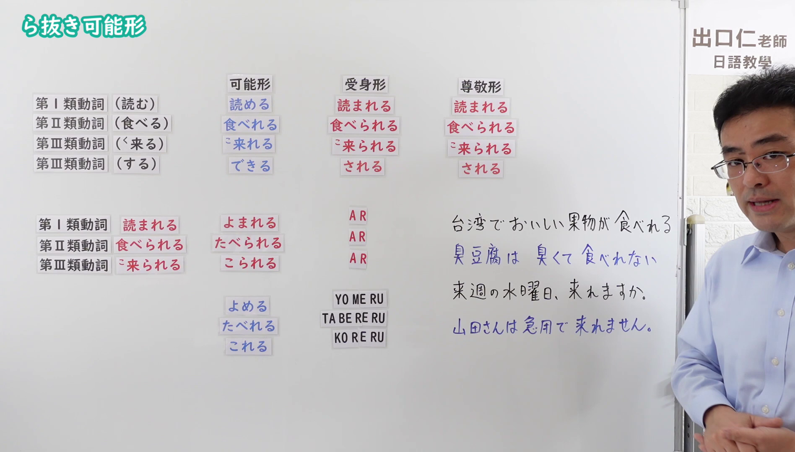
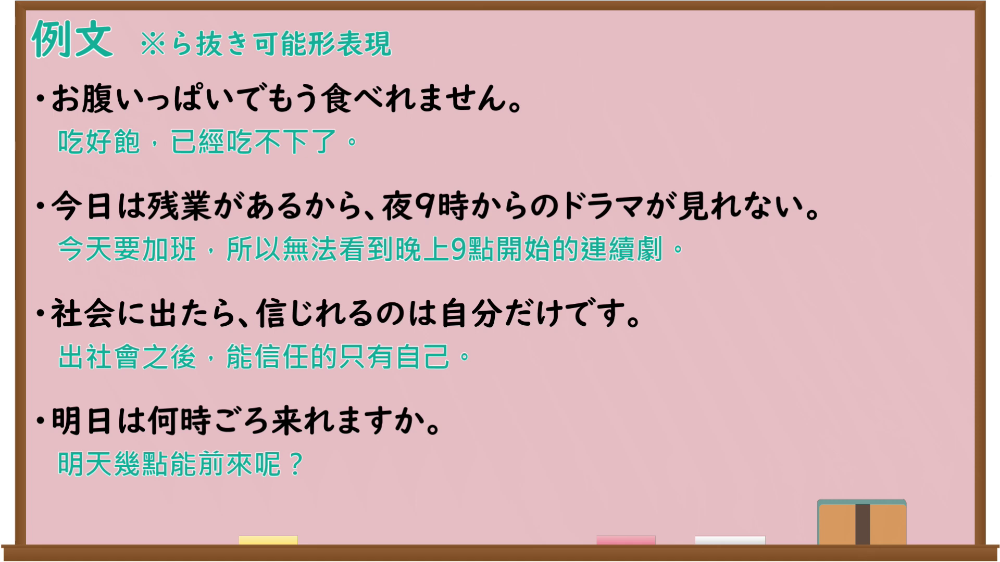

---
{
  "id": "N4-G-0106",
  "kind": "grammar",
  "level": "N4",
  "title": "ら抜き可能形（ら抜き言葉）",
  "card_revision": 1,
  "schema_version": 1,
  "source": {
    "lesson": "N4 第106个语法",
    "material": "出口日語原视频板书、Bilibili P106音频的本地中文／日语混合转写 WebVTT 与wordrabbit及nihongo-appliedlinguistics正文",
    "video": "https://www.youtube.com/watch?v=SQ9ea741S2k",
    "screenshot": "assets/grammar/n4/N4-G-0106-connection.png",
    "screenshot_seconds": 800.5,
    "screenshot_crop": {
      "x": 0,
      "y": 0,
      "width": 1896,
      "height": 1080
    }
  },
  "tags": [
    "可能形",
    "ら抜き言葉",
    "N4"
  ],
  "confusions": [
    "受身形「〜られる」",
    "尊敬形「〜られる」",
    "五段動詞の可能形「〜える」"
  ]
}
---

# ら抜き可能形（ら抜き言葉）

## 视频学习资料整理

原视频：[【Ｎ４文法】ら抜き可能形（ら抜き言葉）](https://www.youtube.com/watch?v=SQ9ea741S2k)

**接续图**：真实时间 800.50 秒（13:20），原图尺寸 1920×1080，裁切区域 x=0、y=0、宽1896、高1080（固定左上角，收拢右下角，裁去右侧人像与空白）。

**例句图**：真实时间 849.48 秒（14:09），原图尺寸 1920×1080，未裁切（整幅画面）。

# 核心

## 功能一：一段活用動詞の可能形「〜（ら）れる」（ら抜き言葉：省略「ら」的说法）

**くわしい意味記述：**

- **ら抜き言葉：** 「ら抜き言葉」とは、可能の意味を持つ「られる」から「ら」が抜けて「食べれる」「考えれる」のようになった表現のことです。本来必要な「ら」が省略されていることから、「ら抜き言葉」と呼ばれています。例えば、「見られる」「来られる」が、ら抜きになると「見れる」「来れる」のように変化します。（所谓「ら抜き言葉」，是指表示可能的「られる」脱落「ら」，变成「食べれる」「考えれる」这样的说法。因为本来必需的「ら」被省略了，所以称为「ら抜き言葉」。例如「見られる」「来られる」变成ら抜き说法时，就成了「見れる」「来れる」。）
- **ら抜きが起こる理由：** 一段活用動詞の「られる」という形は、可能だけでなく、受身・尊敬の意味でも使われます。（一段活用动词的「られる」这一形式不仅表示可能，也表示被动、尊敬。）

### 例句

1. このレストランでは、新鮮な魚介類を食べれる。

   （在这家餐厅可以吃到新鲜的海鲜。标准说法为「食べられる」。）

2. 疲れていても朝は早く起きれる。

   （即使很累，早上也能早起。标准说法为「起きられる」。）

3. 友人が週末に私の家に来れると知って、準備を始めた。

   （知道朋友周末能来我家，就开始做准备了。标准说法为「来られる」。）

4. 不要なものは簡単に捨てれる。

   （不需要的东西能轻松扔掉。标准说法为「捨てられる」。）

# 来源

- [出口日語原视频](https://www.youtube.com/watch?v=SQ9ea741S2k)
- [wordrabbit「「ら抜き言葉」の一覧・例と見分け方。間違いなのか」](https://wordrabbit.jp/blog/2)（查询日期：2026-09-25）
- [nihongo-appliedlinguistics「ら抜きことばとは？ら抜きことばの例と、ら抜きが起こる理由」](https://www.nihongo-appliedlinguistics.net/wp/archives/8624)（查询日期：2026-09-25）
