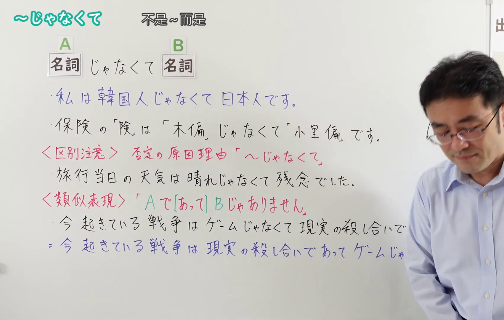
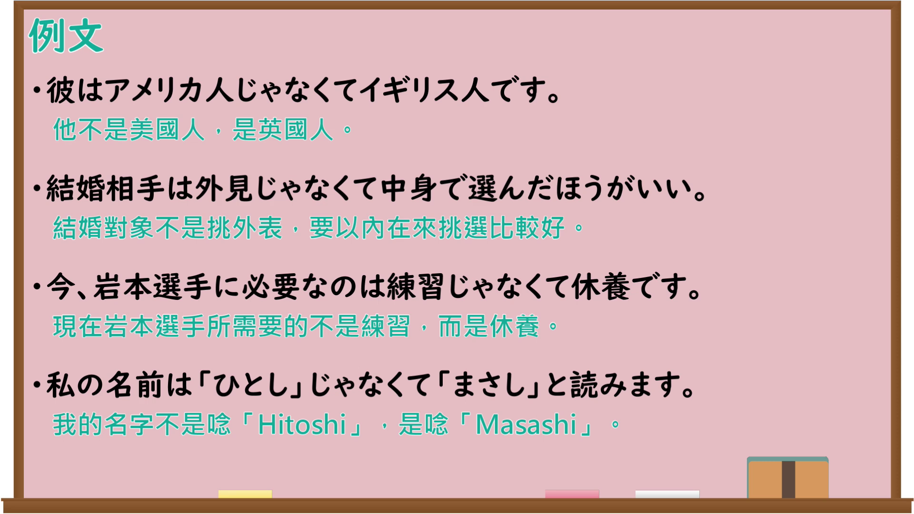

---
{
  "id": "N4-G-0107",
  "kind": "grammar",
  "level": "N4",
  "title": "～じゃなくて（～ではなく）",
  "card_revision": 1,
  "schema_version": 1,
  "source": {
    "lesson": "N4 第107个语法",
    "material": "出口日語原视频板书、Bilibili P107音频的本地中文／日语混合转写 WebVTT 与Hagoromo正文",
    "video": "https://www.youtube.com/watch?v=XvA-6R_4TR4",
    "screenshot": "assets/grammar/n4/N4-G-0107-connection.png",
    "screenshot_seconds": 1.0,
    "screenshot_crop": {
      "x": 0,
      "y": 0,
      "width": 1702,
      "height": 1080
    }
  },
  "tags": [
    "否定",
    "対比",
    "N4"
  ],
  "confusions": [
    "～じゃなくて（否定の原因理由）",
    "～で［あって］〜じゃありません",
    "～ではなくて（口語形）"
  ]
}
---

# ～じゃなくて（～ではなく）

## 视频学习资料整理

原视频：[【Ｎ４文法】～じゃなくて](https://www.youtube.com/watch?v=XvA-6R_4TR4)

**接续图**：真实时间 1.00 秒（0:01），原图尺寸 1920×1080，裁切区域 x=0、y=0、宽1702、高1080（固定左上角，收拢右下角，裁去右侧人像与空白）。

**例句图**：真实时间 242.00 秒（4:02），原图尺寸 1920×1080，未裁切（整幅画面）。

# 核心

## 功能一：A（名詞）じゃなくて B（名詞）（否定A，再说出正确的B）

**最上位意味カテゴリー：**

- **ではなく：** ものごとの様子（事物的样态）

**中位意味カテゴリー：**

- **ではなく：** 否定（否定）

**意味：**

- **ではなく：** 否定（否定）

**くわしい意味記述：**

- **ではなく：** あることを否定して，あとに正しいことを述べる時に用いる。（否定某一点，并在后面陈述正确内容时使用。）

**派生語：** 未列出

### 例句

1. 卒業記念パーティーはいつもの会場ではなく、今年は別の会場で行われることになっています。

   （毕业纪念聚会不在平时的会场，今年决定在别的会场举行。）

2. 高速道路に限らず、巨大な施設の安全を確保するのは、機器ではなく人間だ。

   （不仅高速公路，确保巨大设施安全的不是机器，而是人。）

3. ピンマイクではなくて、そのもの、本体にもうマイクが内蔵されてる、これと同じなんですけど、

   （不是领夹麦克风，是那个，本体里已经内置了麦克风，和这个是一样的。）

# 来源

- [出口日語原视频](https://www.youtube.com/watch?v=XvA-6R_4TR4)
- [Hagoromo「ではなく（否定）」](https://hagoromo-text.work/lookup?vid=857)（查询日期：2026-09-25）
