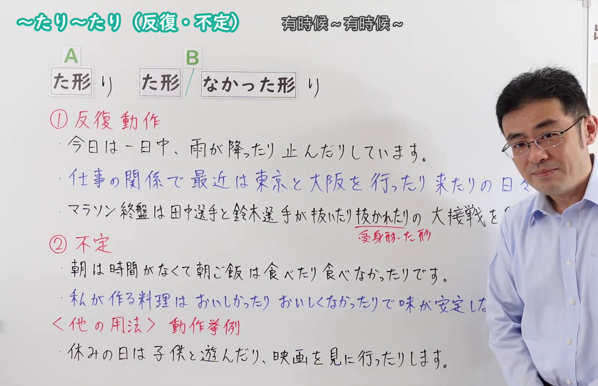
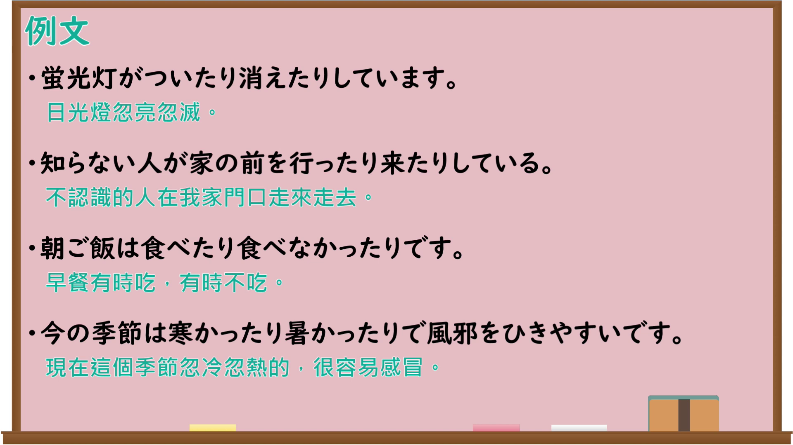

---
{
  "id": "N4-G-0108",
  "kind": "grammar",
  "level": "N4",
  "title": "～たり～たり（反復・不定）",
  "card_revision": 1,
  "schema_version": 1,
  "source": {
    "lesson": "N4 第108个语法",
    "material": "出口日語原视频板书、Bilibili P108音频的本地中文／日语混合转写 WebVTT 与Hagoromo正文",
    "video": "https://www.youtube.com/watch?v=EvtY9ac6Umw",
    "screenshot": "assets/grammar/n4/N4-G-0108-connection.png",
    "screenshot_seconds": 278.14,
    "screenshot_crop": {
      "x": 0,
      "y": 0,
      "width": 1672,
      "height": 1080
    }
  },
  "tags": [
    "並列",
    "反復",
    "N4"
  ],
  "confusions": [
    "～たり～たりする（文末「する」）",
    "～し（並列）",
    "～とか～とか"
  ]
}
---

# ～たり～たり（反復・不定）

## 视频学习资料整理

原视频：[【Ｎ４文法】～たり～たり（反復・不定）](https://www.youtube.com/watch?v=EvtY9ac6Umw)

**接续图**：真实时间 278.14 秒（4:38），原图尺寸 1920×1080，裁切区域 x=0、y=0、宽1672、高1080（固定左上角，收拢右下角，裁去右侧人像与空白）。

**例句图**：真实时间 283.07 秒（4:43），原图尺寸 1920×1080，未裁切（整幅画面）。

# 核心

## 功能一：A（た形）り ＋ B（た形）り（反復・習慣：列举多个反复出现或分别发生的事例）

**最上位意味カテゴリー：**

- **たり〜たり：** ものごとの関係（事物的关系）

**中位意味カテゴリー：**

- **たり〜たり：** 並列・反復（并列与反复）

**意味：**

- **たり〜たり：** 繰り返し・習慣（反复与习惯）

**くわしい意味記述：**

- **たり〜たり：** 複数の出来事の例をあげる時に使う。その例は別々の時間にしたことでも構わないし，別々の人がしたことでも構わない。（用于列举多个事件的例子。这些例子可以是不同时间做的事，也可以是不同的人做的事。）

**派生語：** 未列出

### 例句

1. 彼女は音楽が好きなようで、毎日、ＣＤを聞いたり歌を歌ったりピアノをひいたりしている。

   （她好像很喜欢音乐，每天听CD、唱歌、弹钢琴。）

2. さっきからあの人、何回も何回も行ったり来たりしてるな。

   （刚才起那个人就一次又一次地来回走。）

3. だれかが傷ついたり、淋しい思いをしたりしたとしても、仕方がないことだってあるんじゃないのかなア。

   （就算有人受伤、有人感到寂寞，也有无可奈何的时候吧。）

## 功能二：A（た形）り ＋ B（た形）り＋する（不定：把若干行为或情况并列着举出）

**最上位意味カテゴリー：**

- **たり〜たりする：** ものごとの関係（事物的关系）

**中位意味カテゴリー：**

- **たり〜たりする：** 並列・反復（并列与反复）

**意味：**

- **たり〜たりする：** 不定（不定）

**くわしい意味記述：**

- **たり〜たりする：** いろいろなことをするとき，またはいろいろなことが起こるときに，そのうちのいくつかを並べて示すときに使う。（在做各种各样的事，或发生各种各样的事时，用于并列举出其中的若干项。）

**派生語：** 未列出

### 例句

1. 本をよんだり、音楽を聞いたりしました。

   （读了书，听了音乐。）

2. もし旅先で病気になったり、つらい目にあったりしたら、またこの間みたいに来てくれる？

   （如果在旅途中生病了，或是遇到难过的事，你还会像上次那样来吗？）

3. 俺が馬鹿にしたりからかったりしてる訳じゃねぇじゃないかよ。

   （我又不是在嘲笑你、拿你开玩笑啊。）

# 来源

- [出口日語原视频](https://www.youtube.com/watch?v=EvtY9ac6Umw)
- [Hagoromo「たり〜たり（繰り返し・習慣）」](https://hagoromo-text.work/lookup?vid=26)（查询日期：2026-09-25）
- [Hagoromo「たり〜たりする（不定）」](https://hagoromo-text.work/lookup?vid=746)（查询日期：2026-09-25）
