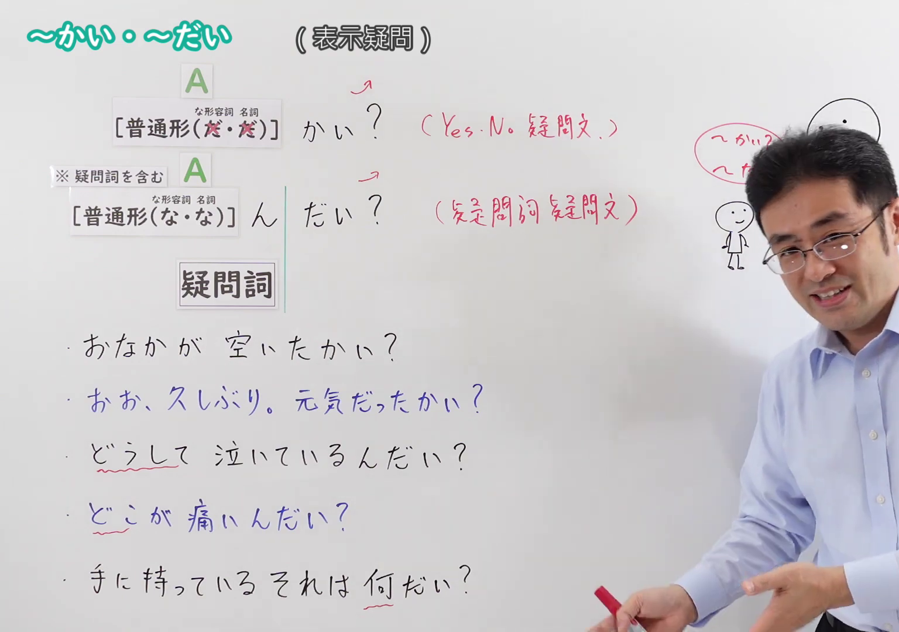
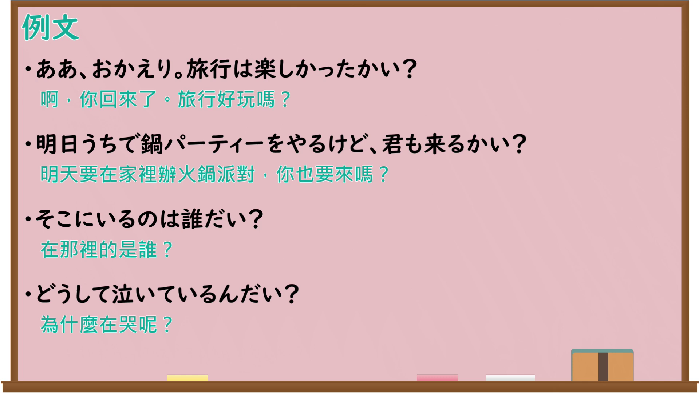

---
{
  "id": "N4-G-0109",
  "kind": "grammar",
  "level": "N4",
  "title": "～かい・～だい",
  "card_revision": 1,
  "schema_version": 1,
  "source": {
    "lesson": "N4 第109个语法",
    "material": "出口日語原视频板书、Bilibili P109音频的本地中文／日语混合转写 WebVTT 与Hagoromo正文",
    "video": "https://www.youtube.com/watch?v=8_5zZaqj7iA",
    "screenshot": "assets/grammar/n4/N4-G-0109-connection.png",
    "screenshot_seconds": 331.65,
    "screenshot_crop": {
      "x": 0,
      "y": 0,
      "width": 1536,
      "height": 1080
    }
  },
  "tags": [
    "終助詞",
    "疑問",
    "N4"
  ],
  "confusions": [
    "～か（普通の疑問）",
    "～だい（疑問詞と共起）",
    "～かしら"
  ]
}
---

# ～かい・～だい

## 视频学习资料整理

原视频：[【Ｎ４文法】～かい・～だい](https://www.youtube.com/watch?v=8_5zZaqj7iA)

**接续图**：真实时间 331.65 秒（5:31），原图尺寸 1920×1080，裁切区域 x=0、y=0、宽1536、高1080（固定左上角，收拢右下角，裁去右侧人像与空白）。

**例句图**：真实时间 375.87 秒（6:15），原图尺寸 1920×1080，未裁切（整幅画面）。

# 核心

## 功能一：A（普通形）＋かい（「か」的口语变体，构成是非疑问句，带男性语感）

**最上位意味カテゴリー：**

- **かい：** 人との関係（人际关系）

**中位意味カテゴリー：**

- **かい：** 問いかけ（提问）

**意味：**

- **かい：** 問いかけ（提问）

**くわしい意味記述：**

- **かい：** 疑問の終助詞「か」の話し言葉でのバリエーション。男性的な性格を帯びる。（疑问终助词「か」在口语中的变体。带有男性化的语感。）

**派生語：** 未列出

### 例句

1. このウィスキー、飲むかい。

   （这威士忌，喝吗？）

2. きょううちに来ないかい？

   （今天不来我家吗？）

3. 回して取るんかい。

   （是转着取的吗？）

4. 奈良と大阪は、ちょっと違うんじゃないかい。

   （奈良和大阪不是有点不一样吗？）

## 功能二：疑問表現（どう・だれ・何・いつ など）＋だい（与疑问词呼应，构成疑问词疑问句）

**最上位意味カテゴリー：**

- **だい：** 人との関係（人际关系）

**中位意味カテゴリー：**

- **だい：** 問いかけ（提问）

**意味：**

- **だい：** 問いかけ（提问）

**くわしい意味記述：**

- **だい：** 疑問表現「どう」「だれ」「何」「いつ」などとともに上昇調のイントネーションで，「ちょっと休んだらどうだい？」「あの人は誰だい？」「この荷物は何だい？」「いつ帰ったんだい？/帰ったのはいつ（なん）だい？」「今何時（なん）だい？」のように使い，「〜ですか」と同じ意味を持つ。（与「どう」「だれ」「何」「いつ」等疑问表达一起，用上升语调使用，如「ちょっと休んだらどうだい？」「あの人は誰だい？」「この荷物は何だい？」「いつ帰ったんだい？／帰ったのはいつ（なん）だい？」「今何時（なん）だい？」，意思与「〜ですか」相同。）

**派生語：** 未列出

### 例句

1. どうしたんだい。そんな顔して。

   （怎么了？摆着那样一副表情。）

2. 結局さ何が違うんだい?、この2つって。

   （说到底，这两个到底哪里不一样？）

3. 誰だい、あの飛入りは……。

   （那个混进来的人是谁啊……）

4. 宮さん、あの金剛石の指環をはめていた奴はどうだい、いやに気取った奴じゃないか。

   （宫先生，那个戴着金钢石戒指的家伙怎么样，不是个特别装腔作势的家伙吗。）

# 来源

- [出口日語原视频](https://www.youtube.com/watch?v=8_5zZaqj7iA)
- [Hagoromo「かい（問いかけ）」](https://hagoromo-text.work/lookup?vid=368)（查询日期：2026-09-25）
- [Hagoromo「だい（問いかけ）」](https://hagoromo-text.work/lookup?vid=666)（查询日期：2026-09-25）
