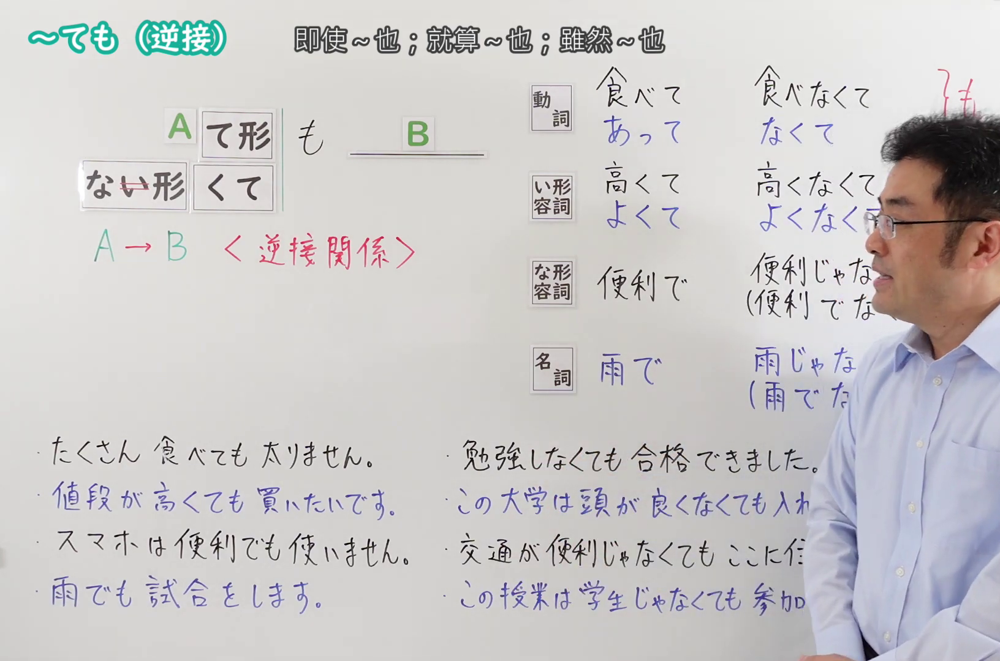
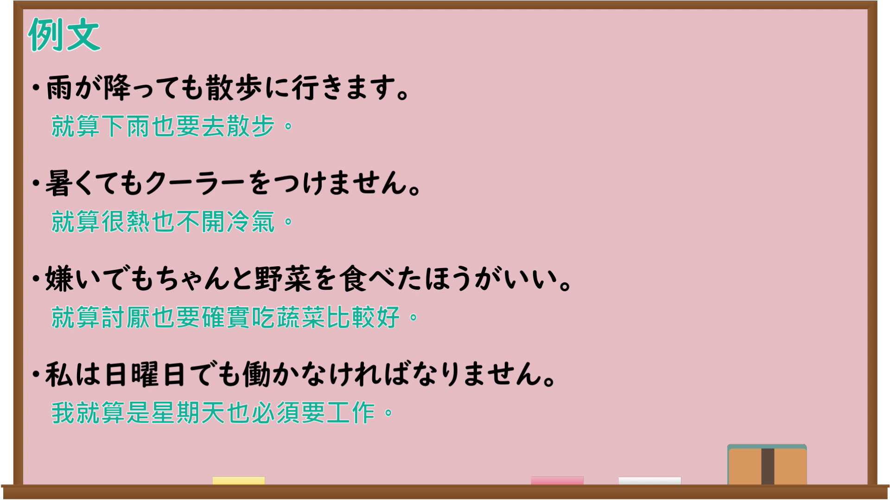

---
{
  "id": "N4-G-0110",
  "kind": "grammar",
  "level": "N4",
  "title": "～ても（逆接）",
  "card_revision": 1,
  "schema_version": 1,
  "source": {
    "lesson": "N4 第110个语法",
    "material": "出口日語原视频板书、Bilibili P110音频的本地中文／日语混合转写 WebVTT 与Hagoromo正文",
    "video": "https://www.youtube.com/watch?v=jhs9ftJJPAw",
    "screenshot": "assets/grammar/n4/N4-G-0110-connection.png",
    "screenshot_seconds": 323.65,
    "screenshot_crop": {
      "x": 0,
      "y": 0,
      "width": 1632,
      "height": 1080
    }
  },
  "tags": [
    "逆接",
    "譲歩",
    "N4"
  ],
  "confusions": [
    "～てもいい（許可）",
    "～のに",
    "～ても〜ても"
  ]
}
---

# ～ても（逆接）

## 视频学习资料整理

原视频：[【Ｎ４文法】～ても（逆接）](https://www.youtube.com/watch?v=jhs9ftJJPAw)

**接续图**：真实时间 323.65 秒（5:23），原图尺寸 1920×1080，裁切区域 x=0、y=0、宽1632、高1080（固定左上角，收拢右下角，裁去右侧人像与空白）。

**例句图**：真实时间 339.60 秒（5:39），原图尺寸 1920×1080，未裁切（整幅画面）。

# 核心

## 功能一：A（て形／なくて）＋も＋B（逆接：即使A，结果仍然是B）

**最上位意味カテゴリー：**

- **ても：** ものごとの関係（事物的关系）

**中位意味カテゴリー：**

- **ても：** 逆接・譲歩（逆接与让步）

**意味：**

- **ても：** 逆接：譲歩（逆接：让步）

**くわしい意味記述：**

- **ても：** 前の内容からは予想できないが，それでも後ろの内容になる，ということを表す。うまくいかない，という内容が続くことが多い。（表示虽然从前面的内容无法预想，但结果仍然是后面的内容。后面常接表示不顺利的内容。）

**派生語：** 未列出

### 例句

1. このような言葉は辞書を引いても、わかりません。

   （这样的词即使查字典也不明白。）

2. 牛は引っぱってもついてこない。

   （牛就算用力拉也不跟过来。）

3. 表は固く閉ざしていても、枝折戸を開けておくというのが日本人の癖である。

   （即使正门紧闭，也把旁门开着，这是日本人的习惯。）

4. 上記の馬の場合、人間が保護しようと思って近づいても蹴りとばす。

   （上面说的那匹马的情况，即使人想保护它而靠近，它也会踢开。）

# 来源

- [出口日語原视频](https://www.youtube.com/watch?v=jhs9ftJJPAw)
- [Hagoromo「ても（逆接：譲歩）」](https://hagoromo-text.work/lookup?vid=869)（查询日期：2026-09-25）
