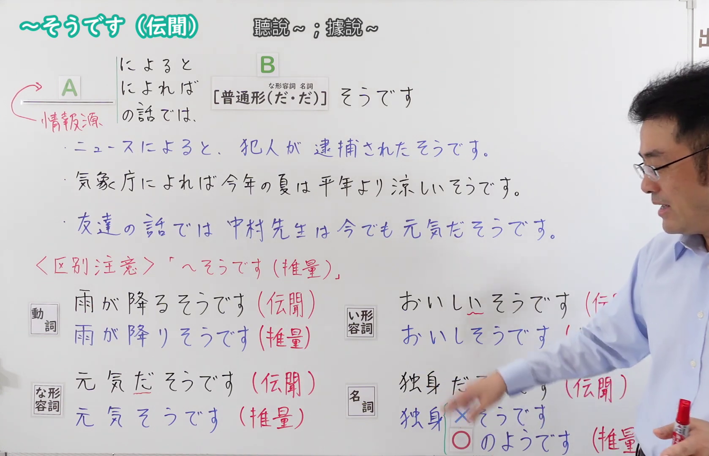
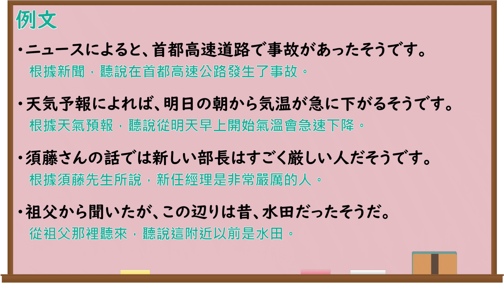

---
{
  "id": "N4-G-0111",
  "kind": "grammar",
  "level": "N4",
  "title": "～そうです（伝聞）",
  "card_revision": 1,
  "schema_version": 1,
  "source": {
    "lesson": "N4 第111个语法",
    "material": "出口日語原视频板书、Bilibili P111音频的本地中文／日语混合转写 WebVTT 与Hagoromo正文",
    "video": "https://www.youtube.com/watch?v=SE37VlrlGQc",
    "screenshot": "assets/grammar/n4/N4-G-0111-connection.png",
    "screenshot_seconds": 341.15,
    "screenshot_crop": {
      "x": 0,
      "y": 0,
      "width": 1678,
      "height": 1080
    }
  },
  "tags": [
    "伝聞",
    "N4"
  ],
  "confusions": [
    "～そうです（推量・様態）",
    "～らしい（伝聞・推量）"
  ]
}
---

# ～そうです（伝聞）

## 视频学习资料整理

原视频：[【Ｎ４文法】～そうです（伝聞）](https://www.youtube.com/watch?v=SE37VlrlGQc)

**接续图**：真实时间 341.15 秒（5:41），原图尺寸 1920×1080，裁切区域 x=0、y=0、宽1678、高1080（固定左上角，收拢右下角，裁去右侧人像与空白）。

**例句图**：真实时间 386.64 秒（6:26），原图尺寸 1920×1080，未裁切（整幅画面）。

# 核心

## 功能一：A（情報源「によると／によれば／の話では」）＋B（普通形）＋そうです（表示从A听说B）

**最上位意味カテゴリー：**

- **～そうです：** ものごとの関係（事物的关系）
- **によると～そうだ：** ものごとの関係（事物的关系）

**中位意味カテゴリー：**

- **～そうです：** 伝聞・引用（传闻与引用）
- **によると～そうだ：** 伝聞・引用（传闻与引用）

**意味：**

- **～そうです：** 伝聞（传闻）
- **によると～そうだ：** 伝聞（传闻）

**くわしい意味記述：**

- **～そうです：** 伝聞を表す。丁寧体で使うことが多い。普通体の話し言葉では「って」を使うことが多い。（表示传闻。多用于礼貌体。普通体的口语中多用「って」。）
- **によると～そうだ：** 伝聞を表す。「…によると」の「…」は伝聞情報を得た情報源を表す。（表示传闻。「…によると」中的「…」表示获得传闻消息的信息来源。）

**派生語：** 未列出

### 例句

1. 天気予報によると、明日は大雪になるそうです。

   （据天气预报说，明天会下大雪。）

2. その時のお話によると、日本とアメリカの大学生に数学の文章題を解かせてみたところ、日本の大学生のほうが正解率が高かったそうです。

   （据当时那番话所说，让日本和美国的大学生做数学应用题，结果日本大学生的正确率更高。）

3. 先月八日のお昼過ぎ、買物に出たきり消息が分らないそうです。

   （据说上个月八日过了中午以后，出门买东西就一直没有消息。）

4. ある人によると、それはまるで敬語の見本市のようだそうです。

   （据某人说，那简直就像是敬语的展销会。）

# 来源

- [出口日語原视频](https://www.youtube.com/watch?v=SE37VlrlGQc)
- [Hagoromo「そうだ（伝聞）」](https://hagoromo-text.work/lookup?vid=626)（查询日期：2026-09-25）
- [Hagoromo「によると～そうだ」](https://hagoromo-text.work/lookup?vid=2)（查询日期：2026-09-25）
