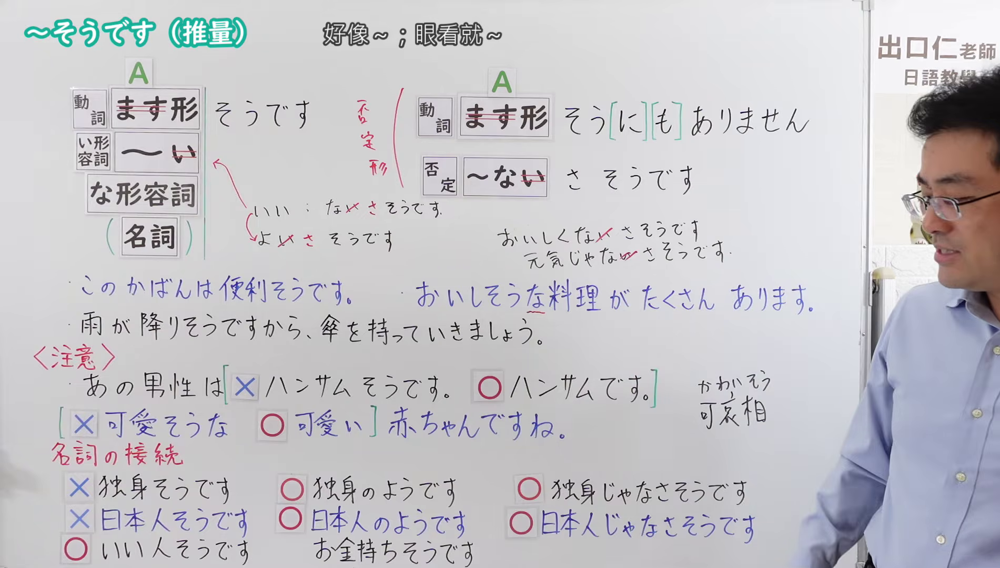
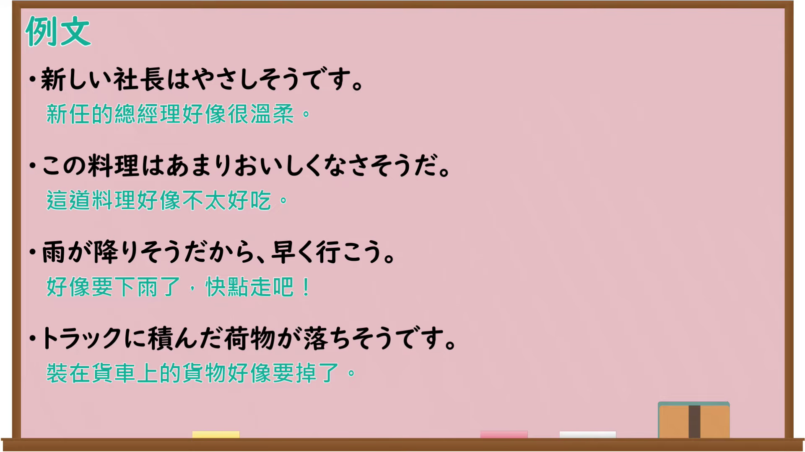

---
{
  "id": "N4-G-0112",
  "kind": "grammar",
  "level": "N4",
  "title": "～そうです（推量・様態）",
  "card_revision": 1,
  "schema_version": 1,
  "source": {
    "lesson": "N4 第112个语法",
    "material": "出口日語原视频板书、Bilibili P112音频的本地中文／日语混合转写 WebVTT 与Hagoromo正文",
    "video": "https://www.youtube.com/watch?v=B0Db1Nniuj4",
    "screenshot": "assets/grammar/n4/N4-G-0112-connection.png",
    "screenshot_seconds": 721.0,
    "screenshot_crop": {
      "x": 0,
      "y": 0,
      "width": 1901,
      "height": 1080
    }
  },
  "tags": [
    "推量",
    "様態",
    "N4"
  ],
  "confusions": [
    "～そうです（伝聞）",
    "～ようです",
    "～みたいです"
  ]
}
---

# ～そうです（推量・様態）

## 视频学习资料整理

原视频：[【Ｎ４文法】～そうです（推量）](https://www.youtube.com/watch?v=B0Db1Nniuj4)

**接续图**：真实时间 721.00 秒（12:01），原图尺寸 1920×1080，裁切区域 x=0、y=0、宽1901、高1080（固定左上角，收拢右下角，裁去右侧人像与空白）。

**例句图**：真实时间 786.04 秒（13:06），原图尺寸 1920×1080，未裁切（整幅画面）。

# 核心

## 功能一：A（動詞ます形・イ形語幹・ナ形語幹）＋そうです（眼看就要…：从事物当前的样态判断即将发生变化）

**最上位意味カテゴリー：**

- **～そうです：** ものごとの様子（事物的样态）

**中位意味カテゴリー：**

- **～そうです：** 様子・状態（样态与状态）

**意味：**

- **～そうです：** 様子（样态）

**くわしい意味記述：**

- **～そうです：** 話し手が人・事物Xの様子を見て，それがVに変わる直前の状態であると判断していることを表す。（表示说话人看到人或事物X的样态，判断它正处于即将转变为V的前一刻。）

**派生語：** 未列出

### 例句

1. このセーターはあたたかそうだ。

   （这件毛衣看起来似乎很暖和。）

2. ボタンが取れそうだ。

   （扣子眼看就要掉了。）

3. この乗馬の仕方には諸説があるが、日本人は、いまのように後ろから見て左側から左足をかけて右足でまたいだというわけではなさそうである。

   （关于这种骑马的方式有各种说法，但日本人似乎并不是像现在这样从后面看、由左侧跨上左脚再用右脚跨过去。）

## 功能二：A（動詞ます形・イ形語幹・ナ形語幹）＋そうです（好像…：凭外观或迹象做出的推测判断）

**最上位意味カテゴリー：**

- **～そうです：** ものごとの様子（事物的样态）

**中位意味カテゴリー：**

- **～そうです：** 様子・状態（样态与状态）

**意味：**

- **～そうです：** 予想・判断（预想与判断）

**くわしい意味記述：**

- **～そうです：** ある人・事物Xについて，話し手が「はっきりと断言できないが，Yという様子や状態だろう」と判断・予測・推量していることを表す。（表示关于某人或某事物X，说话人做出「虽然无法明确断言，但大概是Y这种样态或状态吧」的判断、预测或推量。）

**派生語：** 未列出

### 例句

1. 低気圧が来ていますので、明日にかけて西日本は雨になりそうです。

   （因为低气压正在接近，到明天为止西日本似乎会下雨。）

2. 日本の経済はこれからよくなりそうだ。

   （日本的经济今后似乎会好转。）

3. 明日は何かいいことありそうだ。

   （明天似乎会有什么好事。）

# 来源

- [出口日語原视频](https://www.youtube.com/watch?v=B0Db1Nniuj4)
- [Hagoromo「そうだ（様子）」](https://hagoromo-text.work/lookup?vid=625)（查询日期：2026-09-25）
- [Hagoromo「そうだ（予想・判断）」](https://hagoromo-text.work/lookup?vid=627)（查询日期：2026-09-25）
