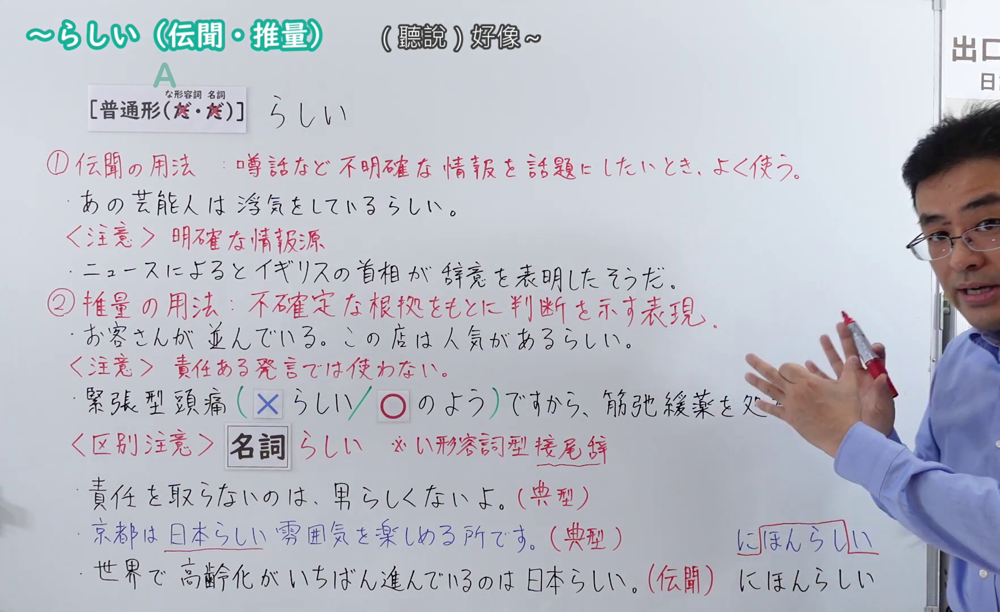
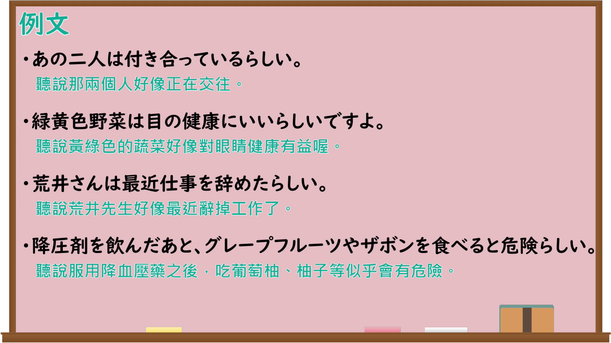

---
{
  "id": "N4-G-0113",
  "kind": "grammar",
  "level": "N4",
  "title": "～らしい（伝聞・推量）",
  "card_revision": 1,
  "schema_version": 1,
  "source": {
    "lesson": "N4 第113个语法",
    "material": "出口日語原视频板书、Bilibili P113音频的本地中文／日语混合转写 WebVTT 与毎日のんびり日本語教師正文",
    "video": "https://www.youtube.com/watch?v=6Fc6KLzWp9s",
    "screenshot": "assets/grammar/n4/N4-G-0113-connection.png",
    "screenshot_seconds": 529.33,
    "screenshot_crop": {
      "x": 0,
      "y": 0,
      "width": 1764,
      "height": 1080
    }
  },
  "tags": [
    "伝聞",
    "推量",
    "N4"
  ],
  "confusions": [
    "～そうです（伝聞）",
    "～ようです",
    "～らしい（典型）"
  ]
}
---

# ～らしい（伝聞・推量）

## 视频学习资料整理

原视频：[【Ｎ４文法】～らしい（伝聞・推量）](https://www.youtube.com/watch?v=6Fc6KLzWp9s)

**接续图**：真实时间 529.33 秒（8:49），原图尺寸 1920×1080，裁切区域 x=0、y=0、宽1764、高1080（固定左上角，收拢右下角，裁去右侧人像与空白）。

**例句图**：真实时间 640.00 秒（10:40），原图尺寸 1920×1080，未裁切（整幅画面）。

# 核心

## 功能一：A（普通形）＋らしい（传闻与推测：转述听来的消息，或根据状况做出客观推测）

**くわしい意味記述：**

- **～らしい：** 他人から聞いた情報や、状況から推測した客観的な情報を述べるときに用います。背景にはある程度信頼できる根拠があるので、可能性は比較的高いです。（用于陈述从他人那里听来的信息，或根据状况推测出的客观信息。因为背后有一定可信度的依据，所以可能性比较高。）

### 例句

1. Ａさんは明日誕生日らしいよ。

   （A先生明天好像是生日。）

2. 天気予報によると、明日は快晴らしい。

   （根据天气预报，明天好像是晴天。）

3. 彼は昇進したらしい。

   （据说他升职了。）

4. 明日は雪が降るらしい。

   （据说明天会下雪。）

5. あのレストランの料理が美味しいらしい。

   （据说那家餐厅的菜很好吃。）

# 来源

- [出口日語原视频](https://www.youtube.com/watch?v=6Fc6KLzWp9s)
- [毎日のんびり日本語教師「【Ｎ４文法】～らしい／らしく／らしくない」](https://mainichi-nonbiri.com/grammar/n4-rashii/)（查询日期：2026-09-25）
