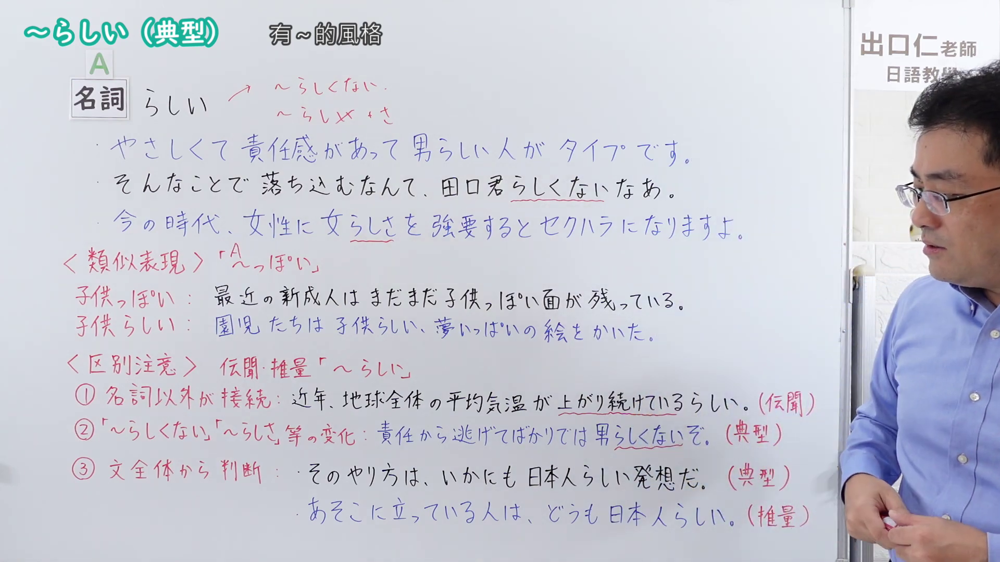
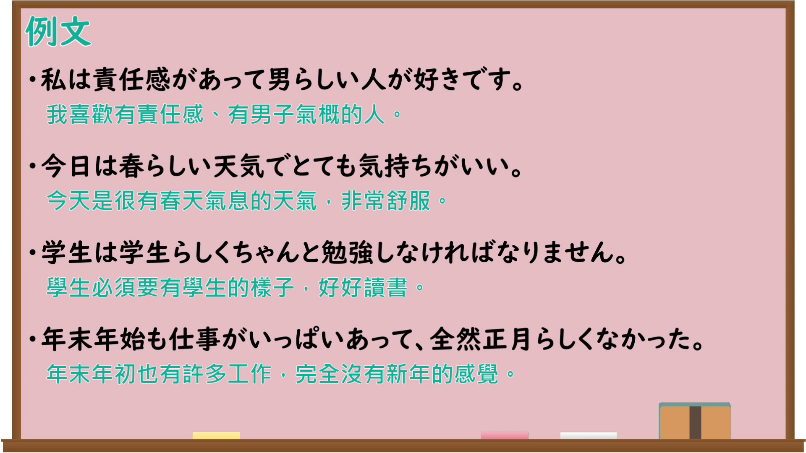

---
{
  "id": "N4-G-0114",
  "kind": "grammar",
  "level": "N4",
  "title": "～らしい（典型）",
  "card_revision": 1,
  "schema_version": 1,
  "source": {
    "lesson": "N4 第114个语法",
    "material": "出口日語原视频板书、Bilibili P114音频的本地中文／日语混合转写 WebVTT 与Hagoromo正文",
    "video": "https://www.youtube.com/watch?v=g9FSC5Am79Y",
    "screenshot": "assets/grammar/n4/N4-G-0114-connection.png",
    "screenshot_seconds": 564.15,
    "screenshot_crop": {
      "x": 0,
      "y": 0,
      "width": 1920,
      "height": 1080
    }
  },
  "tags": [
    "典型",
    "接尾辞",
    "N4"
  ],
  "confusions": [
    "～らしい（伝聞・推量）",
    "～っぽい"
  ]
}
---

# ～らしい（典型）

## 视频学习资料整理

原视频：[【Ｎ４文法】～らしい（典型）](https://www.youtube.com/watch?v=g9FSC5Am79Y)

**接续图**：真实时间 564.15 秒（9:24），原图尺寸 1920×1080，未裁切（整幅画面）。

**例句图**：真实时间 661.24 秒（11:01），原图尺寸 1920×1080，未裁切（整幅画面）。

# 核心

## 功能一：A（名詞）＋らしい（表示具备A的典型性质，很有A的风格）

**最上位意味カテゴリー：**

- **Nらしい：** 考え・感情（思考与感情）

**中位意味カテゴリー：**

- **Nらしい：** 比喩・比況（比喻与比拟）

**意味：**

- **Nらしい：** 典型（典型）

**くわしい意味記述：**

- **Nらしい：** 説明したい対象が，Nの典型的な性質を持っている，と言いたい時に使う。（想要说明某对象具有N的典型性质时使用。）

**派生語：** 未列出

### 例句

1. 雪が降っているお寺の景色は、いかにも京都らしい。

   （下着雪时寺庙的景色，实在是很有京都的味道。）

2. あの子はいつも若者らしい服装をしているね。

   （那孩子总是穿着很有年轻人风格的服装呢。）

3. それ以降、名所らしい名所に行ったことはない。

   （从那以后，我就没去过称得上是名胜的名胜。）

4. 私の父には、そんな父親らしい愛情が欠けているのよ。

   （我父亲缺少那种称得上父爱的关爱。）

5. 民主制度や人権、人間らしい生活などについて、多くの人が共通の考え方を持つようになっています。

   （关于民主制度、人权以及像样的人的生活等，许多人已经开始持有共同的想法。）

# 来源

- [出口日語原视频](https://www.youtube.com/watch?v=g9FSC5Am79Y)
- [Hagoromo「Nらしい」](https://hagoromo-text.work/lookup?vid=131)（查询日期：2026-09-25）
