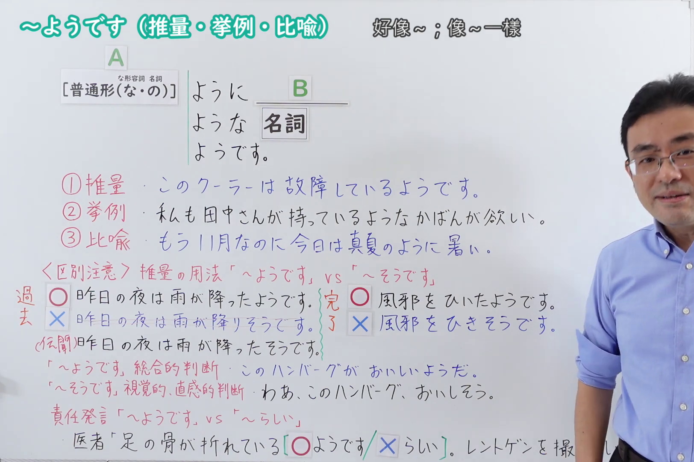
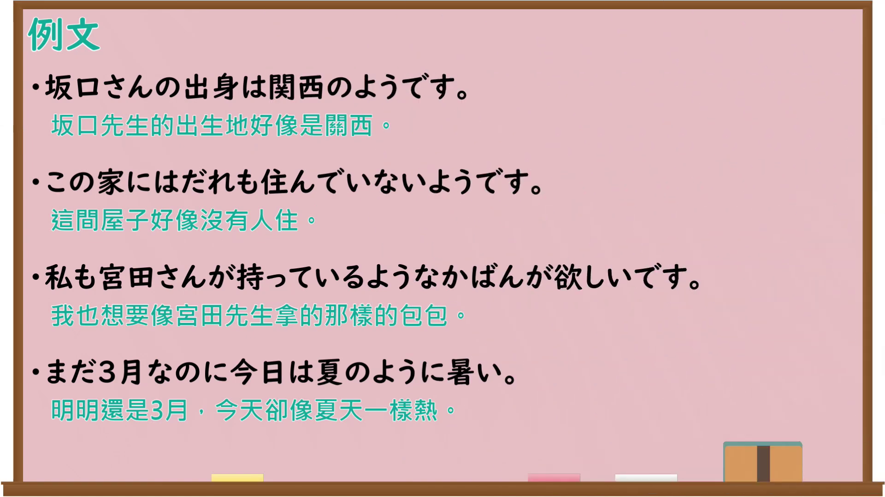

---
{
  "id": "N4-G-0115",
  "kind": "grammar",
  "level": "N4",
  "title": "～ようです（推量・挙例・比喩）",
  "card_revision": 1,
  "schema_version": 1,
  "source": {
    "lesson": "N4 第115个语法",
    "material": "出口日語原视频板书、Bilibili P115音频的本地中文／日语混合转写 WebVTT 与Hagoromo正文",
    "video": "https://www.youtube.com/watch?v=6lPpxyXAxxM",
    "screenshot": "assets/grammar/n4/N4-G-0115-connection.png",
    "screenshot_seconds": 580.16,
    "screenshot_crop": {
      "x": 0,
      "y": 0,
      "width": 1624,
      "height": 1080
    }
  },
  "tags": [
    "推量",
    "例示",
    "比喩",
    "N4"
  ],
  "confusions": [
    "～そうです（推量・様態）",
    "～みたいです",
    "～らしい（伝聞・推量）"
  ]
}
---

# ～ようです（推量・挙例・比喩）

## 视频学习资料整理

原视频：[【Ｎ４文法】～ようです](https://www.youtube.com/watch?v=6lPpxyXAxxM)

**接续图**：真实时间 580.16 秒（9:40），原图尺寸 1920×1080，裁切区域 x=0、y=0、宽1624、高1080（固定左上角，收拢右下角，裁去右侧人像与空白）。

**例句图**：真实时间 584.00 秒（9:44），原图尺寸 1920×1080，未裁切（整幅画面）。

# 核心

## 功能一：①推量：A（普通形）＋ようです（好像…：凭感觉或主观印象做出的推测）

**最上位意味カテゴリー：**

- **～ようです：** 考え・感情（思考与感情）

**中位意味カテゴリー：**

- **～ようです：** 推量（推测）

**意味：**

- **～ようです：** 推量・概言（推测与概括性陈述）

**くわしい意味記述：**

- **～ようです：** ある物事について話し手の感覚や主観から感じたことを言うときに使う。（用于就某事物陈述说话人从感觉或主观上感受到的内容。）

**派生語：** 未列出

### 例句

1. 山田さんはもう寝たようです。

   （山田先生好像已经睡了。）

2. あの店はおいしいようです。

   （那家店好像很好吃。）

3. ご存じないようだわね。

   （看样子您不知道呢。）

4. まだのようです。

   （好像还没有。）

## 功能二：②挙例：A（普通形）＋ように／ような（像…那样：举出大致相同的事例）

**最上位意味カテゴリー：**

- **～ようです：** ものごとの関係（事物的关系）

**中位意味カテゴリー：**

- **～ようです：** 例示（例示）

**意味：**

- **～ようです：** 例示（例示）

**くわしい意味記述：**

- **～ようです：** 「〜とだいたい同じようだ」という意味を表す。「Xように/ようなY」という文ではXとYがほぼ一致することを表す。「上記/下記/次のように」などという表現では指し示す部分に詳しい内容があることを表す。（表示「与…大致相同」的意思。在「Xように／ようなY」这样的句子中，表示X与Y基本一致。在「上記／下記／次のように」等说法中，表示所指的部分里有详细内容。）

**派生語：** ような，ように

### 例句

1. そうめんのようなさっぱりしたものが食べたい。

   （想吃像素面那样清爽的东西。）

2. 例のように答えてください。

   （请像示例那样回答。）

3. これのような要領で第３課のところを。

   （请按这样的要领处理第３课的部分。）

## 功能三：③比喩：A（名詞）＋ようです（像…一样，宛如…：打比方来说明）

**最上位意味カテゴリー：**

- **～ようです：** 考え・感情（思考与感情）

**中位意味カテゴリー：**

- **～ようです：** 比喩・比況（比喻与比拟）

**意味：**

- **～ようです：** 比喩・比況（比喻与比拟）

**くわしい意味記述：**

- **～ようです：** 何かを説明する時に，似ている状況や物を例に出して言う時に使う。（在说明某事时，举出相似的状况或事物来说时使用。）

**派生語：** ような，ように

### 例句

1. 僕のお菓子が小さいと言うなんて、父は子供のようです。

   （居然说我点心小，父亲简直像小孩子一样。）

2. 彼女は赤ん坊のような手をしています。

   （她的手像婴儿一样。）

3. 彼はまるでお酒でも飲んだような赤い顔をしていました。

   （他脸通红，简直像喝了酒一样。）

4. 彼女は子供のように泣いている。

   （她像小孩子一样哭着。）

# 来源

- [出口日語原视频](https://www.youtube.com/watch?v=6lPpxyXAxxM)
- [Hagoromo「ようだ（推量・概言）」](https://hagoromo-text.work/lookup?vid=1679)（查询日期：2026-09-25）
- [Hagoromo「ようだ（例示）」](https://hagoromo-text.work/lookup?vid=1692)（查询日期：2026-09-25）
- [Hagoromo「ようだ（比喩・比況）」](https://hagoromo-text.work/lookup?vid=1678)（查询日期：2026-09-25）
