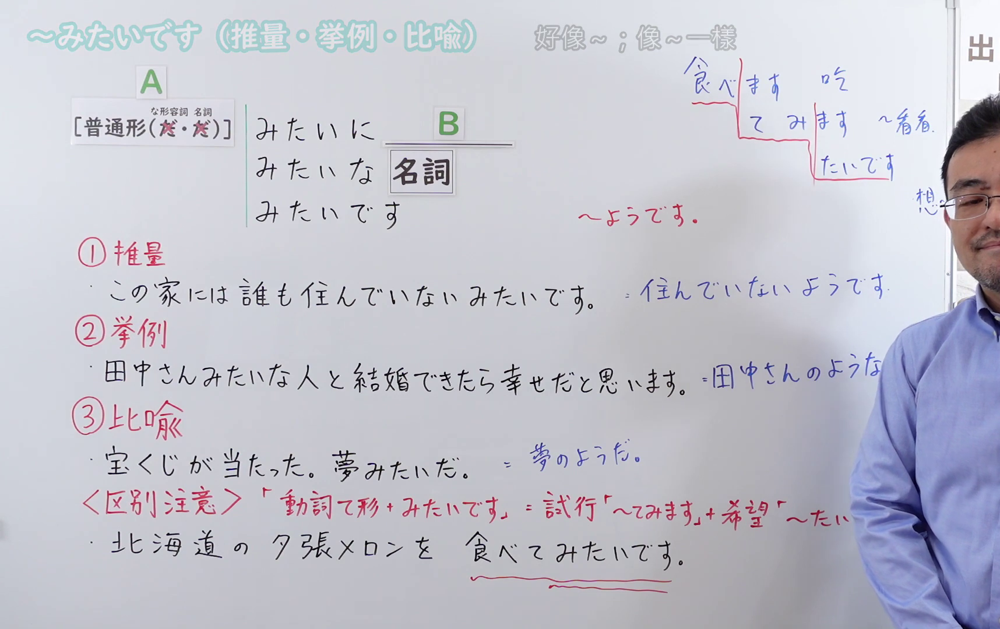
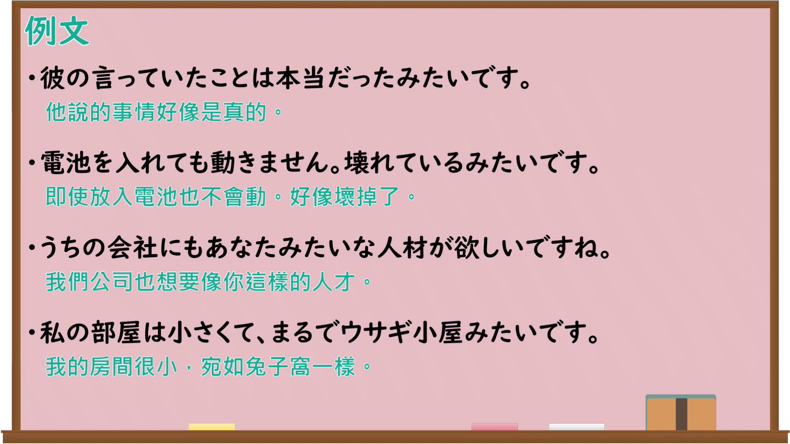

---
{
  "id": "N4-G-0116",
  "kind": "grammar",
  "level": "N4",
  "title": "～みたいです（推量・挙例・比喩）",
  "card_revision": 1,
  "schema_version": 1,
  "source": {
    "lesson": "N4 第116个语法",
    "material": "出口日語原视频板书、Bilibili P116音频的本地中文／日语混合转写 WebVTT 与Hagoromo及毎日のんびり日本語教師正文",
    "video": "https://www.youtube.com/watch?v=2UiJx-cbUw4",
    "screenshot": "assets/grammar/n4/N4-G-0116-connection.png",
    "screenshot_seconds": 277.62,
    "screenshot_crop": {
      "x": 0,
      "y": 0,
      "width": 1716,
      "height": 1080
    }
  },
  "tags": [
    "推量",
    "比喩",
    "例示",
    "N4"
  ],
  "confusions": [
    "～ようです",
    "～らしい（伝聞・推量）",
    "動詞て形＋みたいです"
  ]
}
---

# ～みたいです（推量・挙例・比喩）

## 视频学习资料整理

原视频：[【Ｎ４文法】～みたいです（推量・挙例・比喩）](https://www.youtube.com/watch?v=2UiJx-cbUw4)

**接续图**：真实时间 277.62 秒（4:37），原图尺寸 1920×1080，裁切区域 x=0、y=0、宽1716、高1080（固定左上角，收拢右下角，裁去右侧人像与空白）。

**例句图**：真实时间 298.00 秒（4:58），原图尺寸 1920×1080，未裁切（整幅画面）。

# 核心

## 功能一：①推量：A（普通形）＋みたいです（好像…：凭五感感受到或推测出的内容）

**くわしい意味記述：**

- **～みたいです：** 話し手の物事に対する主観的な推測を表します。「どうやら」「どうも」等が前項に呼応することもあります。「みたい」は話し言葉で用いられます。「みたい」よりもやや硬い表現に「ようだ／ように／ような」があります。（表示说话人对事物的主观推测。前项也可与「どうやら」「どうも」等呼应。「みたい」用于口语。比「みたい」略生硬的说法是「ようだ／ように／ような」。）

### 例句

1. あそこのお店はいつも行列ができていて、どうやら人気があるみたいだ。

   （那家店老是排着队，看来很受欢迎。）

2. 道が濡れてるし、雨が降ったみたいです。

   （道路湿了，好像下雨了。）

3. あの二人は結婚したみたいだ。

   （他们俩好像结婚了。）

4. うちの猫ちゃんは私がいないと寂しいみたいだ。

   （我家的小猫没有我在好像很寂寞。）

## 功能二：②挙例・③比喩：A（名詞）＋みたいです（像…一样／像…那样）

**最上位意味カテゴリー：**

- **～みたいです：** 考え・感情（思考与感情）

**中位意味カテゴリー：**

- **～みたいです：** 比喩・比況（比喻与比拟）

**意味：**

- **～みたいです：** 例示（例示）

**くわしい意味記述：**

- **～みたいです：** 何かを説明する時に，似ている状況や物を例に出して言う時に使う。（在说明某事时，举出相似的状况或事物来说时使用。）

**派生語：** みたいな，みたいに

### 例句

1. このねこ、パンダみたいですね。

   （这只猫，像熊猫一样呢。）

2. この消しゴムはいちごみたいなにおいがする。

   （这块橡皮有像草莓一样的味道。）

3. うれしくて、子どもみたいによろこんだ。

   （高兴得像小孩子一样欢喜。）

# 来源

- [出口日語原视频](https://www.youtube.com/watch?v=2UiJx-cbUw4)
- [Hagoromo「みたいだ」](https://hagoromo-text.work/lookup?vid=1560)（查询日期：2026-09-25）
- [毎日のんびり日本語教師「【Ｎ４文法】～みたいだ／みたいに／みたいな」](https://mainichi-nonbiri.com/grammar/n4-mitaida/)（查询日期：2026-09-25）
