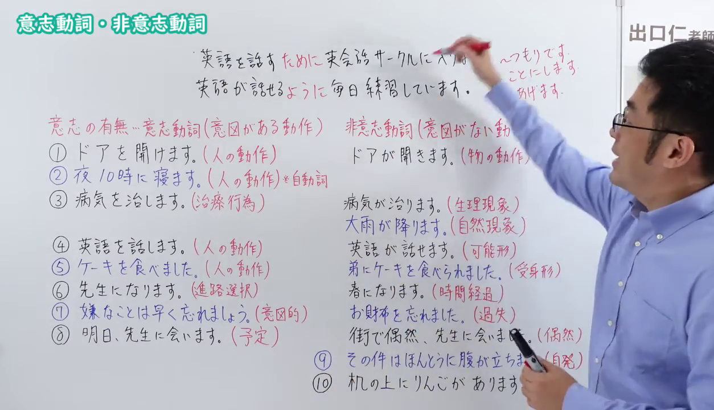
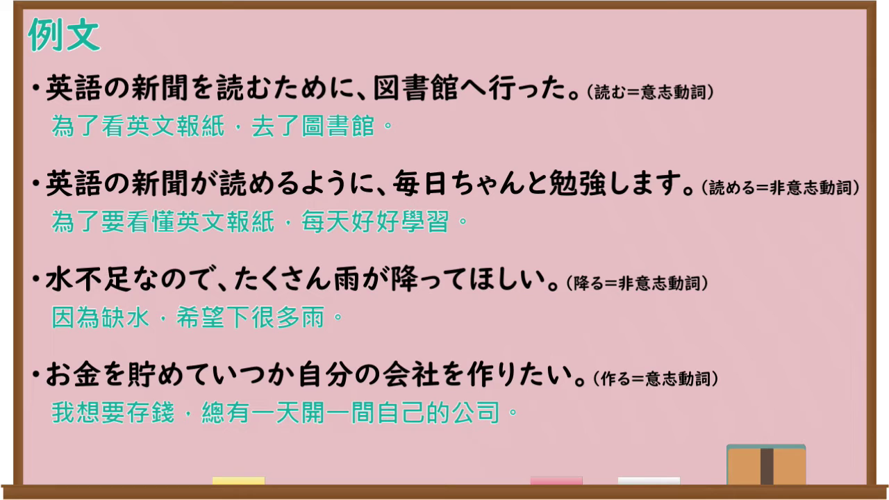

---
{
  "id": "N4-G-0117",
  "kind": "grammar",
  "level": "N4",
  "title": "意志動詞・非意志動詞（ために／ように）",
  "card_revision": 1,
  "schema_version": 1,
  "source": {
    "lesson": "N4 第117个语法",
    "material": "出口日語原视频板书、Bilibili P117音频的本地中文／日语混合转写 WebVTT 与Hagoromo及日本語NET正文",
    "video": "https://www.youtube.com/watch?v=FUvHgtLLshM",
    "screenshot": "assets/grammar/n4/N4-G-0117-connection.png",
    "screenshot_seconds": 885.9,
    "screenshot_crop": {
      "x": 0,
      "y": 0,
      "width": 1254,
      "height": 720
    }
  },
  "tags": [
    "目的",
    "意志動詞",
    "非意志動詞",
    "N4"
  ],
  "confusions": [
    "ために（原因・理由）",
    "ように（比喩・例示）"
  ]
}
---

# 意志動詞・非意志動詞（ために／ように）

## 视频学习资料整理

原视频：[【Ｎ４文法】意志動詞・非意志動詞](https://www.youtube.com/watch?v=FUvHgtLLshM)

**接续图**：真实时间 885.90 秒（14:45），原图尺寸 1280×720（本课源视频为 720p），裁切区域 x=0、y=0、宽1254、高720（固定左上角，收拢右下角，裁去右侧人像与空白）。

**例句图**：真实时间 965.00 秒（16:05），原图尺寸 1280×720（本课源视频为 720p），未裁切（整幅画面）。

# 核心

## 功能一：A（意志動詞）＋ために（表示目的：为了…，去做…）

**最上位意味カテゴリー：**

- **ため（に）：** ものごとの関係（事物的关系）

**中位意味カテゴリー：**

- **ため（に）：** 目的・目標（目的与目标）

**意味：**

- **ため（に）：** 目的（目的）

**くわしい意味記述：**

- **ため（に）：** 「〜（するの）が目的で」という意味を表す。「Xため（に）Y」の形をとり，Xは目的を，Yは何をするかを述べる。動詞を使う場合，意志動詞を使い，XとYの主語が同じでなければならない。（表示「以…为目的」的意思。采用「Xため（に）Y」的形式，X 陈述目的，Y 陈述做什么。使用动词时要用意志动词，且 X 与 Y 的主语必须相同。）

**派生語：** ために

### 例句

1. 彼は大学に入るために一生懸命勉強しています。

   （他为了考上大学正在拼命学习。）

2. やっぱり、えー、少し、あのー、リラックスするために旅行に出かけたりとか、そのようなことをしております。

   （果然，呃，为了稍微放松一下，会去旅行之类的，做那样的事情。）

3. 何かを得るためには何かを捨てなければいけない。

   （为了得到什么，就必须舍弃什么。）

4. 我々は、継続中の紛争を解決するための努力をこの地域の他の国が行うよう奨励する。

   （我们鼓励该地区其他国家作出努力，以解决持续中的纷争。）

## 功能二：A（非意志動詞）＋ように（表示目标与期待：为了能够…）

**くわしい意味記述：**

- **～ように：** 目標を実現させるために〜する。（为了实现目标而做…。）接続为「V（辞書形）＋ように」「V（ナイ形）＋ように」，V 为无意志动词（見える、聞こえる、わかる、なおる、可能动词等）。

### 例句

1. 日本語を上手に話せるように、毎日シャドーイングをしています。

   （为了能流利地说日语，每天都在做跟读练习。）

2. 日本語で漫画が読めるように、毎日日本語を勉強しています。

   （为了能用日语看漫画，每天都在学日语。）

3. 太らないように、甘いものは食べないことにしています。

   （为了不发胖，我决定不吃甜食。）

4. 明日、寝坊しないように、今日は早く寝ます。

   （为了明天不睡过头，今天早点睡。）

# 来源

- [出口日語原视频](https://www.youtube.com/watch?v=FUvHgtLLshM)
- [Hagoromo「ため（に）（目的）」](https://hagoromo-text.work/lookup?vid=726)（查询日期：2026-09-25）
- [日本語NET「〜ように（目標・期待）」](https://nihongokyoshi-net.com/2018/09/25/jlptn4-grammar-yooni/)（查询日期：2026-09-25）
