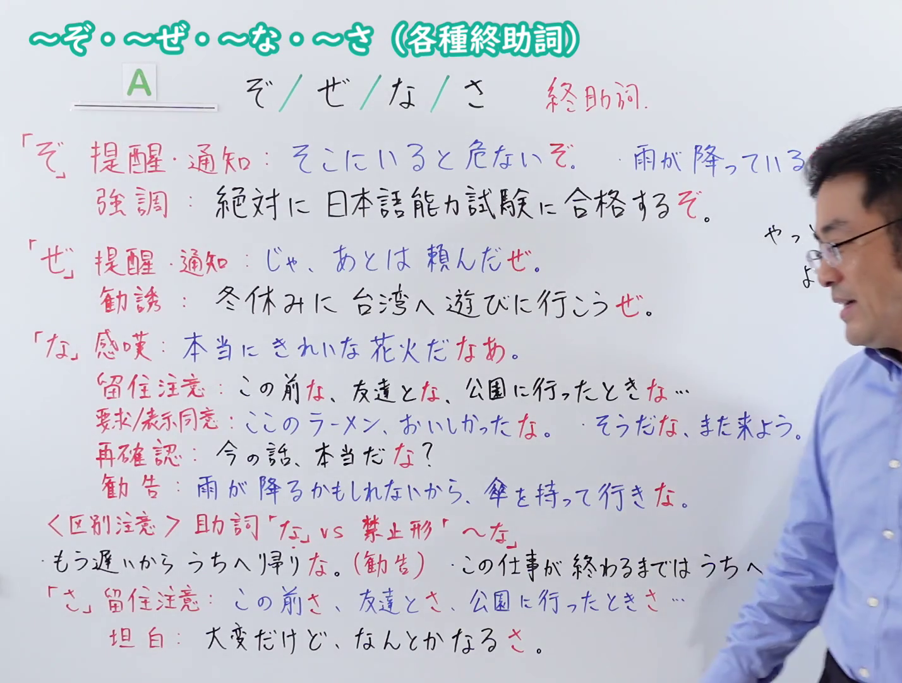
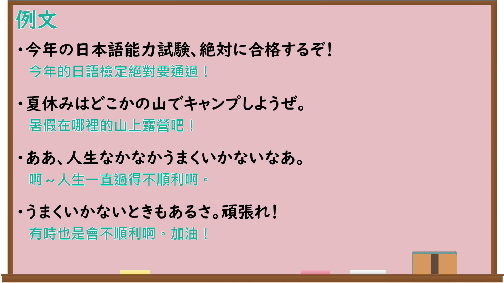

---
{
  "id": "N4-G-0118",
  "kind": "grammar",
  "level": "N4",
  "title": "ぞ・ぜ・な・さ（各種終助詞）",
  "card_revision": 1,
  "schema_version": 1,
  "source": {
    "lesson": "N4 第118个语法",
    "material": "出口日語原视频板书、Bilibili P118音频的本地中文／日语混合转写 WebVTT 与例文で学ぶ 日本語文法正文",
    "video": "https://www.youtube.com/watch?v=WI0s7-Yrhwc",
    "screenshot": "assets/grammar/n4/N4-G-0118-connection.png",
    "screenshot_seconds": 679.55,
    "screenshot_crop": {
      "x": 0,
      "y": 0,
      "width": 1428,
      "height": 1080
    }
  },
  "tags": [
    "終助詞",
    "N4"
  ],
  "confusions": [
    "な（禁止形「〜な」）",
    "ね",
    "よ"
  ]
}
---

# ぞ・ぜ・な・さ（各種終助詞）

## 视频学习资料整理

原视频：[[N4 Grammar] Various particles: "zo", "ze", "na", "sa"](https://www.youtube.com/watch?v=WI0s7-Yrhwc)

**接续图**：真实时间 679.55 秒（11:19），原图尺寸 1920×1080，裁切区域 x=0、y=0、宽1428、高1080（固定左上角，收拢右下角，裁去右侧人像与空白）。

**例句图**：真实时间 722.38 秒（12:02），原图尺寸 1920×1080，未裁切（整幅画面）。

# 核心

## 功能一：伝達を表す終助詞（ぞ・ぜ・さ）：把说话人新认识到或认为理所当然的内容传达给听话人

**くわしい意味記述：**

- **ぞ：** 新たな認識が成立したことを示す。（表示新的认识得以成立。）
- **ぜ：** 話し手が認識した内容を一方的に聞き手に示す。（把说话人认识到的内容单方面地提示给听话人。）
- **さ：** 話し手にとって当然と思える内容を聞き手に示す。（把说话人认为理所当然的内容提示给听话人。）

### 例句

1. さあ、そろそろ勉強を始めるぞ。

   （来吧，差不多该开始学习了。）

2. 定休日って書いてあるぞ。

   （上面写着固定休息日呢。）

3. もう、宿題が終わったぜ。

   （作业已经写完了哦。）

4. こんな問題は楽勝さ。

   （这种问题轻松搞定啦。）

5. おばけなんていないさ。

   （幽灵什么的根本不存在啦。）

## 功能二：確認・詠嘆を表す終助詞（な）：自言自语地表示新认识到的事态，或较为随便的确认

**くわしい意味記述：**

- **な：** ① 非対話的に、話し手が新たに認識した事態を示す ② くだけた形での確認を示す（①非对话性地表示说话人新认识到的事态 ②表示较为随便的确认）

### 例句

1. 雪でも降りそうだな。

   （好像要下雪了呢。）

2. 雨が降りそうだな。傘を持っていこう。

   （好像要下雨了。带上伞吧。）

3. さては、寝坊したな。

   （敢情是睡过头了吧。）

4. 温かくなってきた。もう春だなあ。

   （天变暖了。已经是春天了啊。）

# 来源

- [出口日語原视频](https://www.youtube.com/watch?v=WI0s7-Yrhwc)
- [例文で学ぶ 日本語文法「終助詞とは？種類と用法を一覧でわかりやすく解説！」](https://japanese-language-education.com/shuujoshi/)（查询日期：2026-09-25）
