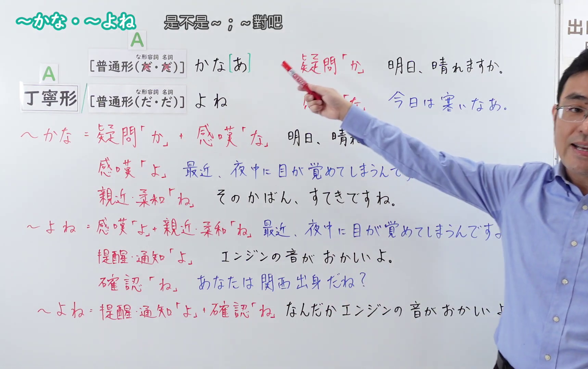
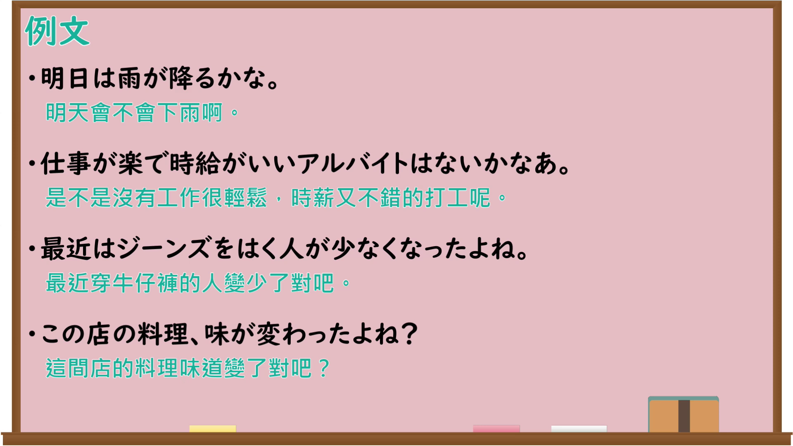

---
{
  "id": "N4-G-0119",
  "kind": "grammar",
  "level": "N4",
  "title": "～かな・～よね",
  "card_revision": 1,
  "schema_version": 1,
  "source": {
    "lesson": "N4 第119个语法",
    "material": "出口日語原视频板书、Bilibili P119音频的本地中文／日语混合转写 WebVTT 与Hagoromo及日本語教師コトハジメ正文",
    "video": "https://www.youtube.com/watch?v=5capDd0k6B8",
    "screenshot": "assets/grammar/n4/N4-G-0119-connection.png",
    "screenshot_seconds": 525.16,
    "screenshot_crop": {
      "x": 0,
      "y": 0,
      "width": 1718,
      "height": 1080
    }
  },
  "tags": [
    "終助詞",
    "かな",
    "よね",
    "N4"
  ],
  "confusions": [
    "ね",
    "よ",
    "～かしら"
  ]
}
---

# ～かな・～よね

## 视频学习资料整理

原视频：[【Ｎ４文法】～かな・～よね](https://www.youtube.com/watch?v=5capDd0k6B8)

**接续图**：真实时间 525.16 秒（8:45），原图尺寸 1920×1080，裁切区域 x=0、y=0、宽1718、高1080（固定左上角，收拢右下角，裁去右侧人像与空白）。画面上方老师抬手的动作遮住了右侧少量例句文字。

**例句图**：真实时间 538.59 秒（8:58），原图尺寸 1920×1080，未裁切（整幅画面）。

# 核心

## 功能一：～かな（疑问「か」＋感叹「な」：对内容没有确证时的疑问或自言自语）

**最上位意味カテゴリー：**

- **～かな：** 人との関係（人际关系）

**中位意味カテゴリー：**

- **～かな：** 問いかけ（提问）

**意味：**

- **～かな：** 問いかけ（提问）

**くわしい意味記述：**

- **～かな：** 発話内容に確証が持てない時に使う終助詞。必ずしも相手に回答を要求しているわけではない。また，確認が持てないことを伝える時に「〜かなと思う」という表現形式もよく使われる。（对说话内容没有确证时使用的终助词。并不一定要对方回答。另外，在表达无法确认时也常用「〜かなと思う」这一表现形式。）

**派生語：** 未列出

### 例句

1. 山田さんきょうは来るかな。

   （山田先生今天会来吗？）

2. かえって、その、工学部の人の方ができるかなっと思ってたんです。

   （我反倒一直觉得，那个，工学院的人可能更行吧。）

3. あ、どっかあるかな。

   （啊，哪里有吗？）

4. ふと、今どうしているのかなあと、なつかしく思い出される人がいる。

   （会忽然怀念地想起某个人，心里想他现在在做什么呢。）

## 功能二：～よね（主张意见的「よ」＋征求同意的「ね」：提出自己的判断并寻求对方认同）

**くわしい意味記述：**

- **～よね：** 話し手が意見の主張をするときの「よ」＋同意を求めるときの「ね」（information＋confirmation）（说话人主张意见时的「よ」＋征求同意时的「ね」（信息提示＋确认）。）

### 例句

1. ミーティングって３時からだったよね。

   （会议是三点开始的吧。）

2. あれ、ここにお財布、置いてたよね。

   （咦，钱包是放在这里的吧。）

3. 漢字って難しいよね。

   （汉字真难啊。）

4. この部屋って禁煙だよね。

   （这个房间是禁烟的吧。）

5. 明日の飲み会、来るよね。

   （明天的聚餐你会来吧。）

# 来源

- [出口日語原视频](https://www.youtube.com/watch?v=5capDd0k6B8)
- [Hagoromo「かな（問いかけ）」](https://hagoromo-text.work/lookup?vid=400)（查询日期：2026-09-25）
- [日本語教師コトハジメ「終助詞「ね」vs「よ」vs「よね」」](https://cotohajime.net/ending-particle-yo-ne-yone/)（查询日期：2026-09-25）
