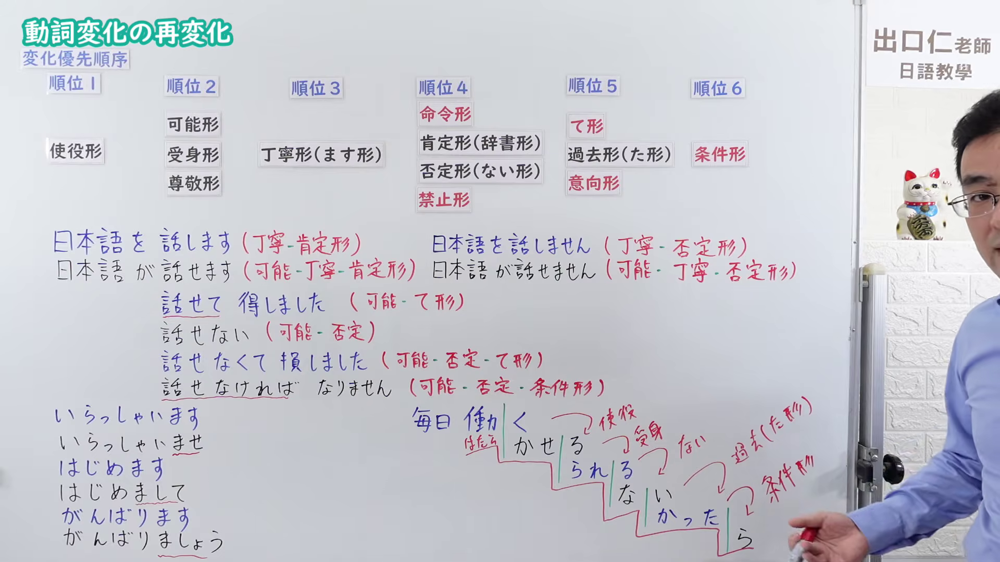
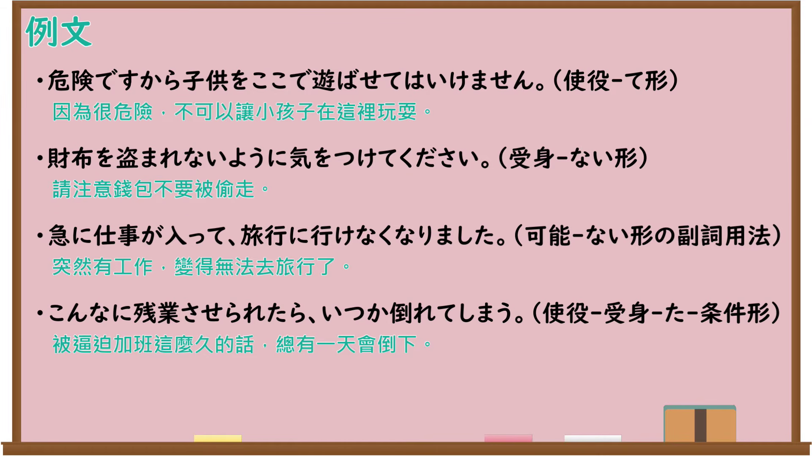

---
{
  "id": "N4-G-0120",
  "kind": "grammar",
  "level": "N4",
  "title": "動詞変化の再変化（使役形・受身形・使役受身）",
  "card_revision": 1,
  "schema_version": 1,
  "source": {
    "lesson": "N4 第120个语法",
    "material": "出口日語原视频板书、Bilibili P120音频的本地中文／日语混合转写 WebVTT 与毎日のんびり日本語教師正文",
    "video": "https://www.youtube.com/watch?v=AkB3KwakhX0",
    "screenshot": "assets/grammar/n4/N4-G-0120-connection.png",
    "screenshot_seconds": 949.68,
    "screenshot_crop": {
      "x": 0,
      "y": 0,
      "width": 1920,
      "height": 1080
    }
  },
  "tags": [
    "使役",
    "受身",
    "使役受身",
    "N4"
  ],
  "confusions": [
    "可能形（〜れる／られる／できる）",
    "〜させてください",
    "自発（〜れる／られる）"
  ]
}
---

# 動詞変化の再変化（使役形・受身形・使役受身）

## 视频学习资料整理

原视频：[【Ｎ４文法】動詞変化の再変化](https://www.youtube.com/watch?v=AkB3KwakhX0)

**接续图**：真实时间 949.68 秒（15:49），原图尺寸 1920×1080，未裁切（整幅画面）。

**例句图**：真实时间 1020.00 秒（17:00），原图尺寸 1920×1080，未裁切（整幅画面）。

# 核心

## 功能一：順位1 使役形「〜（さ）せる」（让…、使…：强制他人做某事，或允许、放任某动作）

**くわしい意味記述：**

- **〜（さ）せる：** 使役形とも呼ばれる文法です。他人に物事を強制したり、動作の許可や放任の意味を表します。他動詞の時は被使役者に助詞「に」を使い、自動詞の時は助詞「を」を使います。ただし例外もあります。「待つ」は他動詞ですが、被使役者には「を」が使われます。（也称为使役形的语法。表示强制他人做某事，或表示允许、放任某动作。他动词时被使役者用助词「に」，自动词时用助词「を」。但也有例外，如「待つ」虽是他动词，被使役者却用「を」。）

### 例句

1. 母は私を買い物に行かせた。

   （妈妈让我去买东西。）

2. 風が入ってきて寒いので、友達に窓を閉めさせた。

   （风吹进来很冷，我就让朋友关上了窗户。）

3. 子供がやりたいと言ったことはやらせてあげたい。

   （孩子说想做的事，我想让他去做。）

4. 不注意で子供に怪我をさせてしまった。

   （因为疏忽让孩子受了伤。）

## 功能二：順位2 受身形「〜れる／られる／される」（被…、受到…）

**くわしい意味記述：**

- **〜れる／られる／される：** 受身形とも呼ばれる文法です。直接受身文の場合、動作の受け手には助詞「は」を使い、動作をさせる側には助詞「に」「から」を使います。文中で助詞「に」が重複して使用されるときはそれを避けるため、動作をさせる側に助詞「から」が使われます。間接受身文の場合、動作の受け手（主語）には助詞「は」を使い、動作する側には助詞「に」を使います。間接受身文では動作の受け手が動作する側によって何らかの被害を受けることを表します。主語は省略されることがあります。主語が物や物事になる場合、客観的な事実を述べる表現となります。（也称为受身形的语法。直接被动句里，动作的承受者用助词「は」，动作的施行者用助词「に」「から」。句中「に」重复使用时，为避免重复，施行者一侧改用助词「から」。间接被动句里，动作的承受者（主语）用助词「は」，施行动作的一方用助词「に」。间接被动句表示承受者因施行动作一方而受到某种损害。主语有时省略。主语为物品或事情时，则成为陈述客观事实的表达。）

### 例句

1. 私は先生に叱られた。

   （我被老师批评了。）

2. 遅刻して先生に注意された。

   （因为迟到被老师提醒了。）

3. 毎日書いている日記を友人に見られた。

   （我每天写的日记被朋友看到了。）

4. 一晩中赤ちゃんに泣かれて、一睡もできなかった。

   （孩子哭了一整夜，我一觉也没睡成。）

## 功能三：順位1→2 の再変化 使役形＋受身形「〜（さ）せられる」（被迫…；不由得…）

**くわしい意味記述：**

- **〜（さ）せられる：** 使役受身形とも呼ばれる文法です。感心、感動、考えるなどの感情に関する動詞につくときはある物事によって自然に湧き出てきた感情を表し、その他の動詞につくときは誰かに何かを強制されることを表します。五段動詞の使役受身形は「ない形＋せられる／される」で作ります。「～される」の言い方は省略形です。ただし「～す」で終わる動詞（話す、直す…等）は「～話さされる」と「さ」が重複しますので、通常は「話させられる」と言われます。一段動詞の使役受身形は「ない形＋させられる」で作ります。例外はありません。サ変動詞「する」は「させられる」、カ変動詞「来る」は「来させられる」です。（也称为使役受身形。接在感心、感動、考える等与感情有关的动词后时，表示因某事物而自然涌现的感情；接在其他动词后时，表示被某人强制做某事。五段动词的使役受身形由「ない形＋せられる／される」构成，「～される」是省略说法。但以「～す」结尾的动词（話す、直す等）会变成「～話さされる」而重复「さ」，因此通常说「話させられる」。一段动词的使役受身形由「ない形＋させられる」构成，没有例外。サ变动词「する」为「させられる」，カ变动词「来る」为「来させられる」。）

### 例句

1. 熱があったので、先生に早退させられた。

   （因为发烧，被老师要求早退了。）

2. 植民地時代、男性は強制労働をさせられた。

   （殖民地时期，男性被迫从事强制劳动。）

3. 母に薬を飲まされた。

   （被母亲逼着吃了药。）

4. 好きでもない話を延々と聞かせられた。

   （被迫听了很长时间不感兴趣的话。）

5. 非常に感動させられる映画だった。

   （这是一部令人非常感动的电影。）

# 来源

- [出口日語原视频](https://www.youtube.com/watch?v=AkB3KwakhX0)
- [毎日のんびり日本語教師「【Ｎ４文法】～せる／させる」（使役形）](https://mainichi-nonbiri.com/grammar/n4-saseru/)（查询日期：2026-09-25）
- [毎日のんびり日本語教師「【Ｎ４文法】～れる／られる／される」（受身形）](https://mainichi-nonbiri.com/grammar/n4-sareru/)（查询日期：2026-09-25）
- [毎日のんびり日本語教師「【Ｎ４文法】～（さ）せられる」（使役受身／使役受動態）](https://mainichi-nonbiri.com/grammar/n4-saserareru/)（查询日期：2026-09-25）
