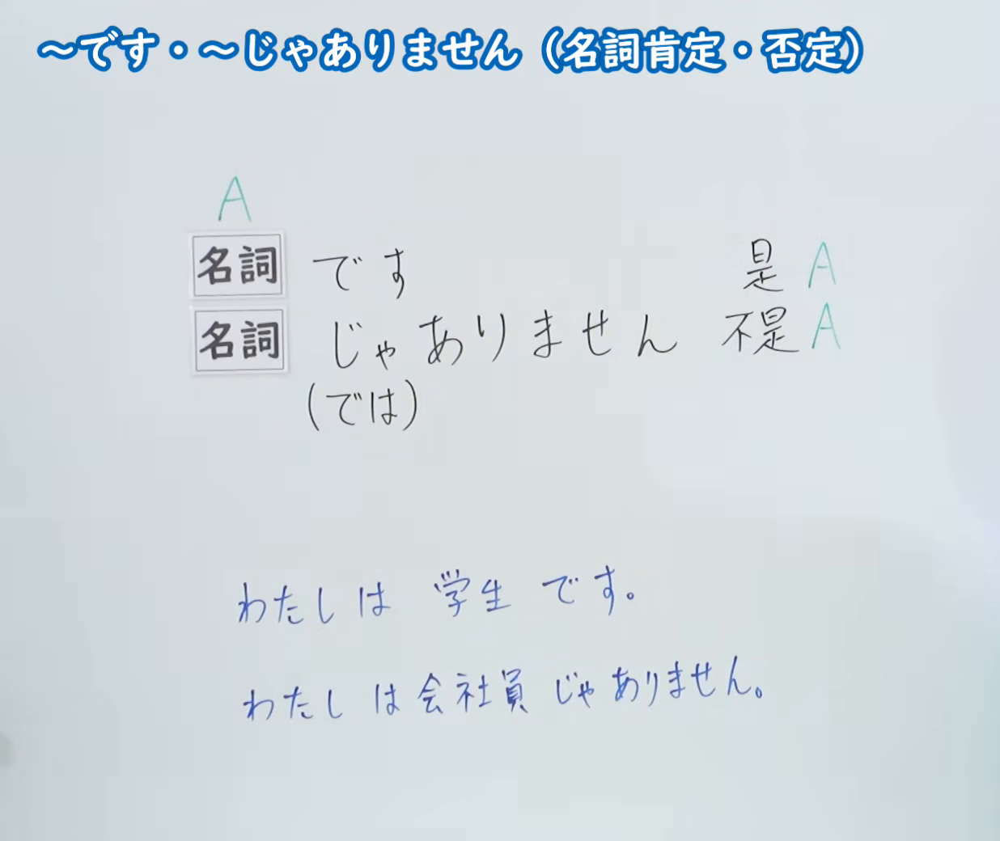
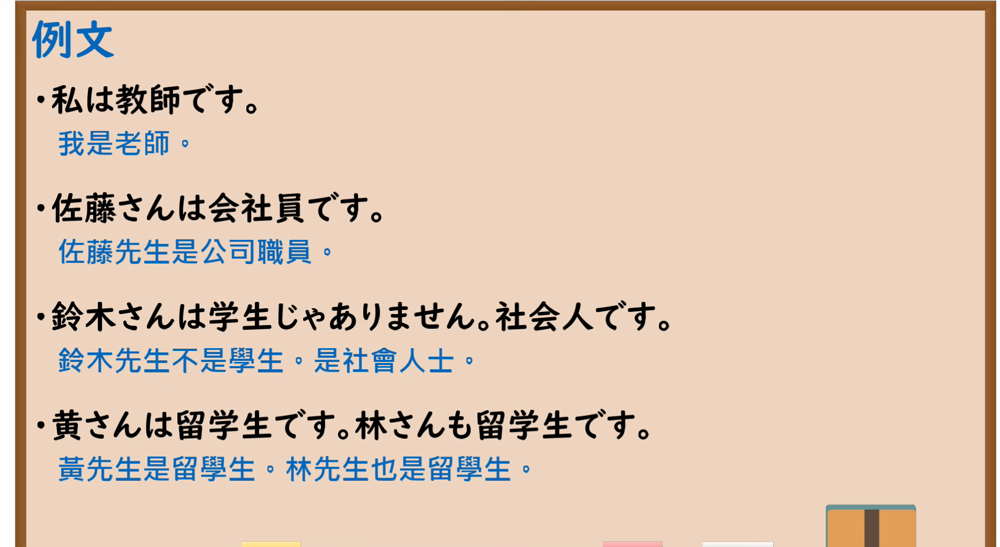

---
{
  "id": "N5-G-0001",
  "kind": "grammar",
  "level": "N5",
  "title": "～です・～じゃありません（名词肯定・否定）",
  "card_revision": 2,
  "schema_version": 1,
  "source": {
    "lesson": "N5 第1个语法",
    "material": "出口日語原视频板书（学习者截取的接续图与例句图）与毎日のんびり日本語教師「～です／ではありません／でした／ではありませんでした」正文",
    "video": "https://www.youtube.com/watch?v=3zRXvtDnev8",
    "screenshot": "assets/grammar/n5/N5-G-0001-connection.png",
    "screenshot_crop": {
      "x": 0,
      "y": 0,
      "width": 1236,
      "height": 1040
    }
  },
  "tags": [
    "です",
    "じゃありません",
    "名词句",
    "N5"
  ],
  "confusions": [
    "～じゃないです",
    "～ではありません"
  ]
}
---

# N5 第1个语法：～です・～じゃありません

# 视频学习资料整理

- 课程：[出口日語「～です・～じゃありません（名詞肯定・否定）」](https://www.youtube.com/watch?v=3zRXvtDnev8)
- 视频 ID：`3zRXvtDnev8`
- 视频时长：6分25秒

## 接续图

- 实际时间：未记录（图片由学习者从原视频截取并提供）
- 成品图尺寸：1236×1040，固定左上角 `(0, 0)`，右下角 `(1236, 1040)`
- 板书内容：标题「～です・～じゃありません（名詞肯定・否定）」；「名詞＋です」对应“是 A”，「名詞＋じゃありません（では）」对应“不是 A”；下方蓝字例句「わたしは学生です。」「わたしは会社員じゃありません。」。老师未入画，板书完整无遮挡。

## 例句图

- 实际时间：未记录（图片由学习者从原视频截取并提供）
- 成品图尺寸：1900×1040，固定左上角 `(0, 0)`，右下角 `(1900, 1040)`
- 板书内容：课程「例文」页，含四条例句及中文翻译（私は教師です／佐藤さんは会社員です／鈴木さんは学生じゃありません。社会人です／黄さんは留学生です。林さんも留学生です）。四条例句均完整可见。

# 核心

## 功能一：是 A／不是 A

**くわしい意味記述：**

- **～です／～ではありません：** 断定の助動詞です。否定形で伴う「では」は、口語では「じゃ」に置き換えられます。（断定助动词。否定形中的「では」在口语中可替换为「じゃ」。）
- **丁寧体の形：** 肯定形は「～は～です」、否定形は「～は～ではありません／～は～じゃありません」。（礼貌体的形式：肯定形为「～は～です」，否定形为「～は～ではありません／～は～じゃありません」。）

### 例句

1. 彼は学生です。

   （他是学生。）

2. その努力は無駄ではありません。

   （那个努力并不是白费。）

3. 今日は日曜日じゃありません。

   （今天不是星期日。）

# 来源

- [出口日語原视频](https://www.youtube.com/watch?v=3zRXvtDnev8)
- [毎日のんびり日本語教師「【Ｎ５文法】～です／ではありません／でした／ではありませんでした」](https://mainichi-nonbiri.com/grammar/n5-desu/)（查询日期：2026-10-15；Hagoromo 未收录本语法，故按流程采用优先级最高的备选网站条目）
