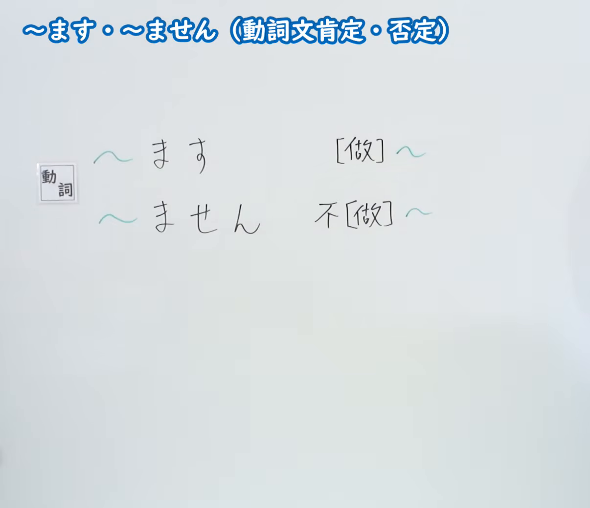
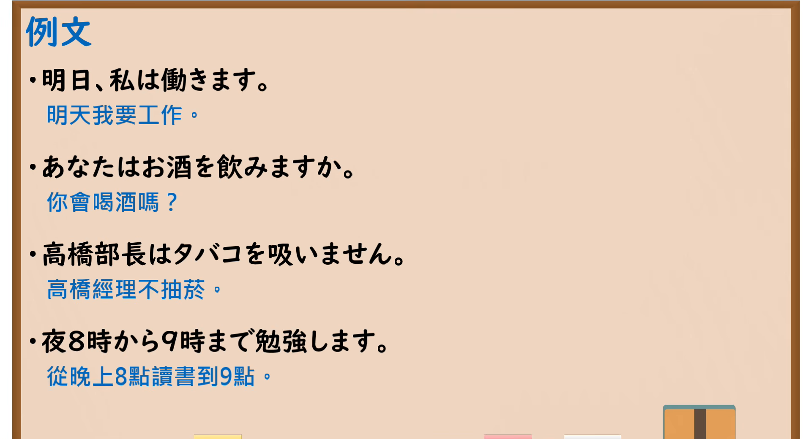

---
{
  "id": "N5-G-0002",
  "kind": "grammar",
  "level": "N5",
  "title": "～ます・～ません（动词句肯定・否定）",
  "card_revision": 2,
  "schema_version": 1,
  "source": {
    "lesson": "N5 第2个语法",
    "material": "出口日語原视频板书（学习者截取的接续图与例句图）与东京外国语大学「Vます／Vません：解説」正文",
    "video": "https://www.youtube.com/watch?v=cygGNONmB9U",
    "screenshot": "assets/grammar/n5/N5-G-0002-connection.png",
    "screenshot_crop": {
      "x": 0,
      "y": 0,
      "width": 1206,
      "height": 1040
    }
  },
  "tags": [
    "ます",
    "ません",
    "动词",
    "丁寧体",
    "N5"
  ],
  "confusions": [
    "～です／～ではありません",
    "～ないです"
  ]
}
---

# N5 第2个语法：～ます・～ません

# 视频学习资料整理

- 课程：[出口日語「～ます・～ません（動詞文肯定・否定）」](https://www.youtube.com/watch?v=cygGNONmB9U)
- 视频 ID：`cygGNONmB9U`
- 视频时长：5分13秒

## 接续图

- 实际时间：未记录（图片由学习者从原视频截取并提供）
- 成品图尺寸：1206×1040，固定左上角 `(0, 0)`，右下角 `(1206, 1040)`
- 板书内容：标题「～ます・～ません（動詞文肯定・否定）」；「動詞」标签后接「～ます」对应“[做]～”，「～ません」对应“不[做]～”。老师未入画，板书完整无遮挡；下半部分为空白板面。

## 例句图

- 实际时间：未记录（图片由学习者从原视频截取并提供）
- 成品图尺寸：1900×1040，固定左上角 `(0, 0)`，右下角 `(1900, 1040)`
- 板书内容：课程「例文」页，含四条例句及中文翻译（明日、私は働きます／あなたはお酒を飲みますか／高橋部長はタバコを吸いません／夜8時から9時まで勉強します）。四条例句均完整可见。

# 核心

## 功能一：[做]～／不[做]～

**くわしい意味記述：**

- **～ます／～ません：** 「Vます」は動詞の丁寧な形（非過去）です。肯定形は「Vます」、否定形は「Vません」です。「Vます」は文末で、ものの状態や動きを述べるときに使います。（「Vます」是动词的礼貌形（非过去）。肯定形为「Vます」，否定形为「Vません」。「Vます」用于句末，叙述事物的状态或动作。）
- **使い方：** ①現在の習慣的な行為、②現在の状態、③未来の予定・意向に使います。（用法：①现在的习惯性行为，②现在的状态，③未来的计划与意向。）

### 例句

1. わたしは毎日勉強します。

   （我每天学习。）

2. わたしは毎日勉強しません。

   （我每天不学习。）

3. 田中さんはこれから図書館で勉強します。

   （田中接下来要在图书馆学习。）

4. わたしはあした研究室にいません。

   （我明天不在研究室。）

5. 毎日、学校へ行きます。

   （每天去学校。）

# 来源

- [出口日語原视频](https://www.youtube.com/watch?v=cygGNONmB9U)
- [东京外国语大学「日本語 文法 Vます／Vません：解説」](https://www.coelang.tufs.ac.jp/mt/ja/gmod/contents/explanation/023.html)（查询日期：2026-10-15；Hagoromo、毎日のんびり日本語教師、日本語NET 均未找到直接对应条目，按流程采用互联网检索所得的该页）
