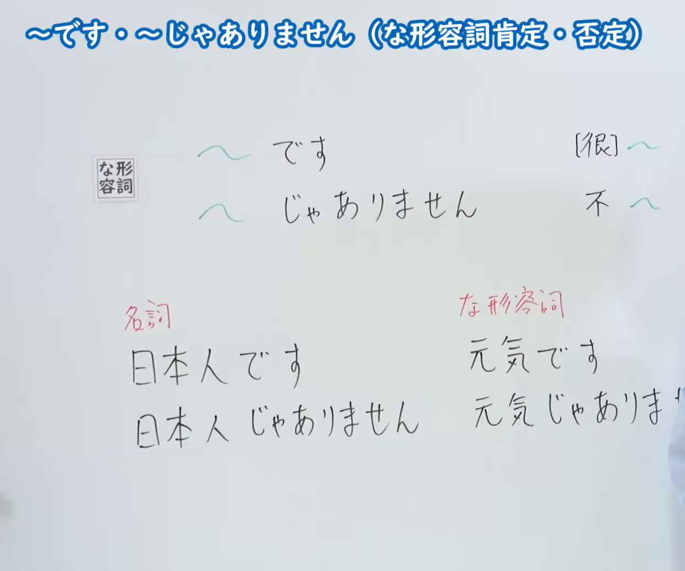
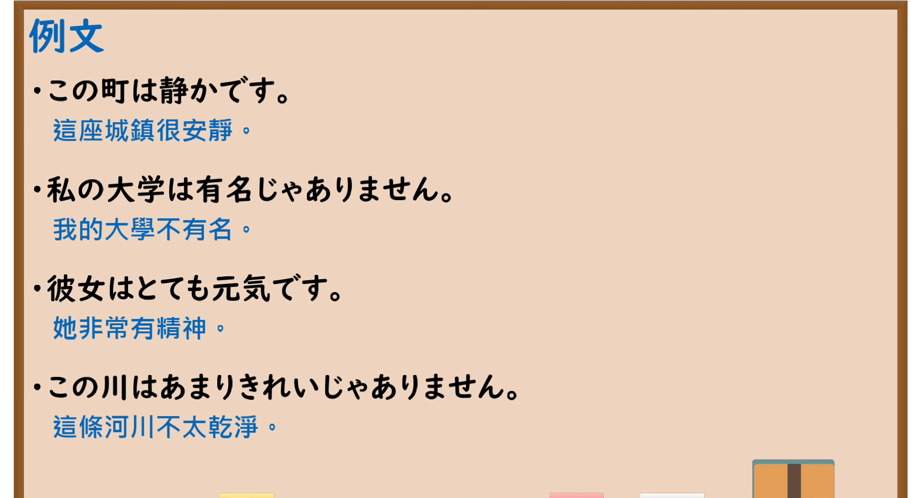

---
{
  "id": "N5-G-0003",
  "kind": "grammar",
  "level": "N5",
  "title": "～です・～じゃありません（な形容词肯定・否定）",
  "card_revision": 2,
  "schema_version": 1,
  "source": {
    "lesson": "N5 第3个语法",
    "material": "出口日語原视频板书（学习者截取的接续图与例句图）与东京外国语大学「NAです／NAではありません：解説」正文",
    "video": "https://www.youtube.com/watch?v=M2UYM1DlK_I",
    "screenshot": "assets/grammar/n5/N5-G-0003-connection.png",
    "screenshot_crop": {
      "x": 0,
      "y": 0,
      "width": 1245,
      "height": 1040
    }
  },
  "tags": [
    "です",
    "じゃありません",
    "な形容词",
    "N5"
  ],
  "confusions": [
    "名词＋の＋名词",
    "な形容词＋な＋名词"
  ]
}
---

# N5 第3个语法：～です・～じゃありません（な形容词）

# 视频学习资料整理

- 课程：[出口日語「～です・～じゃありません（な形容詞肯定・否定）」](https://www.youtube.com/watch?v=M2UYM1DlK_I)
- 视频 ID：`M2UYM1DlK_I`
- 视频时长：5分57秒

## 接续图

- 实际时间：未记录（图片由学习者从原视频截取并提供）
- 成品图尺寸：1245×1040，固定左上角 `(0, 0)`，右下角 `(1245, 1040)`
- 板书内容：标题「～です・～じゃありません（な形容詞肯定・否定）」；「な形容詞」标签后接「～です」对应“[很]～”，「～じゃありません」对应“不～”；下方红字对比「名詞：日本人です／日本人じゃありません」与「な形容詞：元気です／元気じゃありません」。右侧板书末端「元気じゃありません」的最后一个字被画面右缘截断，老师站在画面右侧边缘；该处是原画面所限，未补写。

## 例句图

- 实际时间：未记录（图片由学习者从原视频截取并提供）
- 成品图尺寸：1900×1040，固定左上角 `(0, 0)`，右下角 `(1900, 1040)`
- 板书内容：课程「例文」页，含四条例句及中文翻译（この町は静かです／私の大学は有名じゃありません／彼女はとても元気です／この川はあまりきれいじゃありません）。四条例句均完整可见。

# 核心

## 功能一：[很]～／不～

**くわしい意味記述：**

- **NAです／NAではありません：** ナ形容詞も、Nの性質や特徴（色・形・大きさなど）、状態について述べることができます。（な形容词也可以叙述事物的性质、特征（颜色、形状、大小等）和状态。）
- **ではありません／じゃありません：** 話しことばでは、「NAではありません」が「NAじゃありません」になることが多いです。（口语中，「NAではありません」常说成「NAじゃありません」。）
- **注意：** 「きれい」「ゆうめい」「きらい」などは「い」で終わっていますが、ナ形容詞です。（「きれい」「ゆうめい」「きらい」等虽以「い」结尾，但属于な形容词。）

### 例句

1. このかさはじょうぶです。

   （这把伞很结实。）

2. A：そのかさはじょうぶですか。　B：いいえ、じょうぶではありません。

   （A：那把伞结实吗？　B：不，不结实。）

3. このかさはじょうぶではないです。

   （这把伞不结实。）

# 来源

- [出口日語原视频](https://www.youtube.com/watch?v=M2UYM1DlK_I)
- [东京外国语大学「日本語 文法 NAです／NAではありません：解説」](https://www.coelang.tufs.ac.jp/mt/ja/gmod/contents/explanation/036.html)（查询日期：2026-10-15；Hagoromo、毎日のんびり日本語教師、日本語NET 均未找到直接对应条目，按流程采用互联网检索所得的该页）
