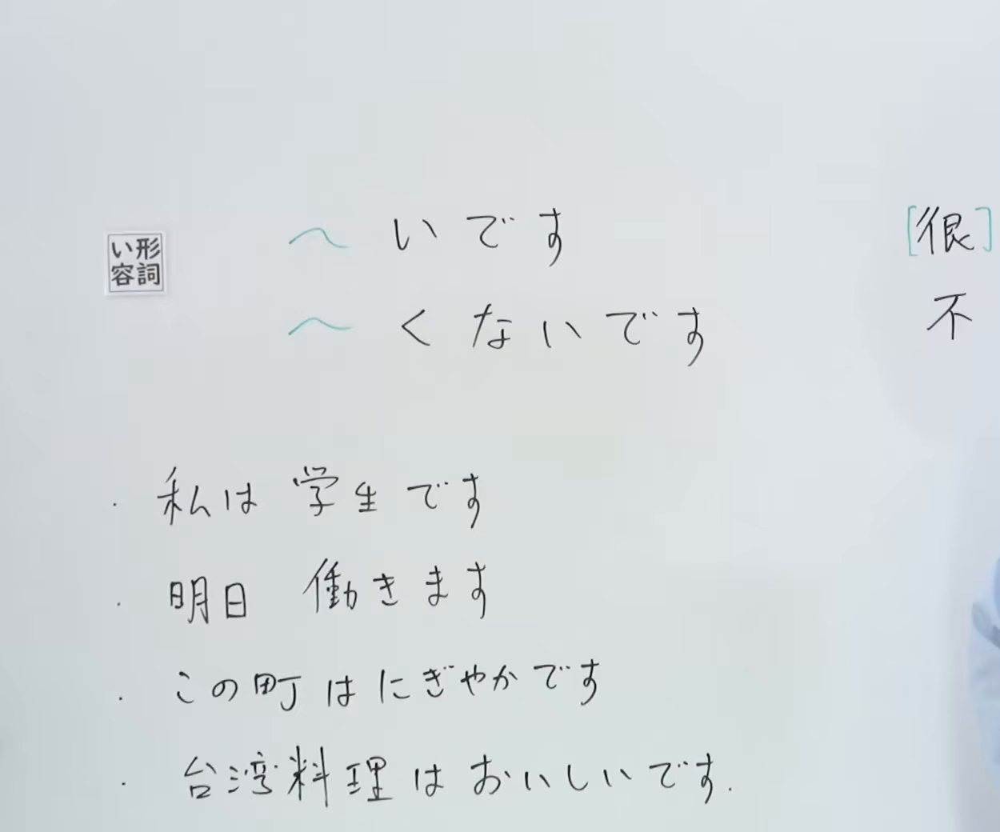
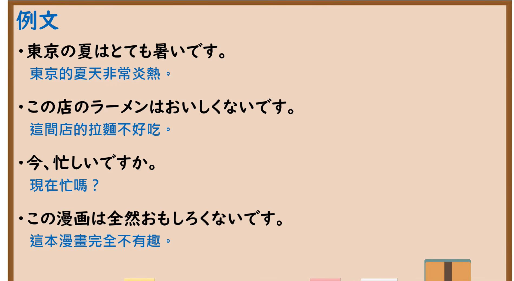

---
{
  "id": "N5-G-0004",
  "kind": "grammar",
  "level": "N5",
  "title": "～いです・～くないです（い形容词肯定・否定）",
  "card_revision": 2,
  "schema_version": 1,
  "source": {
    "lesson": "N5 第4个语法",
    "material": "出口日語原视频板书（学习者截取的接续图与例句图）与东京外国语大学「Aいです／Aくありません／Aくないです：解説」正文",
    "video": "https://www.youtube.com/watch?v=GByt-fO-sRA",
    "screenshot": "assets/grammar/n5/N5-G-0004-connection.png",
    "screenshot_crop": {
      "x": 0,
      "y": 0,
      "width": 1250,
      "height": 1040
    }
  },
  "tags": [
    "い形容词",
    "いです",
    "くないです",
    "N5"
  ],
  "confusions": [
    "な形容词",
    "～くありません",
    "いい／よい",
    "きれい"
  ]
}
---

# N5 第4个语法：～いです・～くないです

# 视频学习资料整理

- 课程：[出口日語「～いです・～くないです（い形容詞肯定・否定）」](https://www.youtube.com/watch?v=GByt-fO-sRA)
- 视频 ID：`GByt-fO-sRA`
- 视频时长：6分54秒

## 接续图

- 实际时间：未记录（图片由学习者从原视频截取并提供）
- 成品图尺寸：1250×1040，固定左上角 `(0, 0)`，右下角 `(1250, 1040)`
- 板书内容：「い形容詞」标签后接「～いです」对应“[很]～”，「～くないです」对应“不～”；下方手写四句「私は学生です」「明日働きます」「この町はにぎやかです」「台湾料理はおいしいです」。画面右缘有老师身影，右上角的“[很]”“不”右半部被画面边缘截断，未补写。

## 例句图

- 实际时间：未记录（图片由学习者从原视频截取并提供）
- 成品图尺寸：1900×1040，固定左上角 `(0, 0)`，右下角 `(1900, 1040)`
- 板书内容：课程「例文」页，含四条例句及中文翻译（東京の夏はとても暑いです／この店のラーメンはおいしくないです／今、忙しいですか／この漫画は全然おもしろくないです）。四条例句均完整可见。

# 核心

## 功能一：[很]～／不～

**くわしい意味記述：**

- **Aいです／Aくありません／Aくないです：** イ形容詞は、Nの性質や特徴（色・形・大きさなど）、状態について述べることができます。（い形容词可以叙述事物的性质、特征（颜色、形状、大小等）和状态。）
- **主語の表し方：** イ形容詞述語の主語は、「は」でも「が」でも表わすことができますが、「は」で表わすのがふつうです。（以い形容词为谓语时，主语用「は」或「が」都可以，但通常用「は」表示。）
- **「いい」の活用：** イ形容詞「いい」は、活用が例外です。丁寧形の否定は「よくありません」「よくないです」になります。（い形容词「いい」的活用是例外，礼貌体否定为「よくありません」「よくないです」。）

### 例句

1. このりんごはあまいです。

   （这个苹果很甜。）

2. あのりんごはあまくありません。

   （那个苹果不甜。）

3. わたしの家の犬は大きいです。

   （我家的狗很大。）

4. となりの家の犬は大きくありません。

   （邻居家的狗不大。）

5. きょうは寒くないです。

   （今天不冷。）

# 来源

- [出口日語原视频](https://www.youtube.com/watch?v=GByt-fO-sRA)
- [东京外国语大学「日本語 文法 Aいです／Aくありません／Aくないです：解説」](https://www.coelang.tufs.ac.jp/mt/ja/gmod/contents/explanation/030.html)（查询日期：2026-10-15；Hagoromo、毎日のんびり日本語教師、日本語NET 均未找到直接对应条目，按流程采用互联网检索所得的该页）
