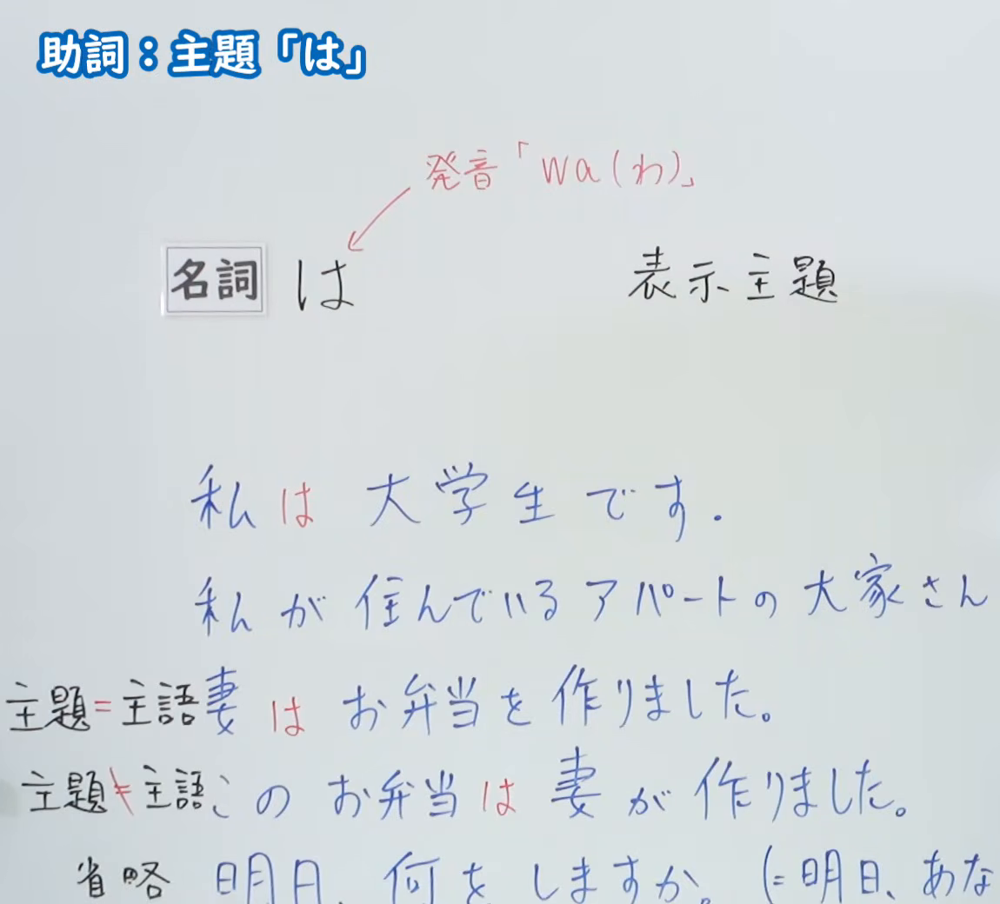
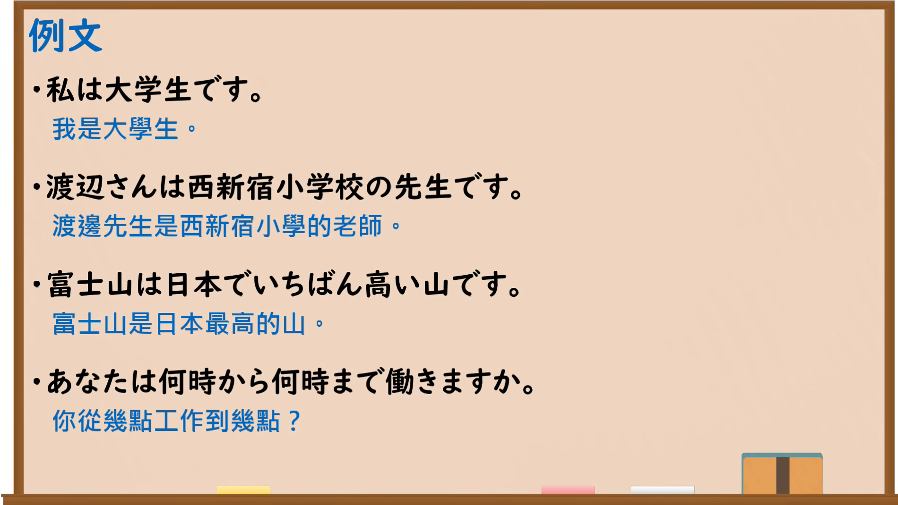

---
{
  "id": "N5-G-0005",
  "kind": "grammar",
  "level": "N5",
  "title": "助词：主题「は」",
  "card_revision": 2,
  "schema_version": 1,
  "source": {
    "lesson": "N5 第5个语法",
    "material": "出口日語原视频板书（学习者截取的接续图与例句图）与东京外国语大学「NはNです：解説」正文",
    "video": "https://www.youtube.com/watch?v=uJ_BqCFrnXM",
    "screenshot": "assets/grammar/n5/N5-G-0005-connection.png",
    "screenshot_crop": {
      "x": 0,
      "y": 0,
      "width": 1150,
      "height": 1040
    }
  },
  "tags": [
    "は",
    "助词",
    "主题",
    "N5"
  ],
  "confusions": [
    "主题与主语",
    "は／が",
    "主题省略"
  ]
}
---

# N5 第5个语法：助词「は」

# 视频学习资料整理

- 课程：[出口日語「助詞：主題「は」」](https://www.youtube.com/watch?v=uJ_BqCFrnXM)
- 视频 ID：`uJ_BqCFrnXM`
- 视频时长：10分33秒

## 接续图

- 实际时间：未记录（图片由学习者从原视频截取并提供）
- 成品图尺寸：1150×1040，固定左上角 `(0, 0)`，右下角 `(1150, 1040)`
- 板书内容：标题「助詞：主題「は」」；「名詞は」对应“表示主題”，红字标注发音「wa（わ）」；例句「私は大学生です」「妻はお弁当を作りました」（主題＝主語）、「このお弁当は妻が作りました」（主題≠主語）、省略例「明日、何をしますか」。下方两行（「私が住んでいるアパートの大家さん…」「明日、あな…」）右半部被画面右缘截断，未补写。

## 例句图

- 实际时间：未记录（图片由学习者从原视频截取并提供）
- 成品图尺寸：1900×1070，固定左上角 `(0, 0)`，右下角 `(1900, 1070)`
- 板书内容：课程「例文」页，含四条例句及中文翻译（私は大学生です／渡辺さんは西新宿小学校の先生です／富士山は日本でいちばん高い山です／あなたは何時から何時まで働きますか）。四条例句均完整可见，画面含黑板下沿。

# 核心

## 功能一：表示主题

**くわしい意味記述：**

- **は：** 「Ｎです」「Ｎではありません」で説明しているものが何であるかはっきりさせたいときは、その前に「Ｎは」「Ｎが」をつけます。（想要明确「Ｎです」「Ｎではありません」所说明的对象是什么时，在前面加上「Ｎは」「Ｎが」。）
- **「は」の発音と意味：** 「は」は「ワ」と発音します。主語について「それについて言えば」という意味を添えます。（「は」读作「ワ」，为主语添加“就……而言”的意思。）
- **「は」と「が」：** 名詞を述語として使うときの主語は、「は」でも「が」でも表わすことができますが、「は」で表わすのが最もふつうです。「が」で表わすときには、特別な意味が出ることが多いです。（以名词为谓语时，主语用「は」或「が」都可以，但最常见的是用「は」；用「が」时通常会带有特别的含义。）

### 例句

1. 田中さんは学生です。

   （田中是学生。）

2. 田中さんは学生ではありません。

   （田中不是学生。）

3. 父は先生です。

   （父亲是老师。）

4. 学校は休みです。

   （学校放假。）

# 来源

- [出口日語原视频](https://www.youtube.com/watch?v=uJ_BqCFrnXM)
- [东京外国语大学「日本語 文法 NはNです：解説」](https://www.coelang.tufs.ac.jp/mt/ja/gmod/contents/explanation/002.html)（查询日期：2026-10-15；Hagoromo、毎日のんびり日本語教師、日本語NET 均未找到直接对应条目，按流程采用互联网检索所得的该页）
