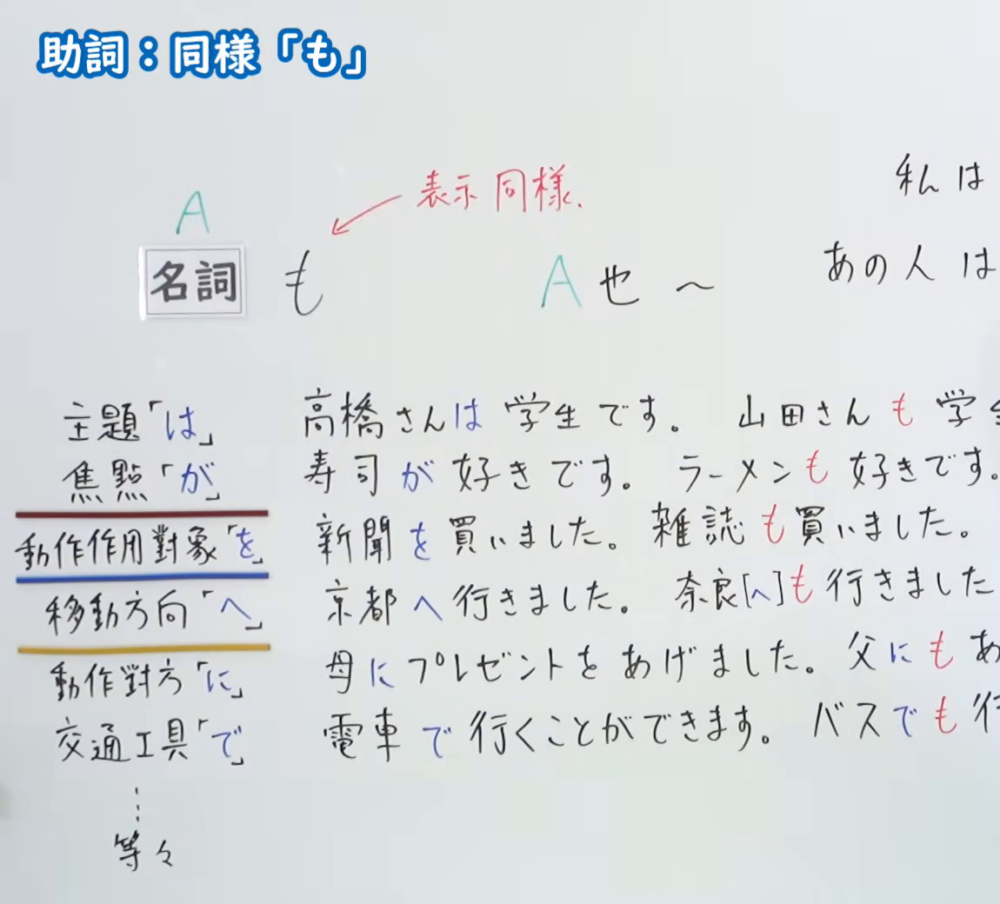
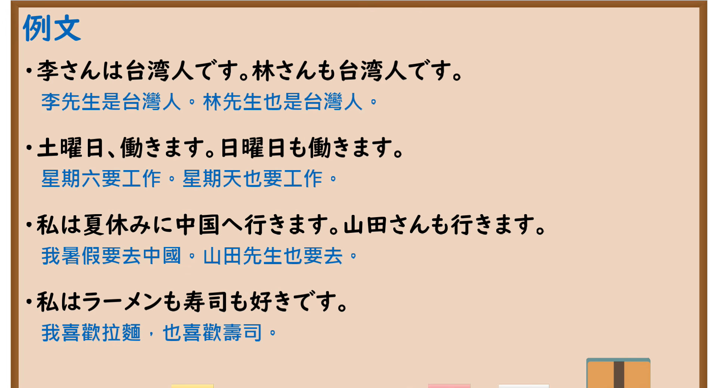

---
{
  "id": "N5-G-0006",
  "kind": "grammar",
  "level": "N5",
  "title": "助词：同样「も」",
  "card_revision": 2,
  "schema_version": 1,
  "source": {
    "lesson": "N5 第6个语法",
    "material": "出口日語原视频板书（学习者截取的接续图与例句图）与おにぎり君の日本語教室「も（同類・並立）」正文",
    "video": "https://www.youtube.com/watch?v=NRrg4YWl_AQ",
    "screenshot": "assets/grammar/n5/N5-G-0006-connection.png",
    "screenshot_crop": {
      "x": 0,
      "y": 0,
      "width": 1150,
      "height": 1040
    }
  },
  "tags": [
    "も",
    "助词",
    "同样",
    "N5"
  ],
  "confusions": [
    "は／も",
    "が／も",
    "を／も",
    "へ／も",
    "に／も",
    "で／も"
  ]
}
---

# N5 第6个语法：助词「も」

# 视频学习资料整理

- 课程：[出口日語「助詞：同様「も」」](https://www.youtube.com/watch?v=NRrg4YWl_AQ)
- 视频 ID：`NRrg4YWl_AQ`
- 视频时长：7分30秒

## 接续图

- 实际时间：未记录（图片由学习者从原视频截取并提供）
- 成品图尺寸：1150×1040，固定左上角 `(0, 0)`，右下角 `(1150, 1040)`
- 板书内容：标题「助詞：同様「も」」；「名詞も」对应“A也～”，红字标注“表示同樣”；左侧列出「は」（主題）、「が」（焦點）、「を」（動作作用對象）、「へ」（移動方向）、「に」（動作對方）、「で」（交通工具）等；右侧六组对比例句（高橋さんは学生です。山田さんも学生です／寿司が好きです。ラーメンも好きです／新聞を買いました。雑誌も買いました／京都へ行きました。奈良へも行きました／母にプレゼントをあげました。父にもあげました／電車で行くことができます。バスでも行くことができます）。右半部例句末尾及右上角句子被画面右缘截断，未补写。

## 例句图

- 实际时间：未记录（图片由学习者从原视频截取并提供）
- 成品图尺寸：1900×1040，固定左上角 `(0, 0)`，右下角 `(1900, 1040)`
- 板书内容：课程「例文」页，含四条例句及中文翻译（李さんは台湾人です。林さんも台湾人です／土曜日、働きます。日曜日も働きます／私は夏休みに中国へ行きます。山田さんも行きます／私はラーメンも寿司も好きです）。四条例句均完整可见。

# 核心

## 功能一：表示同样（A也～）

**くわしい意味記述：**

- **も：** 「〜も」は、同様の事柄を加えるときに使用される助詞で、他のものと同じことが当てはまることを示します。（「〜も」是在追加同样事项时使用的助词，表示其他事物也同样适用。）

### 例句

1. 私も行きたい。

   （我也想去。）

2. この本も面白いです。

   （这本书也很有趣。）

3. 今日も雨です。

   （今天也在下雨。）

4. 犬も猫も好きです。

   （狗和猫我都喜欢。）

5. 私にもできる。

   （我也能做到。）

# 来源

- [出口日語原视频](https://www.youtube.com/watch?v=NRrg4YWl_AQ)
- [おにぎり君の日本語教室「も（同類・並立）」](https://aiueo.cc/pages_v2/ja/grammar/web/23.php)（查询日期：2026-10-15；Hagoromo、毎日のんびり日本語教師、日本語NET 均未找到直接对应条目，按流程采用互联网检索所得的该页）
