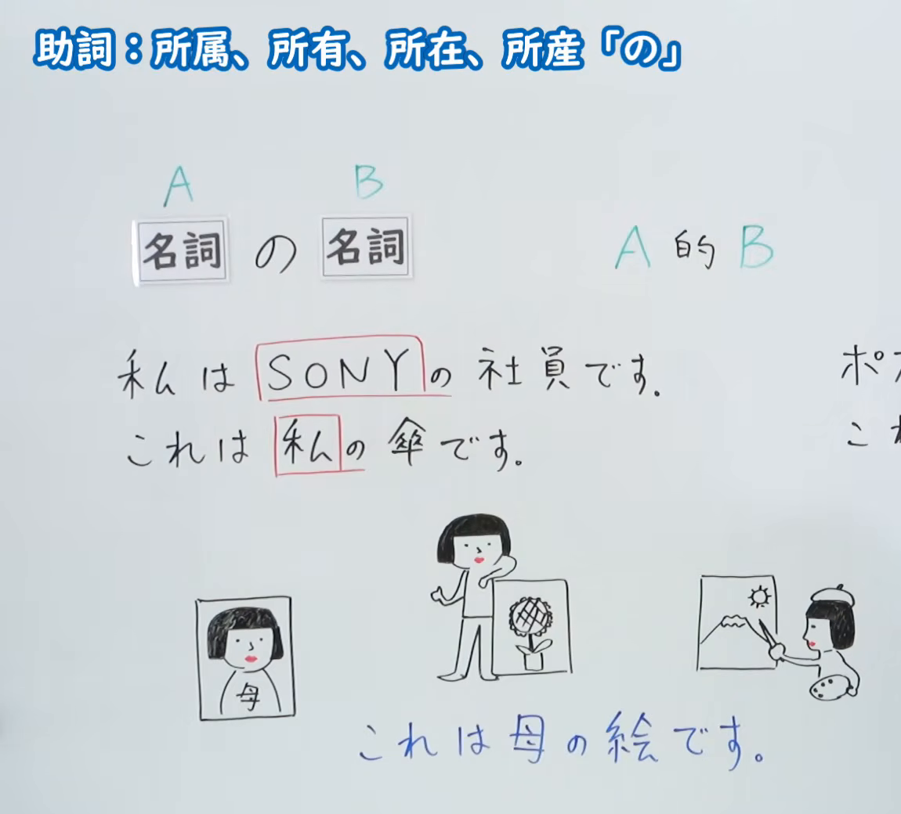
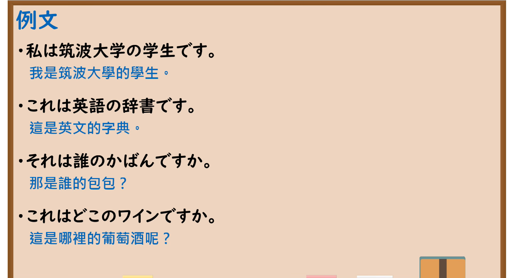

---
{
  "id": "N5-G-0007",
  "kind": "grammar",
  "level": "N5",
  "title": "助词：所属、所有、所在、所产「の」",
  "card_revision": 2,
  "schema_version": 1,
  "source": {
    "lesson": "N5 第7个语法",
    "material": "出口日語原视频板书（学习者截取的接续图与例句图）与东京外国语大学「NのN：解説」正文",
    "video": "https://www.youtube.com/watch?v=YhRbMNOfeek",
    "screenshot": "assets/grammar/n5/N5-G-0007-connection.png",
    "screenshot_crop": {
      "x": 0,
      "y": 0,
      "width": 1150,
      "height": 1040
    }
  },
  "tags": [
    "の",
    "助词",
    "所属",
    "所有",
    "N5"
  ],
  "confusions": [
    "所属与所有",
    "地点关系",
    "来源",
    "多义的の"
  ]
}
---

# N5 第7个语法：助词「の」

# 视频学习资料整理

- 课程：[出口日語「助詞：所属、所有、所在、所産「の」」](https://www.youtube.com/watch?v=YhRbMNOfeek)
- 视频 ID：`YhRbMNOfeek`
- 视频时长：5分38秒

## 接续图

- 实际时间：未记录（图片由学习者从原视频截取并提供）
- 成品图尺寸：1150×1040，固定左上角 `(0, 0)`，右下角 `(1150, 1040)`
- 板书内容：标题「助詞：所属、所有、所在、所産「の」」；「名詞A の 名詞B」对应“A的B”；例句「私はSONYの社員です」「これは私の傘です」，配三幅手绘插图与「これは母の絵です」。右上角另有一组例句（以「ポ…」「これ…」开头）被画面右缘截断，未补写。

## 例句图

- 实际时间：未记录（图片由学习者从原视频截取并提供）
- 成品图尺寸：1900×1040，固定左上角 `(0, 0)`，右下角 `(1900, 1040)`
- 板书内容：课程「例文」页，含四条例句及中文翻译（私は筑波大学の学生です／これは英語の辞書です／それは誰のかばんですか／これはどこのワインですか）。四条例句均完整可见。

# 核心

## 功能一：A的B

**くわしい意味記述：**

- **N1のN2：** 「N1のN2」における「N1の」は、N2を修飾します。N1とN2の関係には、N1がN2の所有者である場合、N1がN2の位置である場合、N1がN2の種類である場合などがあります。（「N1のN2」中的「N1の」修饰N2。N1与N2的关系有：N1是N2的所有者、N1是N2的位置、N1是N2的种类等。）
- **N2の省略：** N1がN2の所有者、種類を表わし、状況からN2が何であるかわかっているとき、N2は省略できます。（N1表示N2的所有者或种类，且根据情境能知道N2是什么时，可以省略N2。）
- **所属先：** N1がN2の所属先であることを表わす場合があります。（有时表示N1是N2的所属单位。）

### 例句

1. わたしのペンはこれです。

   （我的笔是这支。）

2. はさみは机の上にあります。

   （剪刀在桌子上。）

3. あれは数学の教科書です。

   （那是数学教科书。）

4. A：これは誰のかばんですか。　B：わたしのです。

   （A：这是谁的包？　B：是我的。）

5. わたしは東京外国語大学の木村です。

   （我是东京外国语大学的木村。）

# 来源

- [出口日語原视频](https://www.youtube.com/watch?v=YhRbMNOfeek)
- [东京外国语大学「日本語 文法 NのN：解説」](https://www.coelang.tufs.ac.jp/mt/ja/gmod/contents/explanation/008.html)（查询日期：2026-10-15；Hagoromo、毎日のんびり日本語教師、日本語NET 均未找到直接对应条目，按流程采用互联网检索所得的该页）
