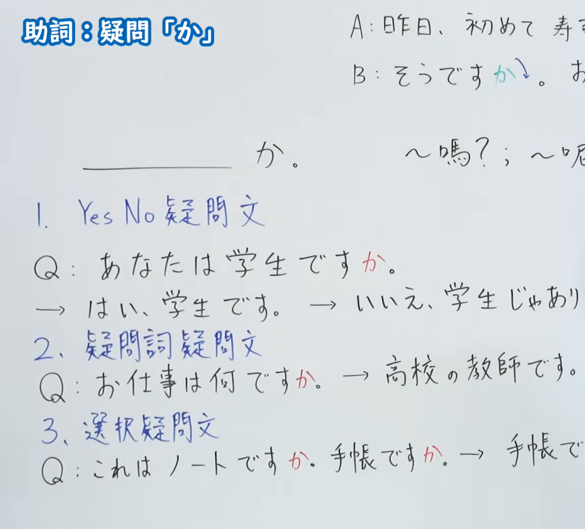
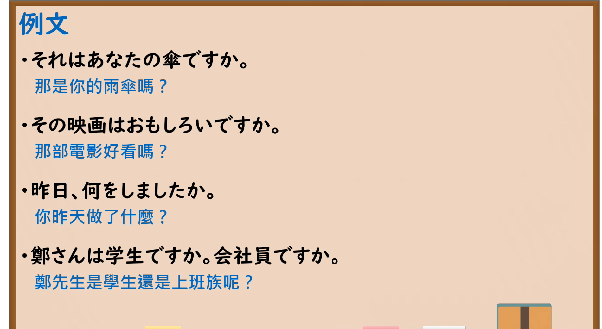

---
{
  "id": "N5-G-0008",
  "kind": "grammar",
  "level": "N5",
  "title": "助词：疑问「か」",
  "card_revision": 2,
  "schema_version": 1,
  "source": {
    "lesson": "N5 第8个语法",
    "material": "出口日語原视频板书（学习者截取的接续图与例句图）与东京外国语大学「終助詞：解説」「Nですか：解説」正文",
    "video": "https://www.youtube.com/watch?v=_T3dW_uSJwI",
    "screenshot": "assets/grammar/n5/N5-G-0008-connection.png",
    "screenshot_crop": {
      "x": 0,
      "y": 0,
      "width": 1150,
      "height": 1040
    }
  },
  "tags": [
    "か",
    "助词",
    "疑问",
    "N5"
  ],
  "confusions": [
    "是非问句",
    "疑问词问句",
    "选择问句",
    "句末语调"
  ]
}
---

# N5 第8个语法：助词「か」

# 视频学习资料整理

- 课程：[出口日語「助詞：疑問「か」」](https://www.youtube.com/watch?v=_T3dW_uSJwI)
- 视频 ID：`_T3dW_uSJwI`
- 视频时长：7分45秒

## 接续图

- 实际时间：未记录（图片由学习者从原视频截取并提供）
- 成品图尺寸：1150×1040，固定左上角 `(0, 0)`，右下角 `(1150, 1040)`
- 板书内容：标题「助詞：疑問「か」」；「＿＿＿か。」对应“～嗎？；～呢？”（右端文字被画面边缘截断）；三类疑问句：1. Yes／No疑問文（Q：あなたは学生ですか。→はい、学生です。→いいえ、学生じゃあり…）；2. 疑問詞疑問文（Q：お仕事は何ですか。→高校の教師です。）；3. 選択疑問文（Q：これはノートですか。手帳ですか。→手帳で…）。右上角会话（A：昨日、初めて寿…／B：そうですか↓。…）及各行答句右半部被画面右缘截断，未补写。

## 例句图

- 实际时间：未记录（图片由学习者从原视频截取并提供）
- 成品图尺寸：1900×1040，固定左上角 `(0, 0)`，右下角 `(1900, 1040)`
- 板书内容：课程「例文」页，含四条例句及中文翻译（それはあなたの傘ですか／その映画はおもしろいですか／昨日、何をしましたか／鄭さんは学生ですか。会社員ですか）。四条例句均完整可见。

# 核心

## 功能一：～嗎？；～呢？

**くわしい意味記述：**

- **か：** 「か」は助詞です。文の終わりにつき、疑問文を作ります。（「か」是助词，接在句末构成疑问句。）
- **「か」が必要な場合：** 丁寧体の疑問文を作る場合、「はい・いいえ」で答えさせる疑問文で、しかもイ形容詞・ナ形容詞・名詞が述語になる場合（＝「です」を伴う場合）は必ず「か」を用います。（构成礼貌体疑问句时，对于用“是／不是”回答的疑问句，若谓语是い形容词、な形容词或名词（即带「です」的情况），必须使用「か」。）
- **イントネーション：** 疑問文のイントネーションは上昇調になります。（疑问句的语调为上升调。）

### 例句

1. あしたは日曜日ですか。

   （明天是星期日吗？）

2. 熱いですか。

   （烫吗？）

3. これは本ですか。

   （这是书吗？）

4. A：中山さんは大学生ですか。　B：はい、大学生です。

   （A：中山是大学生吗？　B：是的，是大学生。）

5. A：田中さんですか。　B：いいえ、山口です。

   （A：是田中吗？　B：不是，是山口。）

# 来源

- [出口日語原视频](https://www.youtube.com/watch?v=_T3dW_uSJwI)
- [东京外国语大学「日本語 文法 終助詞：解説」](https://www.coelang.tufs.ac.jp/mt/ja/gmod/contents/explanation/096.html)、[「日本語 文法 Nですか：解説」](https://www.coelang.tufs.ac.jp/mt/ja/gmod/contents/explanation/003.html)（查询日期：2026-10-15；Hagoromo、毎日のんびり日本語教師、日本語NET 均未找到直接对应条目，按流程采用互联网检索所得的两页，例句1–3取自前者，4–5取自后者）
