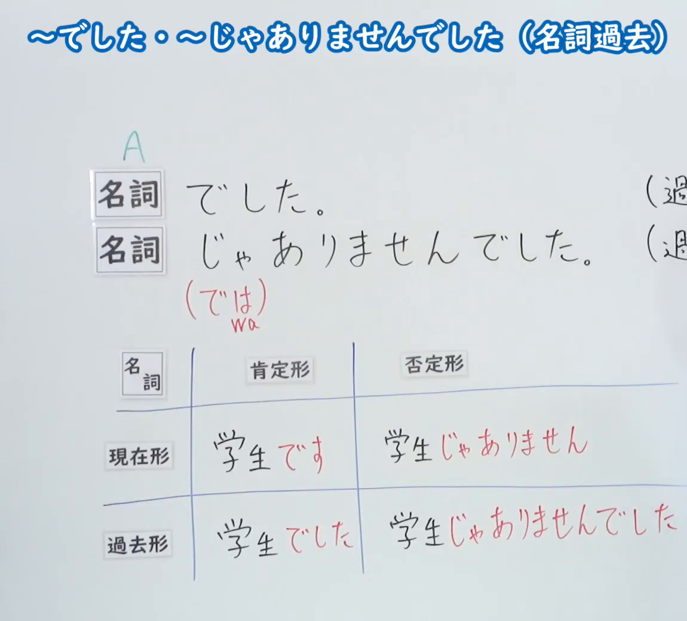
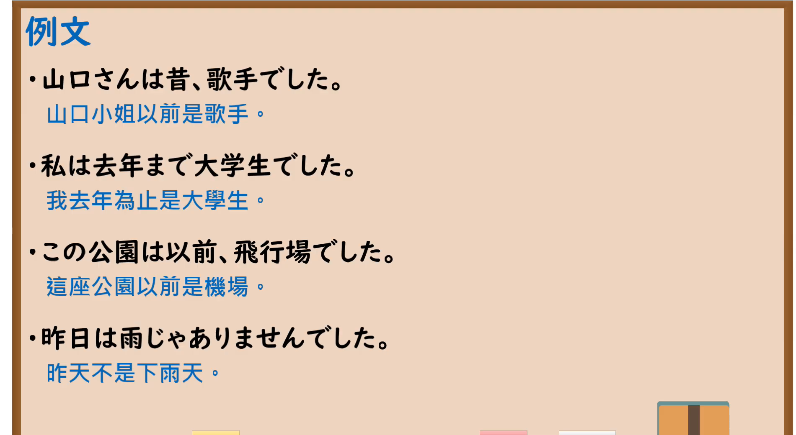

---
{
  "id": "N5-G-0009",
  "kind": "grammar",
  "level": "N5",
  "title": "～でした・～じゃありませんでした（名词过去）",
  "card_revision": 2,
  "schema_version": 1,
  "source": {
    "lesson": "N5 第9个语法",
    "material": "出口日語原视频板书（学习者截取的接续图与例句图）与毎日のんびり日本語教師「～です／ではありません／でした／ではありませんでした」正文",
    "video": "https://www.youtube.com/watch?v=9FgAj3ONjUw",
    "screenshot": "assets/grammar/n5/N5-G-0009-connection.png",
    "screenshot_crop": {
      "x": 0,
      "y": 0,
      "width": 1150,
      "height": 1040
    }
  },
  "tags": [
    "でした",
    "じゃありませんでした",
    "名词句",
    "过去",
    "N5"
  ],
  "confusions": [
    "でした",
    "じゃありませんでした",
    "ではありませんでした",
    "名词句四种形式"
  ]
}
---

# N5 第9个语法：～でした・～じゃありませんでした

# 视频学习资料整理

- 课程：[出口日語「～でした・～じゃありませんでした（名詞過去）」](https://www.youtube.com/watch?v=9FgAj3ONjUw)（播放列表中该课显示为英文标题“[N5 Grammar] ~was/wasn't ~ (noun past tense)”，板书标题为日文）
- 视频 ID：`9FgAj3ONjUw`
- 视频时长：4分36秒

## 接续图

- 实际时间：未记录（图片由学习者从原视频截取并提供）
- 成品图尺寸：1150×1040，固定左上角 `(0, 0)`，右下角 `(1150, 1040)`
- 板书内容：标题「～でした・～じゃありませんでした（名詞過去）」；「名詞でした。」「名詞じゃありませんでした。（では wa）」，右侧括号内的说明（以“(過…”开头）被画面右缘截断，未补写；下方表格为「名詞」的現在形／過去形与肯定形／否定形：学生です／学生じゃありません／学生でした／学生じゃありませんでした（最后一格末字紧贴画面右缘）。

## 例句图

- 实际时间：未记录（图片由学习者从原视频截取并提供）
- 成品图尺寸：1900×1040，固定左上角 `(0, 0)`，右下角 `(1900, 1040)`
- 板书内容：课程「例文」页，含四条例句及中文翻译（山口さんは昔、歌手でした／私は去年まで大学生でした／この公園は以前、飛行場でした／昨日は雨じゃありませんでした）。四条例句均完整可见。

# 核心

## 功能一：（过去）是 A／（过去）不是 A

**くわしい意味記述：**

- **～でした／～ではありませんでした：** 断定の助動詞です。丁寧体の過去形は「～は～でした」、過去否定形は「～は～ではありませんでした」「～は～じゃありませんでした」です。（断定助动词。礼貌体过去形为「～は～でした」，过去否定形为「～は～ではありませんでした」「～は～じゃありませんでした」。）
- **「では」と「じゃ」：** 否定形で伴う「では」は、口語では「じゃ」に置き換えられます。（否定形中的「では」在口语中可替换为「じゃ」。）

### 例句

1. 今日は良い１日でした。

   （今天是美好的一天。）

2. さっきのはそんなに大きな地震ではありませんでした。

   （刚才的地震没有那么强烈。）

3. 私はずっと一人じゃありませんでした。いつも近くで助けてくれる人がいました。

   （我一直不是一个人。在我身边总是有人帮助我。）

# 来源

- [出口日語原视频](https://www.youtube.com/watch?v=9FgAj3ONjUw)
- [毎日のんびり日本語教師「【Ｎ５文法】～です／ではありません／でした／ではありませんでした」](https://mainichi-nonbiri.com/grammar/n5-desu/)（查询日期：2026-10-15；Hagoromo 未收录本语法，故按流程采用优先级最高的备选网站条目）
