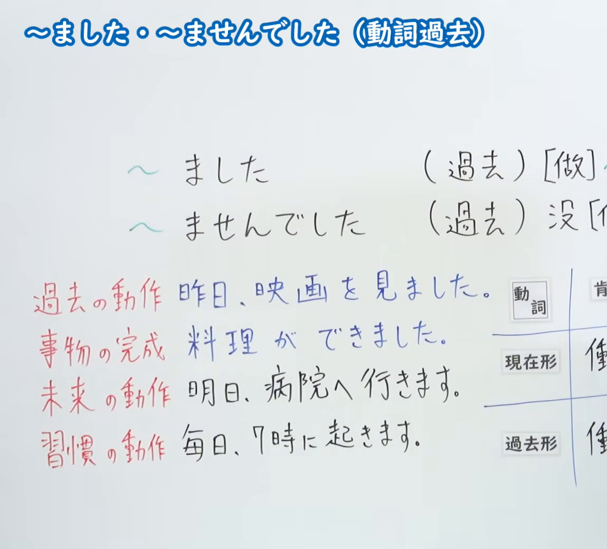
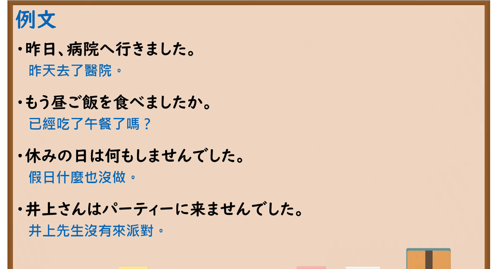

---
{
  "id": "N5-G-0010",
  "kind": "grammar",
  "level": "N5",
  "title": "～ました・～ませんでした（动词过去）",
  "card_revision": 2,
  "schema_version": 1,
  "source": {
    "lesson": "N5 第10个语法",
    "material": "出口日語原视频板书（学习者截取的接续图与例句图）与东京外国语大学「Vました/Vませんでした：解説」正文",
    "video": "https://www.youtube.com/watch?v=VgIfyGDJSrE",
    "screenshot": "assets/grammar/n5/N5-G-0010-connection.png",
    "screenshot_crop": {
      "x": 0,
      "y": 0,
      "width": 1150,
      "height": 1040
    }
  },
  "tags": [
    "ました",
    "ませんでした",
    "动词",
    "过去",
    "N5"
  ],
  "confusions": [
    "ます／ました",
    "过去习惯",
    "ていました",
    "完成"
  ]
}
---

# N5 第10个语法：～ました・～ませんでした

# 视频学习资料整理

- 课程：[出口日語「～ました・～ませんでした（動詞過去）」](https://www.youtube.com/watch?v=VgIfyGDJSrE)（播放列表中该课显示为英文标题“[N5 Grammar] ~mashita/~mashita (Past Verb)”，板书标题为日文）
- 视频 ID：`VgIfyGDJSrE`
- 视频时长：6分0秒

## 接续图

- 实际时间：未记录（图片由学习者从原视频截取并提供）
- 成品图尺寸：1150×1040，固定左上角 `(0, 0)`，右下角 `(1150, 1040)`
- 板书内容：标题「～ました・～ませんでした（動詞過去）」；「～ました」对应“（過去）[做]～”，「～ませんでした」对应“（過去）没[做]～”（右端被画面边缘截断）；左下四行红字分类与例句：過去の動作「昨日、映画を見ました」、事物の完成「料理ができました」、未来の動作「明日、病院へ行きます」、習慣の動作「毎日、7時に起きます」；右侧「動詞」的現在形／過去形表格被画面右缘截断，未补写。

## 例句图

- 实际时间：未记录（图片由学习者从原视频截取并提供）
- 成品图尺寸：1900×1040，固定左上角 `(0, 0)`，右下角 `(1900, 1040)`
- 板书内容：课程「例文」页，含四条例句及中文翻译（昨日、病院へ行きました／もう昼ご飯を食べましたか／休みの日は何もしませんでした／井上さんはパーティーに来ませんでした）。四条例句均完整可见。

# 核心

## 功能一：（过去）[做]～／（过去）没[做]～

**くわしい意味記述：**

- **Vました／Vませんでした：** 動詞「Vます」で表わされることがらが過去にあったことを表わすときは「Vました」を使います。「Vました」は「Vます」の「ます」を「ました」に変えて作ります。否定の形は、「Vません」に「でした」をつけて作ります。（表示动词「Vます」所表达的事情发生在过去时，使用「Vました」。「Vました」是把「Vます」的「ます」改为「ました」构成；否定形是在「Vません」后加「でした」。）
- **完了：** 「Vました」で、基準時から見てその動きが実現済み（完了）であることを述べることができます。英語の「have + pp」にあたります。（「Vました」可以表示以基准时间来看该动作已经实现（完成）。相当于英语的“have + pp”。）

### 例句

1. きのうわたしは勉強しました。

   （昨天我学习了。）

2. むかし、学校の門のそばに大きい木がありました。

   （以前学校门旁边有一棵大树。）

3. きのうは雨が降りませんでした。

   （昨天没有下雨。）

4. A：きのう地震がありましたか。　B：はい、ありました。

   （A：昨天有地震吗？　B：是的，有。）

5. A：試験は終わりましたか。　B：はい、終わりました。

   （A：考试结束了吗？　B：是的，结束了。）

# 来源

- [出口日語原视频](https://www.youtube.com/watch?v=VgIfyGDJSrE)
- [东京外国语大学「日本語 文法 Vました/Vませんでした：解説」](https://www.coelang.tufs.ac.jp/mt/ja/gmod/contents/explanation/025.html)（查询日期：2026-10-15；Hagoromo、毎日のんびり日本語教師、日本語NET 均未找到直接对应条目，按流程采用互联网检索所得的该页）
