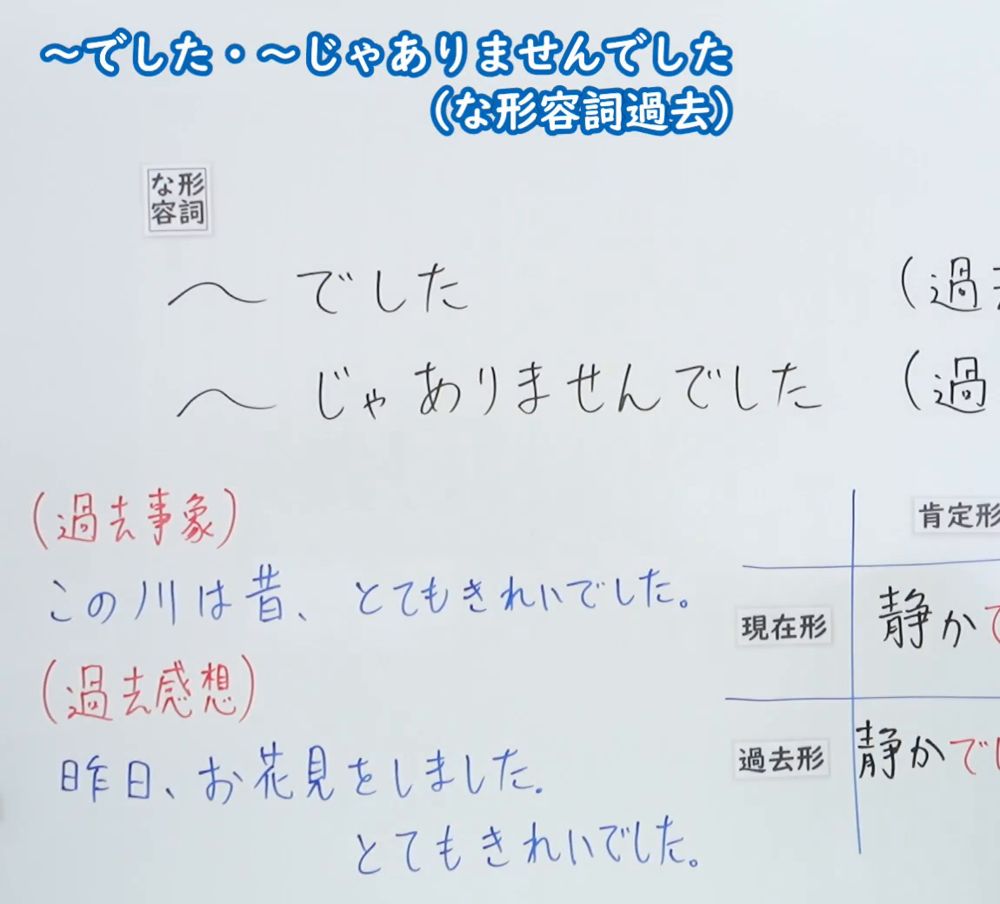
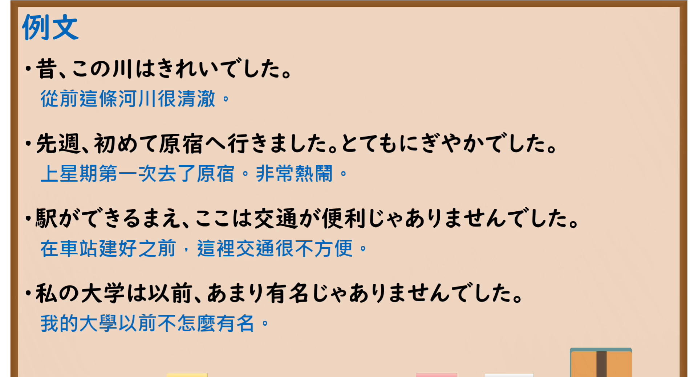

---
{
  "id": "N5-G-0011",
  "kind": "grammar",
  "level": "N5",
  "title": "～でした・～じゃありませんでした（な形容词过去）",
  "card_revision": 2,
  "schema_version": 1,
  "source": {
    "lesson": "N5 第11个语法",
    "material": "出口日語原视频板书（学习者截取的接续图与例句图）与东京外国语大学「NAです／NAではありません：解説」正文",
    "video": "https://www.youtube.com/watch?v=vGZwOFVsETc",
    "screenshot": "assets/grammar/n5/N5-G-0011-connection.png",
    "screenshot_crop": {
      "x": 0,
      "y": 0,
      "width": 1150,
      "height": 1040
    }
  },
  "tags": [
    "でした",
    "じゃありませんでした",
    "な形容词",
    "过去",
    "N5"
  ],
  "confusions": [
    "でした",
    "じゃありませんでした",
    "な的使用位置",
    "きれい"
  ]
}
---

# N5 第11个语法：～でした・～じゃありませんでした（な形容词）

# 视频学习资料整理

- 课程：[出口日語「～でした・～じゃありませんでした（な形容詞過去）」](https://www.youtube.com/watch?v=vGZwOFVsETc)
- 视频 ID：`vGZwOFVsETc`
- 视频时长：5分29秒

## 接续图

- 实际时间：未记录（图片由学习者从原视频截取并提供）
- 成品图尺寸：1150×1040，固定左上角 `(0, 0)`，右下角 `(1150, 1040)`
- 板书内容：标题「～でした・～じゃありませんでした（な形容詞過去）」（两行）；「な形容詞」标签后接「～でした」「～じゃありませんでした」，右侧标注均以“(過…”开头，被画面右缘截断；左下红字「（過去事象）」配例句「この川は昔、とてもきれいでした。」，「（過去感想）」配「昨日、お花見をしました。とてもきれいでした。」；右下「現在形／過去形」表格（静かです／静かでした）右半部被画面右缘截断，未补写。

## 例句图

- 实际时间：未记录（图片由学习者从原视频截取并提供）
- 成品图尺寸：1900×1040，固定左上角 `(0, 0)`，右下角 `(1900, 1040)`
- 板书内容：课程「例文」页，含四条例句及中文翻译（昔、この川はきれいでした／先週、初めて原宿へ行きました。とてもにぎやかでした／駅ができるまえ、ここは交通が便利じゃありませんでした／私の大学は以前、あまり有名じゃありませんでした）。四条例句均完整可见。

# 核心

## 功能一：（过去）[很]～／（过去）不～

**くわしい意味記述：**

- **NAでした／NAではありませんでした：** ナ形容詞の過去の形は「NAでした」「NAではありませんでした」です。（な形容词的过去形是「NAでした」「NAではありませんでした」。）
- **「じゃ」：** 話しことばでは、「NAではありません」「NAではありませんでした」が「NAじゃありません」「NAじゃありませんでした」になることが多いです。（口语中，「NAではありません」「NAではありませんでした」常说成「NAじゃありません」「NAじゃありませんでした」。）
- **別の否定形：** 「NAではなかったです」という形もありますが、「NAではありませんでした」のほうがふつうです。（也有「NAではなかったです」的说法，但更常用的是「NAではありませんでした」。）

### 例句

1. 木村さんは有名でした。

   （木村（过去）很有名。）

2. A：田中さんは元気でしたか。　B：はい、元気でした。

   （A：田中（那时）精神好吗？　B：是的，精神很好。）

3. A：田中さんは元気でしたか。　B：いいえ、元気ではありませんでした。

   （A：田中（那时）精神好吗？　B：不，精神不好。）

4. 田中さんは元気ではなかったです。

   （田中（那时）精神不好。）

# 来源

- [出口日語原视频](https://www.youtube.com/watch?v=vGZwOFVsETc)
- [东京外国语大学「日本語 文法 NAです／NAではありません：解説」](https://www.coelang.tufs.ac.jp/mt/ja/gmod/contents/explanation/036.html)（查询日期：2026-10-15；Hagoromo、毎日のんびり日本語教師、日本語NET 均未找到直接对应条目，按流程采用互联网检索所得的该页）
